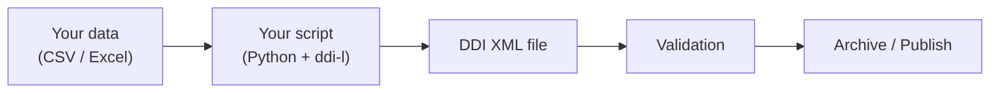

# Module 1: What is metadata and why does it matter?

!!! info "Learning objectives"
    By the end of this module, you can:

    - **O1.** Define metadata in one sentence and point to two pieces of
      metadata that describe a given table.
    - **O2.** List three questions a reader must answer before using an
      undocumented table.
    - **O3.** Describe what DDI is in two sentences and name two kinds of
      organizations that use it.
    - **O4.** Match each FAIR principle to one way DDI metadata supports it.
    - **O5.** State what `ddi-l` does and one thing it does not do.

**Prerequisites:** None.

**Time:** 30 min self-paced / 45 min instructor-led.

**New in this module:** no functions or commands yet. This module sets out
the ideas the rest of the course builds on.

---

## 1. What is metadata?

Metadata is **information about your data**. Think of a library card catalog.
The catalog does not contain the full text of every book. Instead, it tells you
the title, author, subject, and where to find each book. Metadata does the
same thing for data files. It tells you what the data is about without showing
you all the data.

Here are a few examples of metadata:

- The title of a survey.
- The date the data was collected.
- The meaning of each column in a table.

Without metadata, a data file is just rows and columns of numbers. No one
knows what those numbers mean.

---

## 2. Real-world example: a household survey table

Look at the table below. It comes from a household survey.

| Column A | Column B | Column C |
| -------: | -------- | -------: |
|       34 | Female   |   52 000 |
|       28 | Male     |   41 000 |
|       45 | Female   |   67 000 |
|       22 | Male     |   29 000 |
|       51 | Other    |   73 000 |

**Without documentation** you might ask:

- What do the numbers in Column A mean? Ages? ID numbers?
- Is Column C in dollars, euros, or another currency?
- Who was surveyed? Adults only? Everyone?
- When was the survey done?

**With documentation** we add metadata:

| Age | Gender | Annual Income (CAD) |
| --: | ------ | ------------------: |
|  34 | Female |              52 000 |
|  28 | Male   |              41 000 |
|  45 | Female |              67 000 |
|  22 | Male   |              29 000 |
|  51 | Other  |              73 000 |

- **Study title:** Canadian Household Income Survey 2024
- **Population:** Canadian adults aged 18 and older.
- **Collection period:** January-March 2024.

Now the data makes sense. Metadata is the difference between confusion and
clarity.

---

## 3. What is DDI?

**DDI** stands for **Data Documentation Initiative**. It is an international
standard (a set of agreed-upon rules) for describing surveys, censuses, and
datasets. Governments, universities, and research organizations around the
world use DDI to document their data so that others can find it, understand it,
and reuse it.

Key facts about DDI:

- It is maintained by the [DDI Alliance](https://ddialliance.org).
- It uses XML (a structured text format) to store the documentation.
- It covers the full life of a dataset, from planning and collection to
  archiving and sharing.

---

## 4. How DDI makes data FAIR

**FAIR** is a set of four principles that help people share and reuse data.
The letters stand for **Findable**, **Accessible**, **Interoperable**, and
**Re-usable**. Good data should follow all four. DDI-Lifecycle helps you meet
each one.

| Principle | What it means | How DDI helps |
| ----------- | --------------- | --------------- |
| **Findable** | People can search for and discover the data. | DDI gives every item a unique identifier and stores structured fields like title, agency, and concepts. Data catalogs can index these fields so users find your dataset in a search. |
| **Accessible** | People can get the data and its documentation. | DDI files are standard XML. Any tool that reads XML can open them. No special software is required. |
| **Interoperable** | Data works with other data and tools. | DDI uses shared code lists and controlled vocabularies. When two surveys use the same code list for gender or employment status, their data can be combined and compared. |
| **Re-usable** | People understand the data well enough to use it correctly. | DDI records who collected the data, when, how, and what each variable means. A researcher in another country can read the DDI file and know exactly what the data contains. |

### Example: FAIR in action

Imagine Dr. Chen publishes a health survey to an open data repository. Without
DDI metadata, a visitor sees a file called `health-2024.csv` and has no idea
what is inside.

With DDI metadata:

- **Findable**: The repository indexes the DDI title, concepts ("Physical
  Health", "Mental Health"), and agency ("health-research.example.org"). A
  student searching for "mental health survey data" finds it.
- **Accessible**: The DDI XML file is published next to the CSV. Anyone can
  download both files with no login or special tool.
- **Interoperable**: The DDI file uses a standard code list for gender
  (Male / Female / Other). Another team in France uses the same code list, so
  both datasets can be merged for cross-country analysis.
- **Re-usable**: The DDI file says the data was collected from adults aged
  18+ in 2024, that "bmi" is body mass index in kg/m², and that income is in
  Canadian dollars. A new researcher can use the data correctly without asking
  the original team.

Without DDI, the data sits in a file that nobody finds, nobody understands,
and nobody reuses. With DDI, the data becomes a shared resource.

---

## 5. What is ddi-l?

`ddi-l` is a **Python package** (a tool you install and use in the Python
programming language) that lets you **create, read, update, and validate** DDI
documents. You do not need to know XML to use it. You write a few lines of
Python, and `ddi-l` handles the XML for you.

What `ddi-l` can do:

- **Create** a new DDI study with questions and variables.
- **Read** an existing DDI file and inspect its contents.
- **Update** a DDI document by adding or removing items.
- **Validate** a document to make sure it follows the DDI rules.

What `ddi-l` does not do:

- It does not **collect** answers. You still run your survey with your own
  survey tool; `ddi-l` describes the survey and its data.
- It does not **analyze** your data. It does not compute averages or
  tables from the values in your data file. It records what those values
  mean.

---

## 6. The big picture

Here is the typical workflow when you use `ddi-l`:

1. You start with a data file (for example, a CSV or Excel spreadsheet).
2. You write a short Python script that uses `ddi-l` to describe the data.
3. `ddi-l` creates a DDI XML file.
4. You validate the file to make sure everything is correct.
5. You archive or publish the file so others can find and understand your data.

---

## 7. Who uses DDI? Four stories

**Maya, university student.**
Maya just finished her thesis on student stress. She needs to deposit her
survey data in the university's research repository. DDI metadata helps
future students find and understand her dataset.

**Dr. Chen, researcher.**
Dr. Chen runs a multi-country health study. He publishes data to an open
repository. DDI makes his datasets discoverable and comparable across
countries.

**Fatima, archivist.**
Fatima manages a data collection at a national library. She uses DDI to
catalog thousands of datasets so researchers can search and browse the
collection.

**Jean-Pierre, National Statistics Office (NSO) staff.**
Jean-Pierre works at a government statistics office. His team documents every
census and survey with DDI so the public can access reliable, well-documented
data.

---

## Exercises

!!! example "Scenario"
    You receive a data file with no documentation. The file has five rows and
    the columns are labeled A, B, and C. The values look like numbers and
    short words.

**Exercise 1 (O2).** Look at the table below.

| A  | B      |     C |
| -: | ------ | ----: |
| 34 | Female | 52000 |
| 28 | Male   | 41000 |
| 45 | Female | 67000 |
| 22 | Male   | 29000 |
| 51 | Other  | 73000 |

Write down **3 questions** a new person would need answered before they could
use this data. For example: What does column A measure?

Expected output: a list of three questions.

??? success "Answer"
    Any three of these, or similar:

    1. What does each column mean? (Is A an age? In years or months?)
    2. What unit is column C in? (Dollars? Euros? Per year or per month?)
    3. Who was surveyed? (Students? Adults? Everyone?)
    4. When was the data collected?

**Exercise 2 (O1).** The same researcher now sends a documented version of
another file:

> **Campus Sleep Study 2025.** Collected in September 2025 from first-year
> students. `sleep_hrs` is the hours of sleep on a typical school night.

| sleep_hrs |
| --------: |
|         7 |
|         6 |
|         8 |

1. Write a one-sentence definition of metadata.
2. Name **two pieces of metadata** in this file, and **one piece of data**.

Expected output: one sentence, then three short items.

??? success "Answer"
    1. Metadata is information that describes data: what it means, where it
       came from, and how it was collected.
    2. Metadata: any two of the title "Campus Sleep Study 2025", the
       collection date (September 2025), the population (first-year
       students), the column name `sleep_hrs`, or its meaning (hours of sleep
       on a typical school night). Data: any of the values 7, 6, or 8.

**Exercise 3 (O4).** Match each FAIR principle (1 to 4) with the DDI feature
(a to d) that supports it.

| FAIR principle    | DDI feature |
| ----------------- | ----------- |
| 1. Findable       | a. The DDI file records who was surveyed, when, and what each variable means. |
| 2. Accessible     | b. Two surveys use the same DDI code list for employment status. |
| 3. Interoperable  | c. A data catalog indexes the title, agency, and concepts stored in the DDI file. |
| 4. Re-usable      | d. The DDI file is plain XML, published next to the data, that any XML tool can open. |

Expected output: four pairs, such as `1-?`.

??? success "Answer"
    `1-c`, `2-d`, `3-b`, `4-a`.

    - **Findable (c):** the catalog can only find what is described in
      structured fields.
    - **Accessible (d):** a standard, open format needs no special software.
    - **Interoperable (b):** a shared code list means the same code has the
      same meaning in both surveys, so the data can be combined.
    - **Re-usable (a):** a new user knows exactly what the data contains.

**Exercise 4 (O3).** A new colleague asks you: "What is DDI?" Write a
**two-sentence** answer. Name **two kinds of organizations** that use it.

Expected output: two sentences.

??? success "Answer"
    For example: "DDI, the Data Documentation Initiative, is an international
    standard for describing surveys, censuses, and datasets in XML. National
    statistics offices, data archives, universities, and research teams use it
    so that others can find, understand, and reuse their data."

    Any two of these kinds of organizations are correct: national statistics
    offices, data archives or national libraries, universities and their
    research repositories, research teams.

**Exercise 5 (O5).** For each task below, write **does** if `ddi-l` does it,
or **does not** if it does not.

1. Write a DDI XML file from a short Python script.
2. Send a questionnaire to respondents and collect their answers.
3. Check a DDI document against the DDI rules.
4. Calculate the average income from the values in a CSV file.
5. Open an existing DDI file and list its questions.

Then write one sentence that says what `ddi-l` does and one thing it does not
do.

Expected output: five answers, then one sentence.

??? success "Answer"
    Does: 1, 3, and 5. Does not: 2 and 4.

    For example: "`ddi-l` creates, reads, updates, and validates DDI metadata
    from Python, but it does not collect survey answers."

---

## Quiz

???+ question "Question 1 (O1): A spreadsheet has a column headed `Age (years)` with the values 34, 28, and 45. Which of these is metadata?"
    **A.** The value 34.

    **B.** The header `Age (years)`, which says what the values mean and
    their unit.

    **C.** The sum of the three values.

    **D.** The second row.

    ??? success "Answer"
        **B.** Metadata is information about data. The header tells you what
        the numbers mean and how they are measured. The values themselves,
        and anything computed from them, are data.

???+ question "Question 2 (O2): A colleague sends a table with columns A, B, and C and no notes. Column C holds values like 52000. You want to report the average income. Which question must you answer first?"
    **A.** Which font was used to type the table?

    **B.** How many rows does the file have?

    **C.** What is the name of the file?

    **D.** What does column C measure, and in which currency and period?

    ??? success "Answer"
        **D.** Without knowing that C is income, and whether it is in dollars
        or euros, per year or per month, any average you report could be
        wrong. The other questions do not change what the numbers mean.

???+ question "Question 3 (O3): Which sentence best describes DDI?"
    **A.** An international standard for describing surveys, censuses, and
    datasets, used by national statistics offices, data archives, and
    universities.

    **B.** A survey tool that sends questionnaires to respondents.

    **C.** A Python package that computes statistics from data files.

    **D.** A database that stores survey answers.

    ??? success "Answer"
        **A.** DDI is a standard: a set of agreed rules for documentation.
        Option C confuses DDI with tools; `ddi-l` is a Python package that
        works with DDI, and it does not compute statistics.

???+ question "Question 4 (O4): Your survey and a survey in France use the same DDI code list for gender, so the two datasets can be merged. Which FAIR principle does this support most directly?"
    **A.** Findable

    **B.** Accessible

    **C.** Interoperable

    **D.** Re-usable

    ??? success "Answer"
        **C.** Interoperable means data works with other data. A shared code
        list gives each code the same meaning in both datasets, so they can
        be combined and compared.

???+ question "Question 5 (O4): A data catalog reads the title, agency, and concepts in your DDI file, so a search for 'mental health survey' lists your dataset. Which FAIR principle does this support?"
    **A.** Findable

    **B.** Accessible

    **C.** Interoperable

    **D.** Re-usable

    ??? success "Answer"
        **A.** Findable means people can discover the data. Structured DDI
        fields give catalogs something reliable to index and search.

???+ question "Question 6 (O5): Which of these tasks does ddi-l NOT do?"
    **A.** Create a DDI study from a Python script.

    **B.** Collect answers from survey respondents.

    **C.** Validate a DDI document against the DDI rules.

    **D.** Open an existing DDI file and inspect its contents.

    ??? success "Answer"
        **B.** `ddi-l` works with metadata: it creates, reads, updates, and
        validates DDI documents. Collecting answers is the job of a survey
        tool.

---

## Check yourself

- [ ] I can define metadata in one sentence and point to two pieces of
  metadata that describe a table. (O1)
- [ ] I can list three questions a reader must answer before using an
  undocumented table. (O2)
- [ ] I can describe DDI in two sentences and name two kinds of
  organizations that use it. (O3)
- [ ] I can match each FAIR principle to one way DDI metadata supports it.
  (O4)
- [ ] I can state what `ddi-l` does and one thing it does not do. (O5)

---

!!! tip "Instructor notes"
    - **Opening activity:** Start with the "messy table" exercise (Exercise 1).
      Give learners the unlabeled table and ask them to guess what the data
      means. This builds motivation for the rest of the module.
    - **Audience adaptation:** For the messy table, you can show a few rows
      of the course's sample datasets with the headers removed:
      [`census-data.csv`](census-data.csv) for NSO audiences and
      [`thesis-data.csv`](thesis-data.csv) for university students. Both
      come back in the Module 17 capstone.
    - **Discussion prompt:** Ask learners to share a time they received a file
      with no documentation. What questions did they have?
    - **FAIR matching (Exercise 3):** Ask which FAIR letter is hardest to
      achieve without a standard like DDI. Most will say Interoperable or
      Findable.
    - **Closing:** Reinforce that `ddi-l` makes documentation easy: you
      write Python, and the tool creates the standard XML for you.
