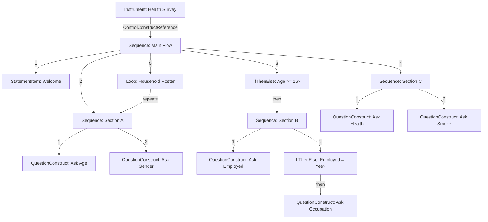

# Module 10: Map a questionnaire to DDI flow logic

!!! info "Learning objectives"
    By the end of this module, you can:

    - **O1.** Identify the questions, sections, skip rules and repeat rules in a questionnaire spec, and name the DDI construct for each (`QuestionConstruct`, `Sequence`, `IfThenElse`, `Loop`, `StatementItem`, `Instrument`).
    - **O2.** Write a script that wraps each question in a `QuestionConstruct` and lists the constructs, in order, in one `Sequence` per section with `.to_reference()`.
    - **O3.** Add an `IfThenElse` that sets its condition with `set_condition()` and runs a section or question only when the condition is true.
    - **O4.** Add a `Loop` that repeats a section, such as a household roster, by pointing it at that section.
    - **O5.** Create an `Instrument` that points to the main `Sequence`, and check that `doc.validate()` returns `[]` for the whole flow.

**Prerequisites:** [Module 9](module-09-code-lists.en.md).

**Time:** 50 min self-paced / 60 min instructor-led.

**New in this module:** `QuestionConstruct`, `Sequence`, `StatementItem`, `IfThenElse`, `set_condition()`, `Loop`, `Instrument`, `.to_reference()`.

---

## 1. From paper to DDI

Most questionnaires start as a written specification.
The spec lists the questions in order and describes **skip patterns**: rules like "If the respondent is under 18, skip to Section C."

Your job is to turn that spec into DDI metadata so that the flow logic is machine-readable.
This module teaches you how.

## 2. A sample questionnaire spec

Here is a simple health survey specification.
Read it carefully; we will map every part to DDI.

!!! example "Health Survey Spec"

    **Section A: Demographics**

    - A1. What is your age? *(numeric)*
    - A2. What is your gender? *(code list: Male, Female, Other)*

    **Section B: Employment** *(skip if age < 16)*

    - B1. Are you currently employed? *(Yes / No)*
    - B2. What is your occupation? *(text, ask only if B1 = Yes)*

    **Section C: Health**

    - C1. How would you rate your general health? *(code list: Excellent, Good, Fair, Poor)*
    - C2. Do you smoke? *(Yes / No)*

    **Household Roster** *(repeat Section A for each household member)*

## 3. The DDI building blocks

Each part of the spec maps to a DDI **control construct**:

| Spec element | DDI construct | What it does |
| --- | --- | --- |
| A section intro | `StatementItem` | Shows text without asking a question |
| A question | `QuestionConstruct` | Asks one question |
| An ordered section | `Sequence` | Groups steps in order |
| "Skip if..." | `IfThenElse` | Branches based on a condition |
| "Ask only if..." | `IfThenElse` | Same; the condition decides which path |
| "Repeat for each..." | `Loop` | Repeats a section for a list of items |
| The whole questionnaire | `Instrument` | Points to the top-level Sequence |

All of these live in the `ddi_l.models.datacollection` module:

```python
from ddi_l.models.datacollection import (
    Instrument,
    Sequence,
    QuestionConstruct,
    IfThenElse,
    Loop,
    StatementItem,
)
```

!!! tip "Two things to remember"
    - You create every construct with the same `doc.add_item(<Type>, name="...")`
      call you already use for categories in Module 9.
    - You **link** constructs to one another with `.to_reference()`. A
      reference says "this construct points to that one". It carries the
      target's identifier and type so the file stays valid.

## 4. Step 1: Create the study and questions

First, create the study and all the questions from the spec.
Each question becomes a DDI question item.

```python
import ddi_l as ddi

doc = ddi.new_study(title="National Health Survey", agency="health.gc.ca")

# Section A
q_age = doc.add_question(text="What is your age?")
q_gender = doc.add_question(text="What is your gender?")

# Section B
q_employed = doc.add_question(text="Are you currently employed?")
q_occupation = doc.add_question(text="What is your occupation?")

# Section C
q_health = doc.add_question(text="How would you rate your general health?")
q_smoke = doc.add_question(text="Do you smoke?")

print(f"Questions: {len(doc.questions)}")  # -> Questions: 6
```

## 5. Step 2: Create QuestionConstructs

A **QuestionConstruct** wraps a question so it can be placed in a Sequence.
Think of it as the instruction "now ask this question."

Add one for each question, and point it at the question with `.to_reference()`:

```python
qc_age = doc.add_item(
    QuestionConstruct, name="Ask Age", question_reference=q_age.to_reference()
)
qc_gender = doc.add_item(
    QuestionConstruct, name="Ask Gender", question_reference=q_gender.to_reference()
)
qc_employed = doc.add_item(
    QuestionConstruct, name="Ask Employed", question_reference=q_employed.to_reference()
)
qc_occupation = doc.add_item(
    QuestionConstruct,
    name="Ask Occupation",
    question_reference=q_occupation.to_reference(),
)
qc_health = doc.add_item(
    QuestionConstruct,
    name="Ask Health Rating",
    question_reference=q_health.to_reference(),
)
qc_smoke = doc.add_item(
    QuestionConstruct, name="Ask Smoke", question_reference=q_smoke.to_reference()
)

print(f"QuestionConstructs: {len(doc.items(QuestionConstruct))}")
# -> QuestionConstructs: 6
```

## 6. Step 3: Build Sequences for each section

The spec has three sections (A, B, C).
Each section becomes a `Sequence` that lists its steps in order. You list the
steps with `control_construct_references`, one reference per step:

```python
seq_demographics = doc.add_item(
    Sequence,
    name="Section A - Demographics",
    control_construct_references=[qc_age.to_reference(), qc_gender.to_reference()],
)
seq_employment = doc.add_item(
    Sequence,
    name="Section B - Employment",
    control_construct_references=[qc_employed.to_reference()],
)
seq_health = doc.add_item(
    Sequence,
    name="Section C - Health",
    control_construct_references=[qc_health.to_reference(), qc_smoke.to_reference()],
)

print(f"Steps in Section A: {len(seq_demographics.control_construct_references)}")
# -> Steps in Section A: 2
```

A Sequence lists **constructs**, not questions: it points to `qc_age`, the
instruction to ask, not to `q_age`, the question's content.

You can also add a **StatementItem** to introduce a section. It shows a
message instead of asking a question:

```python
intro_a = doc.add_item(StatementItem, name="Welcome to the National Health Survey")
```

## 7. Step 4: Model skip patterns with IfThenElse

The spec says: *"Skip Section B if age < 16."*
In DDI, this becomes an `IfThenElse` construct.

An `IfThenElse` has up to three parts:

- **If condition**: the rule to check (age >= 16)
- **Then**: which construct to run if the rule is true (Section B)
- **Else** (optional): which construct to run if it is false

Create it with `add_item()`, set the rule with `set_condition()`, then connect
the "then" branch with `.to_reference()`:

```python
skip_employment = doc.add_item(IfThenElse, name="Age gate for employment")
skip_employment.set_condition("age >= 16", description="Working age")
skip_employment.then_construct_reference = seq_employment.to_reference()
```

The age gate needs no "else" branch. When the respondent is under 16, nothing
runs, and the flow simply continues with the next step of the main Sequence
(Section C, in Step 7). When you do need an else branch, set
`else_construct_reference` the same way.

## 8. Step 5: Model "ask only if" with a nested IfThenElse

The spec says: *"Ask B2 (occupation) only if B1 = Yes."*
This is another `IfThenElse`, this time inside Section B.
The "then" path runs the occupation QuestionConstruct; there is no "else" path,
so the question is skipped when the condition is false:

```python
ask_occupation = doc.add_item(IfThenElse, name="Occupation routing")
ask_occupation.set_condition("employed == 1", description="Employed")
ask_occupation.then_construct_reference = qc_occupation.to_reference()

# Section B asks B1, then runs this gate
seq_employment.control_construct_references.append(ask_occupation.to_reference())

print(f"Steps in Section B: {len(seq_employment.control_construct_references)}")
# -> Steps in Section B: 2
```

## 9. Step 6: Model a household roster with Loop

The spec says: *"Repeat Section A for each household member."*
DDI represents this with a **Loop** construct.

A Loop repeats a control construct (usually a Sequence) for each item in a
list. For example, it runs the demographics section once per household
member. Add it like any other construct, and point it at the section it
repeats with `control_construct_reference`:

```python
from ddi_l.models.datacollection import Loop

roster_loop = doc.add_item(Loop, name="Household roster loop")
roster_loop.control_construct_reference = seq_demographics.to_reference()

print(roster_loop.control_construct_reference.identifier == seq_demographics.identifier)
# -> True
```

Note the difference: a Sequence lists many steps
(`control_construct_references`, plural), while a Loop repeats one
(`control_construct_reference`, singular).

## 10. Step 7: Build the main Sequence and Instrument

The **main Sequence** defines the overall flow of the questionnaire.
It references the welcome statement, the section sequences, the IfThenElse
gate, and the loop, in order.

```python
main_seq = doc.add_item(
    Sequence,
    name="Main Survey Flow",
    control_construct_references=[
        intro_a.to_reference(),
        seq_demographics.to_reference(),
        skip_employment.to_reference(),
        seq_health.to_reference(),
        roster_loop.to_reference(),
    ],
)
```

The order is:

1. `StatementItem`: Welcome
2. `Sequence`: Section A (Demographics)
3. `IfThenElse`: Age gate (→ Section B, or skip it)
4. `Sequence`: Section C (Health)
5. `Loop`: Household roster

Finally, create an **Instrument** that points to the main Sequence.
The Instrument is the top-level entry point: it says "this is the
questionnaire."

```python
instrument = doc.add_item(Instrument, name="Health Survey Instrument")
instrument.control_construct_reference = main_seq.to_reference()
print(f"Instruments: {len(doc.items(Instrument))}")  # -> Instruments: 1

# The whole flow is valid DDI:
assert doc.validate() == []
```

The second line is the one that matters. Without it the Instrument has a
name and nothing else (a questionnaire that administers nothing), and the
document is still perfectly valid, because the schema does not require the
link. Only the `ControlConstructReference` connects the entry point to the
flow you just built.

## 11. The complete mapping

Here is the full spec mapped to DDI, as a diagram. Each arrow is a reference
in the XML. A Sequence's numbered steps run in order. An IfThenElse runs its
"then" construct only when its condition holds; neither gate has an "else",
and DDI has no "go to". When a construct ends, the flow continues with the
next step of the Sequence that holds it.



## 12. Mapping steps

Follow these steps when you map any questionnaire spec to DDI:

1. List all questions → `add_question()`, then `add_item(QuestionConstruct, ...)` for each.
2. Identify sections → `add_item(Sequence, ...)` for each.
3. Find "skip if..." rules → `add_item(IfThenElse, ...)` for each.
4. Find "ask only if..." rules → `add_item(IfThenElse, ...)` for each.
5. Find "repeat for each..." rules → `add_item(Loop, ...)` for each.
6. Find section introductions → `add_item(StatementItem, ...)` for each.
7. Build the main `Sequence` that ties everything together.
8. Create the `Instrument` that points to the main Sequence, and run `doc.validate()`.

---

!!! example "Scenario"
    You received the Health Survey spec above from your research team.
    Your task: create the DDI document with all questions,
    build the flow logic with Sequences, IfThenElse gates and a Loop,
    and connect everything to an Instrument.

---

## Exercises

1. **(O1)** Read this short spec. For each line, name the DDI construct (or constructs) you would use. Do not write code yet.

    - Intro: "This survey asks about your trips to work."
    - T1. Do you travel to a workplace? *(Yes / No)*
    - T2. How do you usually travel? *(ask only if T1 = Yes)*
    - T3. How many minutes did the trip take? *(repeat for each trip you made last week)*

    ??? success "Answer"
        - Intro → a `StatementItem`.
        - T1, T2 and T3 → one question each, wrapped in a `QuestionConstruct`.
        - "ask only if T1 = Yes" → an `IfThenElse` whose condition tests T1 and
          whose "then" branch runs T2's `QuestionConstruct`.
        - "repeat for each trip" → a `Loop` that points to T3's
          `QuestionConstruct` (or to a `Sequence` that holds it).
        - The order of the steps → the main `Sequence`.
        - The whole questionnaire → an `Instrument` that points to the main
          `Sequence`.

2. **(O2)** Create a study for the Health Survey and add its 6 questions. Wrap each question in a `QuestionConstruct`, then add a `Sequence` for each section (A, B, C) that lists its constructs in order. Print the counts and the number of steps in Section A.

    **Expected output:**

    ```text
    QuestionConstructs: 6
    Sequences: 3
    Steps in Section A: 2
    ```

    ??? success "Answer"
        ```python
        import ddi_l as ddi
        from ddi_l.models.datacollection import QuestionConstruct, Sequence

        doc = ddi.new_study(title="National Health Survey", agency="health.gc.ca")
        q_age = doc.add_question(text="What is your age?")
        q_gender = doc.add_question(text="What is your gender?")
        q_employed = doc.add_question(text="Are you currently employed?")
        q_occupation = doc.add_question(text="What is your occupation?")
        q_health = doc.add_question(text="How would you rate your general health?")
        q_smoke = doc.add_question(text="Do you smoke?")

        qc_age = doc.add_item(
            QuestionConstruct, name="Ask Age", question_reference=q_age.to_reference()
        )
        qc_gender = doc.add_item(
            QuestionConstruct, name="Ask Gender", question_reference=q_gender.to_reference()
        )
        qc_employed = doc.add_item(
            QuestionConstruct,
            name="Ask Employed",
            question_reference=q_employed.to_reference(),
        )
        qc_occupation = doc.add_item(
            QuestionConstruct,
            name="Ask Occupation",
            question_reference=q_occupation.to_reference(),
        )
        qc_health = doc.add_item(
            QuestionConstruct, name="Ask Health", question_reference=q_health.to_reference()
        )
        qc_smoke = doc.add_item(
            QuestionConstruct, name="Ask Smoke", question_reference=q_smoke.to_reference()
        )

        seq_demographics = doc.add_item(
            Sequence,
            name="Section A - Demographics",
            control_construct_references=[qc_age.to_reference(), qc_gender.to_reference()],
        )
        seq_employment = doc.add_item(
            Sequence,
            name="Section B - Employment",
            control_construct_references=[qc_employed.to_reference()],
        )
        seq_health = doc.add_item(
            Sequence,
            name="Section C - Health",
            control_construct_references=[qc_health.to_reference(), qc_smoke.to_reference()],
        )

        print(f"QuestionConstructs: {len(doc.items(QuestionConstruct))}")
        print(f"Sequences: {len(doc.items(Sequence))}")
        print(f"Steps in Section A: {len(seq_demographics.control_construct_references)}")
        ```

3. **(O3)** Add the two gates from the spec. The age gate runs Section B only when `age >= 16`. The occupation gate runs B2 only when `employed == 1`; place it in Section B, after B1. Print the number of `IfThenElse` items and the number of steps in Section B.

    **Expected output:**

    ```text
    IfThenElse: 2
    Steps in Section B: 2
    ```

    ??? success "Answer"
        ```python
        from ddi_l.models.datacollection import IfThenElse

        skip_employment = doc.add_item(IfThenElse, name="Age gate for employment")
        skip_employment.set_condition("age >= 16", description="Working age")
        skip_employment.then_construct_reference = seq_employment.to_reference()

        ask_occupation = doc.add_item(IfThenElse, name="Occupation routing")
        ask_occupation.set_condition("employed == 1", description="Employed")
        ask_occupation.then_construct_reference = qc_occupation.to_reference()
        seq_employment.control_construct_references.append(ask_occupation.to_reference())

        print(f"IfThenElse: {len(doc.items(IfThenElse))}")
        print(f"Steps in Section B: {len(seq_employment.control_construct_references)}")
        ```

4. **(O4)** Add the household roster: a `Loop` that repeats Section A. Print the number of loops, and check that the loop points to Section A.

    **Expected output:**

    ```text
    Loops: 1
    Repeats Section A: True
    ```

    ??? success "Answer"
        ```python
        from ddi_l.models.datacollection import Loop

        roster_loop = doc.add_item(Loop, name="Household roster loop")
        roster_loop.control_construct_reference = seq_demographics.to_reference()

        print(f"Loops: {len(doc.items(Loop))}")
        repeats_a = (
            roster_loop.control_construct_reference.identifier == seq_demographics.identifier
        )
        print(f"Repeats Section A: {repeats_a}")
        ```

5. **(O5)** Add a welcome `StatementItem` and the main `Sequence` (welcome, Section A, age gate, Section C, roster loop). Create an `Instrument` that points to the main Sequence. Print the number of steps in the main flow, the number of instruments, and the number of validation errors.

    **Expected output:**

    ```text
    Steps in main flow: 5
    Instruments: 1
    Validation errors: 0
    ```

    ??? success "Answer"
        ```python
        from ddi_l.models.datacollection import Instrument, StatementItem

        intro_a = doc.add_item(StatementItem, name="Welcome to the National Health Survey")
        main_seq = doc.add_item(
            Sequence,
            name="Main Survey Flow",
            control_construct_references=[
                intro_a.to_reference(),
                seq_demographics.to_reference(),
                skip_employment.to_reference(),
                seq_health.to_reference(),
                roster_loop.to_reference(),
            ],
        )
        instrument = doc.add_item(Instrument, name="Health Survey Instrument")
        instrument.control_construct_reference = main_seq.to_reference()

        print(f"Steps in main flow: {len(main_seq.control_construct_references)}")
        print(f"Instruments: {len(doc.items(Instrument))}")
        print(f"Validation errors: {len(doc.validate())}")
        ```

6. **(O1, O5)** *(Optional)* Draw a flowchart of your own survey (real or imaginary) on paper. Label each box with the DDI construct type. Then build it in Python with `add_item()`, link the constructs with `.to_reference()`, and validate it.

    ??? success "Answer"
        Answers vary. Check that every `QuestionConstruct` references a question,
        that each `Sequence` lists its steps in the order respondents see them, and
        that the `Instrument` points to the top-level `Sequence`. Run `doc.validate()`
        before you save: it should return `[]`.

---

## Quiz

???+ question "Question 1 (O1): Which constructs does this spec line need?"
    The spec says: "B2. What is your occupation? *(ask only if B1 = Yes)*".

    **A.** A `QuestionConstruct` for B2, run by the "then" branch of an `IfThenElse` whose condition tests B1.

    **B.** A `Loop` that repeats B2 for each answer to B1.

    **C.** A `StatementItem` that shows the text of B2.

    **D.** A second `Instrument` for employed respondents.

    ??? success "Answer"
        **A.** "Ask only if" is a condition, so it is an `IfThenElse`. Its
        "then" branch runs the `QuestionConstruct` that asks B2.

???+ question "Question 2 (O2): What is wrong with this Sequence?"
    <!-- docs-test: skip -- deliberately wrong: it lists questions, not constructs -->
    ```python
    seq_a = doc.add_item(
        Sequence,
        name="Section A",
        control_construct_references=[q_age.to_reference(), q_gender.to_reference()],
    )
    ```

    **A.** Nothing. A Sequence can list questions directly.

    **B.** A Sequence can hold only one step.

    **C.** It lists the questions themselves. It should list the `QuestionConstruct`s that ask them (`qc_age`, `qc_gender`).

    **D.** `.to_reference()` must be called on the Sequence, not on its steps.

    ??? success "Answer"
        **C.** A Sequence orders **control constructs**. The question holds the
        content; the `QuestionConstruct` is the instruction "ask it now", and
        that is what a Sequence lists.

???+ question "Question 3 (O3): A 12-year-old reaches this gate. What happens next?"
    The main Sequence is: welcome, Section A, `skip_employment`, Section C.

    <!-- docs-test: skip -- fragment: seq_employment is the reader's own Section B -->
    ```python
    skip_employment = doc.add_item(IfThenElse, name="Age gate for employment")
    skip_employment.set_condition("age >= 16")
    skip_employment.then_construct_reference = seq_employment.to_reference()
    ```

    **A.** Section B, then Section C.

    **B.** Section B only, then the survey ends.

    **C.** Nothing more: the survey ends at the gate.

    **D.** Section B is skipped, and the flow continues with Section C, the next step of the main Sequence.

    ??? success "Answer"
        **D.** The condition `age >= 16` is false, and the gate has no "else"
        branch, so nothing runs inside it. The main Sequence then moves on to
        its next step, Section C.

???+ question "Question 4 (O4): Which line makes the roster repeat Section A?"
    You want `roster_loop` to repeat Section A (`seq_demographics`) for each
    household member. Which line does that?

    **A.** `seq_demographics.control_construct_references.append(roster_loop.to_reference())`

    **B.** `roster_loop.control_construct_reference = seq_demographics.to_reference()`

    **C.** `roster_loop.set_condition("household members")`

    **D.** `roster_loop = doc.add_item(Sequence, name="Household roster")`

    ??? success "Answer"
        **B.** A `Loop` points to the one construct it repeats through
        `control_construct_reference`. Option A would put the loop inside
        Section A, which is the wrong way round.

???+ question "Question 5 (O5): What if the Instrument is not linked to the flow?"
    You create the Instrument but forget
    `instrument.control_construct_reference = main_seq.to_reference()`.
    What is true?

    **A.** `doc.validate()` reports an error about the missing link.

    **B.** Python raises `AttributeError` when you save.

    **C.** `doc.validate()` still returns `[]`, but the Instrument points to no flow, so it administers nothing.

    **D.** The Instrument finds the main Sequence on its own.

    ??? success "Answer"
        **C.** The schema does not require the link, so the file is valid. But
        only `control_construct_reference` connects the questionnaire's entry
        point to the flow. Always set it, then validate.

---

## Going further (optional)

This section has no objective or quiz question. Read it when you need routing
with more than two paths.

### Multi-way routing with ElseIf

Some specs route respondents to one of several sections: "if 65 or older, ask
about retirement; if 16 to 64, ask about employment; otherwise skip both." One
`IfThenElse` can hold extra conditions as **ElseIf** branches, added with
`add_elseif()`:

```python
q_retired = doc.add_question(text="In what year did you retire?")
qc_retired = doc.add_item(
    QuestionConstruct,
    name="Ask Retirement Year",
    question_reference=q_retired.to_reference(),
)
seq_retirement = doc.add_item(
    Sequence,
    name="Section B2 - Retirement",
    control_construct_references=[qc_retired.to_reference()],
)

age_router = doc.add_item(IfThenElse, name="Age router")
age_router.set_condition("age >= 65", description="Retirement age")
age_router.then_construct_reference = seq_retirement.to_reference()
age_router.add_elseif(seq_employment.to_reference(), command="age >= 16")

print(f"ElseIf branches: {len(age_router.else_if_branches)}")
# -> ElseIf branches: 1
```

The conditions are checked in order, so test the narrowest group first. If the
first condition were `age >= 16`, a 70-year-old would match it and never reach
the retirement branch. A respondent under 16 matches neither condition, so
nothing runs; set `else_construct_reference` if that case needs its own branch.

*Try it:* add an "else" branch to `age_router` that runs a `StatementItem`
thanking respondents under 16, then run `doc.validate()`.

---

## Check yourself

- [ ] I can identify the questions, sections, skip rules and repeat rules in a spec, and name the DDI construct for each. (O1)
- [ ] I can write a script that wraps each question in a `QuestionConstruct` and lists the constructs, in order, in one `Sequence` per section. (O2)
- [ ] I can add an `IfThenElse` with `set_condition()` that runs a section or question only when its condition is true. (O3)
- [ ] I can add a `Loop` that repeats a section, such as a household roster. (O4)
- [ ] I can create an `Instrument` that points to the main `Sequence`, and check that `doc.validate()` returns `[]`. (O5)

---

!!! tip "Instructor notes"
    - Start with the paper spec on screen. Ask learners to circle every question, underline every skip rule, and box every "repeat" instruction. This makes the mapping concrete before touching code.
    - Draw the flowchart on a whiteboard. Label each box with the DDI construct name. Then translate box-by-box to Python.
    - Stress the `.to_reference()` habit: every time one construct points to another (a Sequence to its steps, an IfThenElse to its branches), the link is a reference, not the object itself. References keep the file valid because they carry the target's identifier and type.
    - Common confusion: "Why do I need both a Question and a QuestionConstruct?" Answer: the Question is the content ("What is your age?"). The QuestionConstruct is the instruction ("now ask this question"). The Sequence says "ask these in this order." Separating content from flow lets you reuse the same question in different instruments. Quiz question 2 checks this.
    - A gate with only a "then" branch is how DDI says "skip". If learners add an "else" branch that points to Section C while Section C is also the next step of the main Sequence, respondents under 16 would see Section C twice. Ask them to trace a 12-year-old through the flow.
    - For the Loop: show a household roster form where the same section repeats per person. Ask: "How many times does this section run?" Answer: "It depends on how many people live in the household." That is a loop.
    - ElseIf is in "Going further". Use it with faster learners: "If 65+ → ask retirement. If 16-64 → ask employment. Otherwise → skip." Point out that the order of the conditions matters.
    - Exercise 6 (draw your own spec) is excellent for group work. Pairs can swap specs and map each other's questionnaires.

---

**See also:** [Module 9: Code lists](module-09-code-lists.en.md) | [User guide: Any item type](../user-guide.en.md#work-with-any-item-type)
