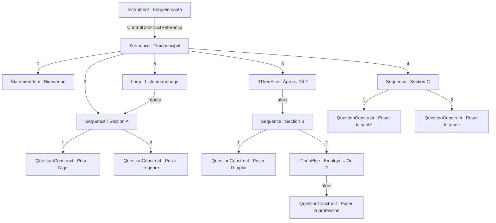

# Module 10 : Traduire un devis de questionnaire en logique de flux DDI

!!! info "Objectifs d'apprentissage"
    À la fin de ce module, vous pouvez :

    - **O1.** Repérer les questions, les sections, les règles de saut et les règles de répétition d'un devis de questionnaire, et nommer la construction DDI de chacune (`QuestionConstruct`, `Sequence`, `IfThenElse`, `Loop`, `StatementItem`, `Instrument`).
    - **O2.** Écrire un script qui enveloppe chaque question dans un `QuestionConstruct` et liste les constructions, dans l'ordre, dans une `Sequence` par section avec `.to_reference()`.
    - **O3.** Ajouter un `IfThenElse` qui définit sa condition avec `set_condition()` et n'exécute une section ou une question que si la condition est vraie.
    - **O4.** Ajouter un `Loop` qui répète une section, comme une liste de ménage, en le pointant vers cette section.
    - **O5.** Créer un `Instrument` qui pointe vers la `Sequence` principale, et vérifier que `doc.validate()` renvoie `[]` pour tout le flux.

**Prérequis :** [Module 9](module-09-code-lists.fr.md).

**Durée :** 50 min en autonomie / 60 min avec instructeur.

**Nouveau dans ce module :** `QuestionConstruct`, `Sequence`, `StatementItem`, `IfThenElse`, `set_condition()`, `Loop`, `Instrument`, `.to_reference()`.

---

## 1. Du papier au DDI

La plupart des questionnaires commencent par un devis écrit.
Le devis liste les questions dans l'ordre et décrit les **sauts conditionnels** : des règles comme « Si le répondant a moins de 18 ans, passer à la section C. »

Votre travail est de transformer ce devis en métadonnées DDI pour que la logique de flux soit lisible par une machine.
Ce module vous apprend comment faire.

## 2. Un exemple de devis de questionnaire

Voici un devis simple d'enquête sur la santé.
Lisez-le attentivement ; nous allons associer chaque partie au DDI.

!!! example "Devis de l'enquête sur la santé"

    **Section A : Démographie**

    - A1. Quel est votre âge ? *(numérique)*
    - A2. Quel est votre genre ? *(liste de codes : Male, Female, Other)*

    **Section B : Emploi** *(sauter si âge < 16)*

    - B1. Êtes-vous actuellement employé ? *(Oui / Non)*
    - B2. Quelle est votre profession ? *(texte, poser seulement si B1 = Oui)*

    **Section C : Santé**

    - C1. Comment évaluez-vous votre santé générale ? *(liste de codes : Excellent, Good, Fair, Poor)*
    - C2. Fumez-vous ? *(Oui / Non)*

    **Liste du ménage** *(répéter la section A pour chaque membre du ménage)*

## 3. Les éléments de base du DDI

Chaque partie du devis correspond à une **construction de contrôle** DDI :

| Élément du devis | Construction DDI | Ce qu'elle fait |
| --- | --- | --- |
| Introduction de section | `StatementItem` | Affiche du texte sans poser de question |
| Une question | `QuestionConstruct` | Pose une question |
| Une section ordonnée | `Sequence` | Regroupe des étapes dans l'ordre |
| « Sauter si... » | `IfThenElse` | Branche selon une condition |
| « Poser seulement si... » | `IfThenElse` | Même chose ; la condition décide du chemin |
| « Répéter pour chaque... » | `Loop` | Répète une section pour une liste d'éléments |
| Le questionnaire complet | `Instrument` | Pointe vers la Sequence principale |

Tous ces éléments se trouvent dans le module `ddi_l.models.datacollection` :

```python
from ddi_l.models.datacollection import (
    Instrument,
    Sequence,
    QuestionConstruct,
    IfThenElse,
    Loop,
    StatementItem,
)
```

!!! tip "Deux choses à retenir"
    - Vous créez chaque construction avec le même appel
      `doc.add_item(<Type>, name="...")` que celui que vous utilisez déjà pour
      les catégories au module 9.
    - Vous **reliez** les constructions entre elles avec `.to_reference()`.
      Une référence dit « cette construction pointe vers celle-là ». Elle
      porte l'identifiant et le type de la cible pour que le fichier reste
      valide.

## 4. Étape 1 : Créer l'étude et les questions

D'abord, créez l'étude et toutes les questions du devis.
Chaque question devient un élément de question DDI.

```python
import ddi_l as ddi

doc = ddi.new_study(title="National Health Survey", agency="health.gc.ca")

# Section A
q_age = doc.add_question(text="What is your age?")
q_gender = doc.add_question(text="What is your gender?")

# Section B
q_employed = doc.add_question(text="Are you currently employed?")
q_occupation = doc.add_question(text="What is your occupation?")

# Section C
q_health = doc.add_question(text="How would you rate your general health?")
q_smoke = doc.add_question(text="Do you smoke?")

print(f"Questions: {len(doc.questions)}")  # -> Questions: 6
```

## 5. Étape 2 : Créer les QuestionConstructs

Un **QuestionConstruct** enveloppe une question pour qu'elle puisse être placée dans une Sequence.
Pensez-y comme l'instruction « maintenant, posez cette question ».

Ajoutez-en un pour chaque question et pointez-le vers la question avec
`.to_reference()` :

```python
qc_age = doc.add_item(
    QuestionConstruct, name="Ask Age", question_reference=q_age.to_reference()
)
qc_gender = doc.add_item(
    QuestionConstruct, name="Ask Gender", question_reference=q_gender.to_reference()
)
qc_employed = doc.add_item(
    QuestionConstruct, name="Ask Employed", question_reference=q_employed.to_reference()
)
qc_occupation = doc.add_item(
    QuestionConstruct,
    name="Ask Occupation",
    question_reference=q_occupation.to_reference(),
)
qc_health = doc.add_item(
    QuestionConstruct,
    name="Ask Health Rating",
    question_reference=q_health.to_reference(),
)
qc_smoke = doc.add_item(
    QuestionConstruct, name="Ask Smoke", question_reference=q_smoke.to_reference()
)

print(f"QuestionConstructs: {len(doc.items(QuestionConstruct))}")
# -> QuestionConstructs: 6
```

## 6. Étape 3 : Construire les Sequences de chaque section

Le devis a trois sections (A, B, C).
Chaque section devient une `Sequence` qui liste ses étapes dans l'ordre. Vous
listez les étapes avec `control_construct_references`, une référence par
étape :

```python
seq_demographics = doc.add_item(
    Sequence,
    name="Section A - Demographics",
    control_construct_references=[qc_age.to_reference(), qc_gender.to_reference()],
)
seq_employment = doc.add_item(
    Sequence,
    name="Section B - Employment",
    control_construct_references=[qc_employed.to_reference()],
)
seq_health = doc.add_item(
    Sequence,
    name="Section C - Health",
    control_construct_references=[qc_health.to_reference(), qc_smoke.to_reference()],
)

print(f"Steps in Section A: {len(seq_demographics.control_construct_references)}")
# -> Steps in Section A: 2
```

Une Sequence liste des **constructions**, pas des questions : elle pointe vers
`qc_age`, l'instruction de poser la question, et non vers `q_age`, le contenu
de la question.

Vous pouvez aussi ajouter un **StatementItem** pour introduire une section.
Il affiche un message au lieu de poser une question :

```python
intro_a = doc.add_item(StatementItem, name="Welcome to the National Health Survey")
```

## 7. Étape 4 : Modéliser les sauts conditionnels avec IfThenElse

Le devis dit : *« Sauter la section B si âge < 16. »*
En DDI, cela devient une construction `IfThenElse`.

Un `IfThenElse` a jusqu'à trois parties :

- **Condition Si** : la règle à vérifier (âge >= 16)
- **Alors** : quelle construction exécuter si la règle est vraie (Section B)
- **Sinon** (facultatif) : quelle construction exécuter si elle est fausse

Créez-le avec `add_item()`, définissez la règle avec `set_condition()`, puis
connectez la branche « alors » avec `.to_reference()` :

```python
skip_employment = doc.add_item(IfThenElse, name="Age gate for employment")
skip_employment.set_condition("age >= 16", description="Working age")
skip_employment.then_construct_reference = seq_employment.to_reference()
```

La porte d'âge n'a pas besoin de branche « sinon ». Quand le répondant a moins
de 16 ans, rien ne s'exécute, et le flux continue simplement avec l'étape
suivante de la Sequence principale (la Section C, à l'étape 7). Quand vous avez
besoin d'une branche « sinon », définissez `else_construct_reference` de la
même façon.

## 8. Étape 5 : Modéliser « poser seulement si » avec un IfThenElse imbriqué

Le devis dit : *« Poser B2 (profession) seulement si B1 = Oui. »*
C'est un autre `IfThenElse`, cette fois à l'intérieur de la Section B.
Le chemin « alors » exécute le QuestionConstruct de la profession ; il n'y a
pas de chemin « sinon », donc la question est sautée quand la condition est
fausse :

```python
ask_occupation = doc.add_item(IfThenElse, name="Occupation routing")
ask_occupation.set_condition("employed == 1", description="Employed")
ask_occupation.then_construct_reference = qc_occupation.to_reference()

# La section B pose B1, puis exécute cette porte
seq_employment.control_construct_references.append(ask_occupation.to_reference())

print(f"Steps in Section B: {len(seq_employment.control_construct_references)}")
# -> Steps in Section B: 2
```

## 9. Étape 6 : Modéliser une liste de ménage avec Loop

Le devis dit : *« Répéter la section A pour chaque membre du ménage. »*
DDI représente cela avec une construction **Loop**.

Un Loop répète une construction de contrôle (habituellement une Sequence)
pour chaque élément d'une liste. Par exemple, il exécute la section
démographique une fois par membre du ménage. Ajoutez-le comme toute autre
construction et pointez-le vers la section qu'il répète avec
`control_construct_reference` :

```python
from ddi_l.models.datacollection import Loop

roster_loop = doc.add_item(Loop, name="Household roster loop")
roster_loop.control_construct_reference = seq_demographics.to_reference()

print(roster_loop.control_construct_reference.identifier == seq_demographics.identifier)
# -> True
```

Notez la différence : une Sequence liste plusieurs étapes
(`control_construct_references`, au pluriel), tandis qu'un Loop en répète une
seule (`control_construct_reference`, au singulier).

## 10. Étape 7 : Construire la Sequence principale et l'Instrument

La **Sequence principale** définit le flux global du questionnaire.
Elle référence le message de bienvenue, les séquences de section, la porte
IfThenElse et la boucle, dans l'ordre.

```python
main_seq = doc.add_item(
    Sequence,
    name="Main Survey Flow",
    control_construct_references=[
        intro_a.to_reference(),
        seq_demographics.to_reference(),
        skip_employment.to_reference(),
        seq_health.to_reference(),
        roster_loop.to_reference(),
    ],
)
```

L'ordre est :

1. `StatementItem` : Bienvenue
2. `Sequence` : Section A (Démographie)
3. `IfThenElse` : Porte d'âge (→ Section B, ou la sauter)
4. `Sequence` : Section C (Santé)
5. `Loop` : Liste du ménage

Enfin, créez un **Instrument** qui pointe vers la Sequence principale.
L'Instrument est le point d'entrée principal : il dit « ceci est le
questionnaire ».

```python
instrument = doc.add_item(Instrument, name="Health Survey Instrument")
instrument.control_construct_reference = main_seq.to_reference()
print(f"Instruments: {len(doc.items(Instrument))}")  # -> Instruments: 1

# Tout le flux est du DDI valide :
assert doc.validate() == []
```

C'est la deuxième ligne qui compte. Sans elle, l'Instrument porte un nom et
rien d'autre (un questionnaire qui n'administre rien), et le document reste
parfaitement valide, car le schéma n'exige pas ce lien. Seule la
`ControlConstructReference` relie le point d'entrée au flux que vous venez
de construire.

## 11. La correspondance complète

Voici le devis complet traduit en DDI, sous forme de diagramme. Chaque flèche
est une référence dans le XML. Les étapes numérotées d'une Sequence
s'exécutent dans l'ordre. Un IfThenElse exécute sa construction « alors »
seulement quand sa condition est vraie ; aucun des deux filtres n'a de
« sinon », et DDI n'a pas de « aller à ». Quand une construction se termine, le
flux reprend à l'étape suivante de la Sequence qui la contient.



## 12. Étapes de la correspondance

Suivez ces étapes quand vous traduisez un devis de questionnaire en DDI :

1. Lister toutes les questions → `add_question()`, puis `add_item(QuestionConstruct, ...)` pour chacune.
2. Identifier les sections → `add_item(Sequence, ...)` pour chacune.
3. Trouver les règles « sauter si... » → `add_item(IfThenElse, ...)` pour chacune.
4. Trouver les règles « poser seulement si... » → `add_item(IfThenElse, ...)` pour chacune.
5. Trouver les règles « répéter pour chaque... » → `add_item(Loop, ...)` pour chacune.
6. Trouver les introductions de section → `add_item(StatementItem, ...)` pour chacune.
7. Construire la `Sequence` principale qui relie tout.
8. Créer l'`Instrument` qui pointe vers la Sequence principale, et exécuter `doc.validate()`.

---

!!! example "Scénario"
    Vous avez reçu le devis de l'enquête sur la santé ci-dessus de votre
    équipe de recherche. Votre tâche : créer le document DDI avec toutes
    les questions, construire la logique de flux avec des Sequences, des
    portes IfThenElse et un Loop, et tout connecter à un Instrument.

---

## Exercices

1. **(O1)** Lisez ce court devis. Pour chaque ligne, nommez la ou les constructions DDI que vous utiliseriez. N'écrivez pas encore de code.

    - Introduction : « Cette enquête porte sur vos trajets vers le travail. »
    - T1. Vous déplacez-vous vers un lieu de travail ? *(Oui / Non)*
    - T2. Comment vous déplacez-vous habituellement ? *(poser seulement si T1 = Oui)*
    - T3. Combien de minutes le trajet a-t-il duré ? *(répéter pour chaque trajet effectué la semaine dernière)*

    ??? success "Réponse"
        - Introduction → un `StatementItem`.
        - T1, T2 et T3 → une question chacune, enveloppée dans un
          `QuestionConstruct`.
        - « poser seulement si T1 = Oui » → un `IfThenElse` dont la condition
          teste T1 et dont la branche « alors » exécute le `QuestionConstruct`
          de T2.
        - « répéter pour chaque trajet » → un `Loop` qui pointe vers le
          `QuestionConstruct` de T3 (ou vers une `Sequence` qui le contient).
        - L'ordre des étapes → la `Sequence` principale.
        - Le questionnaire complet → un `Instrument` qui pointe vers la
          `Sequence` principale.

2. **(O2)** Créez une étude pour l'enquête sur la santé et ajoutez ses 6 questions. Enveloppez chaque question dans un `QuestionConstruct`, puis ajoutez une `Sequence` pour chaque section (A, B, C) qui liste ses constructions dans l'ordre. Affichez les compteurs et le nombre d'étapes de la section A.

    **Résultat attendu :**

    ```text
    QuestionConstructs: 6
    Sequences: 3
    Steps in Section A: 2
    ```

    ??? success "Réponse"
        ```python
        import ddi_l as ddi
        from ddi_l.models.datacollection import QuestionConstruct, Sequence

        doc = ddi.new_study(title="National Health Survey", agency="health.gc.ca")
        q_age = doc.add_question(text="What is your age?")
        q_gender = doc.add_question(text="What is your gender?")
        q_employed = doc.add_question(text="Are you currently employed?")
        q_occupation = doc.add_question(text="What is your occupation?")
        q_health = doc.add_question(text="How would you rate your general health?")
        q_smoke = doc.add_question(text="Do you smoke?")

        qc_age = doc.add_item(
            QuestionConstruct, name="Ask Age", question_reference=q_age.to_reference()
        )
        qc_gender = doc.add_item(
            QuestionConstruct, name="Ask Gender", question_reference=q_gender.to_reference()
        )
        qc_employed = doc.add_item(
            QuestionConstruct,
            name="Ask Employed",
            question_reference=q_employed.to_reference(),
        )
        qc_occupation = doc.add_item(
            QuestionConstruct,
            name="Ask Occupation",
            question_reference=q_occupation.to_reference(),
        )
        qc_health = doc.add_item(
            QuestionConstruct, name="Ask Health", question_reference=q_health.to_reference()
        )
        qc_smoke = doc.add_item(
            QuestionConstruct, name="Ask Smoke", question_reference=q_smoke.to_reference()
        )

        seq_demographics = doc.add_item(
            Sequence,
            name="Section A - Demographics",
            control_construct_references=[qc_age.to_reference(), qc_gender.to_reference()],
        )
        seq_employment = doc.add_item(
            Sequence,
            name="Section B - Employment",
            control_construct_references=[qc_employed.to_reference()],
        )
        seq_health = doc.add_item(
            Sequence,
            name="Section C - Health",
            control_construct_references=[qc_health.to_reference(), qc_smoke.to_reference()],
        )

        print(f"QuestionConstructs: {len(doc.items(QuestionConstruct))}")
        print(f"Sequences: {len(doc.items(Sequence))}")
        print(f"Steps in Section A: {len(seq_demographics.control_construct_references)}")
        ```

3. **(O3)** Ajoutez les deux portes du devis. La porte d'âge n'exécute la section B que si `age >= 16`. La porte de la profession n'exécute B2 que si `employed == 1` ; placez-la dans la section B, après B1. Affichez le nombre d'éléments `IfThenElse` et le nombre d'étapes de la section B.

    **Résultat attendu :**

    ```text
    IfThenElse: 2
    Steps in Section B: 2
    ```

    ??? success "Réponse"
        ```python
        from ddi_l.models.datacollection import IfThenElse

        skip_employment = doc.add_item(IfThenElse, name="Age gate for employment")
        skip_employment.set_condition("age >= 16", description="Working age")
        skip_employment.then_construct_reference = seq_employment.to_reference()

        ask_occupation = doc.add_item(IfThenElse, name="Occupation routing")
        ask_occupation.set_condition("employed == 1", description="Employed")
        ask_occupation.then_construct_reference = qc_occupation.to_reference()
        seq_employment.control_construct_references.append(ask_occupation.to_reference())

        print(f"IfThenElse: {len(doc.items(IfThenElse))}")
        print(f"Steps in Section B: {len(seq_employment.control_construct_references)}")
        ```

4. **(O4)** Ajoutez la liste du ménage : un `Loop` qui répète la section A. Affichez le nombre de boucles, et vérifiez que la boucle pointe vers la section A.

    **Résultat attendu :**

    ```text
    Loops: 1
    Repeats Section A: True
    ```

    ??? success "Réponse"
        ```python
        from ddi_l.models.datacollection import Loop

        roster_loop = doc.add_item(Loop, name="Household roster loop")
        roster_loop.control_construct_reference = seq_demographics.to_reference()

        print(f"Loops: {len(doc.items(Loop))}")
        repeats_a = (
            roster_loop.control_construct_reference.identifier == seq_demographics.identifier
        )
        print(f"Repeats Section A: {repeats_a}")
        ```

5. **(O5)** Ajoutez un `StatementItem` de bienvenue et la `Sequence` principale (bienvenue, section A, porte d'âge, section C, boucle de la liste du ménage). Créez un `Instrument` qui pointe vers la Sequence principale. Affichez le nombre d'étapes du flux principal, le nombre d'instruments et le nombre d'erreurs de validation.

    **Résultat attendu :**

    ```text
    Steps in main flow: 5
    Instruments: 1
    Validation errors: 0
    ```

    ??? success "Réponse"
        ```python
        from ddi_l.models.datacollection import Instrument, StatementItem

        intro_a = doc.add_item(StatementItem, name="Welcome to the National Health Survey")
        main_seq = doc.add_item(
            Sequence,
            name="Main Survey Flow",
            control_construct_references=[
                intro_a.to_reference(),
                seq_demographics.to_reference(),
                skip_employment.to_reference(),
                seq_health.to_reference(),
                roster_loop.to_reference(),
            ],
        )
        instrument = doc.add_item(Instrument, name="Health Survey Instrument")
        instrument.control_construct_reference = main_seq.to_reference()

        print(f"Steps in main flow: {len(main_seq.control_construct_references)}")
        print(f"Instruments: {len(doc.items(Instrument))}")
        print(f"Validation errors: {len(doc.validate())}")
        ```

6. **(O1, O5)** *(Facultatif)* Dessinez sur papier l'organigramme de votre propre enquête (réelle ou imaginaire). Étiquetez chaque boîte avec le type de construction DDI. Puis construisez-le en Python avec `add_item()`, reliez les constructions avec `.to_reference()` et validez-le.

    ??? success "Réponse"
        Les réponses varient. Vérifiez que chaque `QuestionConstruct` référence une
        question, que chaque `Sequence` liste ses étapes dans l'ordre où les
        répondants les voient, et que l'`Instrument` pointe vers la `Sequence` de
        premier niveau. Exécutez `doc.validate()` avant d'enregistrer : il doit
        renvoyer `[]`.

---

## Quiz

???+ question "Question 1 (O1) : De quelles constructions cette ligne du devis a-t-elle besoin ?"
    Le devis dit : « B2. Quelle est votre profession ? *(poser seulement si B1 = Oui)* ».

    **A.** Un `QuestionConstruct` pour B2, exécuté par la branche « alors » d'un `IfThenElse` dont la condition teste B1.

    **B.** Un `Loop` qui répète B2 pour chaque réponse à B1.

    **C.** Un `StatementItem` qui affiche le texte de B2.

    **D.** Un deuxième `Instrument` pour les répondants employés.

    ??? success "Réponse"
        **A.** « Poser seulement si » est une condition, donc un `IfThenElse`.
        Sa branche « alors » exécute le `QuestionConstruct` qui pose B2.

???+ question "Question 2 (O2) : Qu'est-ce qui ne va pas dans cette Sequence ?"
    <!-- docs-test: skip -- deliberately wrong: it lists questions, not constructs -->
    ```python
    seq_a = doc.add_item(
        Sequence,
        name="Section A",
        control_construct_references=[q_age.to_reference(), q_gender.to_reference()],
    )
    ```

    **A.** Rien. Une Sequence peut lister des questions directement.

    **B.** Une Sequence ne peut contenir qu'une seule étape.

    **C.** Elle liste les questions elles-mêmes. Elle devrait lister les `QuestionConstruct` qui les posent (`qc_age`, `qc_gender`).

    **D.** `.to_reference()` doit être appelé sur la Sequence, pas sur ses étapes.

    ??? success "Réponse"
        **C.** Une Sequence ordonne des **constructions de contrôle**. La
        question porte le contenu ; le `QuestionConstruct` est l'instruction
        « posez-la maintenant », et c'est lui qu'une Sequence liste.

???+ question "Question 3 (O3) : Un répondant de 12 ans arrive à cette porte. Que se passe-t-il ensuite ?"
    La Sequence principale est : bienvenue, section A, `skip_employment`, section C.

    <!-- docs-test: skip -- fragment: seq_employment is the reader's own Section B -->
    ```python
    skip_employment = doc.add_item(IfThenElse, name="Age gate for employment")
    skip_employment.set_condition("age >= 16")
    skip_employment.then_construct_reference = seq_employment.to_reference()
    ```

    **A.** La section B, puis la section C.

    **B.** La section B seulement, puis l'enquête se termine.

    **C.** Plus rien : l'enquête se termine à la porte.

    **D.** La section B est sautée, et le flux continue avec la section C, l'étape suivante de la Sequence principale.

    ??? success "Réponse"
        **D.** La condition `age >= 16` est fausse, et la porte n'a pas de
        branche « sinon », donc rien ne s'exécute à l'intérieur. La Sequence
        principale passe ensuite à son étape suivante, la section C.

???+ question "Question 4 (O4) : Quelle ligne fait répéter la section A par la liste du ménage ?"
    Vous voulez que `roster_loop` répète la section A (`seq_demographics`) pour
    chaque membre du ménage. Quelle ligne fait cela ?

    **A.** `seq_demographics.control_construct_references.append(roster_loop.to_reference())`

    **B.** `roster_loop.control_construct_reference = seq_demographics.to_reference()`

    **C.** `roster_loop.set_condition("household members")`

    **D.** `roster_loop = doc.add_item(Sequence, name="Household roster")`

    ??? success "Réponse"
        **B.** Un `Loop` pointe vers la construction unique qu'il répète au
        moyen de `control_construct_reference`. L'option A placerait la boucle
        dans la section A, ce qui est l'inverse de ce qu'on veut.

???+ question "Question 5 (O5) : Et si l'Instrument n'est pas relié au flux ?"
    Vous créez l'Instrument mais oubliez
    `instrument.control_construct_reference = main_seq.to_reference()`.
    Qu'est-ce qui est vrai ?

    **A.** `doc.validate()` signale une erreur sur le lien manquant.

    **B.** Python lève une `AttributeError` à l'enregistrement.

    **C.** `doc.validate()` renvoie toujours `[]`, mais l'Instrument ne pointe vers aucun flux, donc il n'administre rien.

    **D.** L'Instrument trouve la Sequence principale tout seul.

    ??? success "Réponse"
        **C.** Le schéma n'exige pas ce lien, donc le fichier est valide. Mais
        seule `control_construct_reference` relie le point d'entrée du
        questionnaire au flux. Définissez-la toujours, puis validez.

---

## Pour aller plus loin (facultatif)

Cette section n'a ni objectif ni question de quiz. Lisez-la quand vous avez
besoin d'un routage à plus de deux chemins.

### Routage à plusieurs voies avec ElseIf

Certains devis dirigent les répondants vers l'une de plusieurs sections : « si
65 ans ou plus, poser des questions sur la retraite ; si 16 à 64 ans, poser des
questions sur l'emploi ; sinon, sauter les deux. » Un seul `IfThenElse` peut
porter des conditions supplémentaires sous forme de branches **ElseIf**,
ajoutées avec `add_elseif()` :

```python
q_retired = doc.add_question(text="In what year did you retire?")
qc_retired = doc.add_item(
    QuestionConstruct,
    name="Ask Retirement Year",
    question_reference=q_retired.to_reference(),
)
seq_retirement = doc.add_item(
    Sequence,
    name="Section B2 - Retirement",
    control_construct_references=[qc_retired.to_reference()],
)

age_router = doc.add_item(IfThenElse, name="Age router")
age_router.set_condition("age >= 65", description="Retirement age")
age_router.then_construct_reference = seq_retirement.to_reference()
age_router.add_elseif(seq_employment.to_reference(), command="age >= 16")

print(f"ElseIf branches: {len(age_router.else_if_branches)}")
# -> ElseIf branches: 1
```

Les conditions sont vérifiées dans l'ordre : testez donc d'abord le groupe le
plus étroit. Si la première condition était `age >= 16`, un répondant de 70 ans
la satisferait et n'atteindrait jamais la branche de la retraite. Un répondant
de moins de 16 ans ne satisfait aucune des deux conditions, donc rien ne
s'exécute ; définissez `else_construct_reference` si ce cas a besoin de sa
propre branche.

*Essayez :* ajoutez à `age_router` une branche « sinon » qui exécute un
`StatementItem` remerciant les répondants de moins de 16 ans, puis exécutez
`doc.validate()`.

---

## Faites le point

- [ ] Je peux repérer les questions, les sections, les règles de saut et les règles de répétition d'un devis, et nommer la construction DDI de chacune. (O1)
- [ ] Je peux écrire un script qui enveloppe chaque question dans un `QuestionConstruct` et liste les constructions, dans l'ordre, dans une `Sequence` par section. (O2)
- [ ] Je peux ajouter un `IfThenElse` avec `set_condition()` qui n'exécute une section ou une question que si sa condition est vraie. (O3)
- [ ] Je peux ajouter un `Loop` qui répète une section, comme une liste de ménage. (O4)
- [ ] Je peux créer un `Instrument` qui pointe vers la `Sequence` principale, et vérifier que `doc.validate()` renvoie `[]`. (O5)

---

!!! tip "Notes pour l'instructeur"
    - Commencez avec le devis papier à l'écran. Demandez aux apprenants d'encercler chaque question, de souligner chaque règle de saut et d'encadrer chaque instruction « répéter ». Cela rend la correspondance concrète avant de toucher au code.
    - Dessinez l'organigramme au tableau. Étiquetez chaque boîte avec le nom de la construction DDI. Puis traduisez boîte par boîte en Python.
    - Insistez sur l'habitude du `.to_reference()` : chaque fois qu'une construction pointe vers une autre (une Sequence vers ses étapes, un IfThenElse vers ses branches), le lien est une référence, pas l'objet lui-même. Les références gardent le fichier valide car elles portent l'identifiant et le type de la cible.
    - Confusion courante : « Pourquoi ai-je besoin à la fois d'une Question et d'un QuestionConstruct ? » Réponse : la Question est le contenu (« Quel est votre âge ? »). Le QuestionConstruct est l'instruction (« maintenant, posez cette question »). La Sequence dit « posez celles-ci dans cet ordre ». Séparer le contenu du flux permet de réutiliser la même question dans différents instruments. La question 2 du quiz vérifie ce point.
    - Une porte qui n'a qu'une branche « alors » est la façon dont DDI dit « sauter ». Si des apprenants ajoutent une branche « sinon » qui pointe vers la section C alors que la section C est aussi l'étape suivante de la Sequence principale, les répondants de moins de 16 ans verraient la section C deux fois. Demandez-leur de suivre un répondant de 12 ans dans le flux.
    - Pour le Loop : montrez un formulaire de liste de ménage où la même section se répète par personne. Demandez : « Combien de fois cette section s'exécute-t-elle ? » Réponse : « Ça dépend du nombre de personnes dans le ménage. » C'est une boucle.
    - ElseIf se trouve dans « Pour aller plus loin ». Utilisez-le avec les apprenants plus rapides : « Si 65+ → poser la retraite. Si 16-64 → poser l'emploi. Sinon → sauter. » Faites remarquer que l'ordre des conditions compte.
    - L'exercice 6 (dessinez votre propre devis) est excellent pour le travail en groupe. Les paires peuvent échanger leurs devis et traduire le questionnaire de l'autre.

---

**Voir aussi :** [Module 9 : Listes de codes](module-09-code-lists.fr.md) | [Guide utilisateur : Tout type d'élément](../user-guide.fr.md#travailler-avec-nimporte-quel-type-delement)
