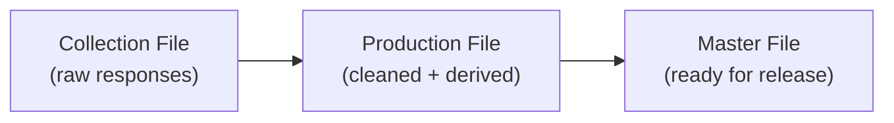
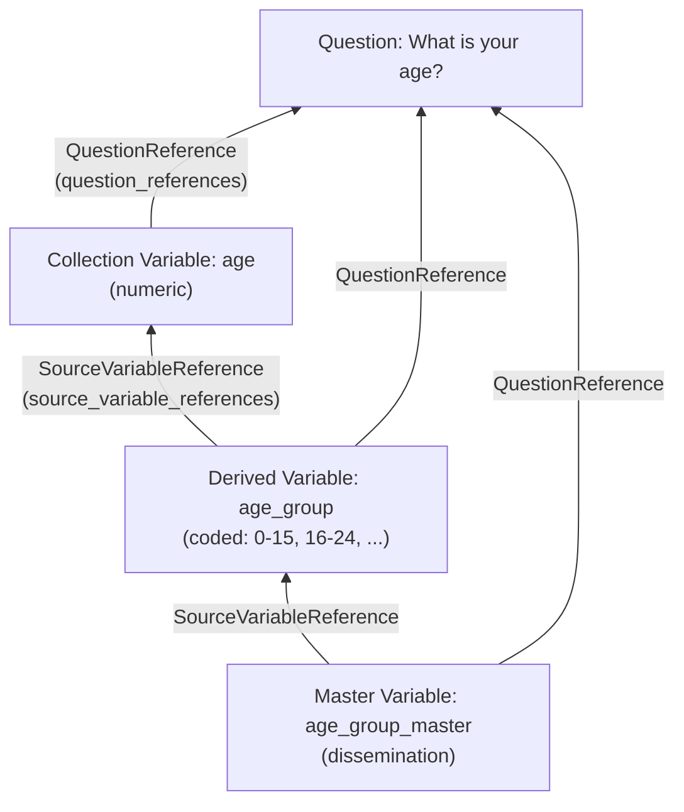

# Module 11: Document data files and variable lineage

!!! info "Learning objectives"
    By the end of this module, you can:

    - **O1.** Explain in two or three sentences how a collection file, a production file and a master file differ, and which variables each one holds.
    - **O2.** Choose a representation for a variable from its values, and set it with `set_numeric()`, `set_coded()` or `set_text()`.
    - **O3.** Link each collection variable to its source question with `doc.add_variable(..., question=...)`.
    - **O4.** Record a derived variable's sources in `source_variable_references`, whether it has one source or several.
    - **O5.** Trace a master-file variable back to its original question by following `source_variable_references` and `question_references` with `doc.find()`.

**Prerequisites:** [Module 10](module-10-questionnaire-flows.en.md).

**Time:** 60 min self-paced / 75 min instructor-led.

**New in this module:** `set_numeric()`, `set_text()`, `variable_representation`, `source_variable_references`, `question_references`, `doc.find()`.

---

## 1. What happens after data collection?

In Module 10 you built a questionnaire.
When respondents answer that questionnaire, the responses become **data files**.

But the raw data rarely goes straight to users.
It passes through stages:



Each stage has its own set of variables.
DDI lets you document every stage and track how each variable connects back to the others.
This is called **data lineage** or **provenance**.

## 2. The three data files

We will use the Health Survey from Module 10 as our running example.

!!! example "Three data files"

    **Collection file**: raw responses exactly as collected.

    | respondent_id | age | gender | employed | occupation | health_rating | smoker |
    |---|---|---|---|---|---|---|
    | R001 | 34 | Female | Yes | Teacher | Good | No |
    | R002 | 17 | Male | No | | Fair | No |
    | R003 | 68 | Female | No | | Excellent | Yes |

    **Production file**: cleaned data with both original and **derived** variables.

    | respondent_id | age | gender | employed | age_group | employment_status_code | health_score |
    |---|---|---|---|---|---|---|
    | R001 | 34 | 2 | 1 | 3 | 1 | 3 |
    | R002 | 17 | 1 | 0 | 2 | 0 | 2 |
    | R003 | 68 | 2 | 0 | 5 | 0 | 4 |

    **Master file**: only the final derived variables, ready for dissemination.

    | respondent_id | age_group | employment_status_code | health_score |
    |---|---|---|---|
    | R001 | 3 | 1 | 3 |
    | R002 | 2 | 0 | 2 |
    | R003 | 5 | 0 | 4 |

## 3. Set up the study

Start by creating the study and the questions from our Health Survey.

```python
import ddi_l as ddi
from ddi_l.models.logicalproduct import Category

doc = ddi.new_study(
    title="National Health Survey: Data Documentation",
    agency="health.gc.ca",
)

# Create the source questions
q_age = doc.add_question(text="What is your age?")
q_gender = doc.add_question(text="What is your gender?")
q_employed = doc.add_question(text="Are you currently employed?")
q_occupation = doc.add_question(text="What is your occupation?")
q_health = doc.add_question(text="How would you rate your general health?")
q_smoke = doc.add_question(text="Do you smoke?")
```

## 4. Build the collection variables

**Collection variables** capture exactly what was asked.
Each one has a **representation** (numeric, coded, or text) and a link back to its **source question**.

A representation tells users **what kind of values** the variable holds:

| The values are... | Call | Examples |
| --- | --- | --- |
| Numbers you can count or measure | `set_numeric()` | age, income, nights in hospital |
| One answer from a fixed set | `set_coded(code_list)` | gender, health rating, yes/no |
| Free words | `set_text()` | occupation, comments |

### Numeric variable: age

```python
v_age = doc.add_variable(name="age", question=q_age)
v_age.set_numeric("Integer", low=0, high=120)
```

The `question=` parameter automatically creates a `question_references` entry linking this variable to the question it came from.
`set_numeric()` records that the values are whole numbers (`"Integer"`) from 0 to 120.

### Coded variable: gender

For coded variables, you first create a code list (Module 9), then point the variable at it with `set_coded()`, which you met in Module 6.

```python
# Create the Gender code list
cl_gender = doc.add_code_list(name="Gender Codes")
doc.add_item(Category, name="Male")
doc.add_item(Category, name="Female")
doc.add_item(Category, name="Other")

v_gender = doc.add_variable(name="gender", question=q_gender)
v_gender.set_coded(cl_gender)
```

### Text variable: occupation

```python
v_occupation = doc.add_variable(name="occupation", question=q_occupation)
v_occupation.set_text()
```

### Check a representation

Each call fills the variable's `variable_representation`. It holds one kind of
representation (`numeric_representation`, `code_representation` or
`text_representation`), and the other two stay `None`:

```python
print(v_age.variable_representation.numeric_representation.numeric_type_code)
# -> Integer
print(v_occupation.variable_representation.text_representation is not None)
# -> True
```

### Build all collection variables

```python
v_employed = doc.add_variable(name="employed", question=q_employed)
v_health = doc.add_variable(name="health_rating", question=q_health)
v_smoke = doc.add_variable(name="smoker", question=q_smoke)

print(f"Collection variables: {len(doc.variables)}")
# -> Collection variables: 6
```

Every collection variable references its source question.
This is the first link in the provenance chain.

## 5. What is a derived variable?

A **derived variable** is computed from one or more existing variables.

Examples:

| Derived variable | Source variable(s) | Derivation |
| --- | --- | --- |
| `age_group` | `age` | Recode: 0-15→1, 16-24→2, 25-44→3, 45-64→4, 65+→5 |
| `employment_status_code` | `employed` | Recode: Yes→1, No→0 |
| `health_score` | `health_rating` | Recode: Excellent→4, Good→3, Fair→2, Poor→1 |

In DDI, you track this derivation with `source_variable_references`, a list of references pointing to the variables that were used to compute the derived value.

## 6. Create derived variables with source references

### Step 1: Create the age_group code list

```python
cl_age_group = doc.add_code_list(name="Age Group Codes")
doc.add_item(Category, name="0-15")
doc.add_item(Category, name="16-24")
doc.add_item(Category, name="25-44")
doc.add_item(Category, name="45-64")
doc.add_item(Category, name="65+")
```

### Step 2: Create the derived variable

```python
v_age_group = doc.add_variable(name="age_group", question=q_age)
v_age_group.set_coded(cl_age_group)
```

### Step 3: Link it to its source variable

The key field is `source_variable_references`.
It tells anyone reading the metadata: "This variable was derived from these other variables."
Build each reference with `.to_reference()`, as you did for constructs in Module 10:

```python
v_age_group.source_variable_references = [v_age.to_reference()]
```

Now `age_group` has two provenance links:

- **Question source**: points to "What is your age?" (set by `question=q_age`)
- **Variable source**: points to the collection variable `age` (set by `source_variable_references`)

## 7. Build all production variables

The production file has both the original collection variables **and** the derived variables.

```python
# Derived: employment_status_code from employed
v_emp_code = doc.add_variable(name="employment_status_code", question=q_employed)
v_emp_code.source_variable_references = [v_employed.to_reference()]

# Derived: health_score from health_rating
v_health_score = doc.add_variable(name="health_score", question=q_health)
v_health_score.source_variable_references = [v_health.to_reference()]

print(f"Total variables (collection + derived): {len(doc.variables)}")
# -> Total variables (collection + derived): 9
```

## 8. The provenance chain

Every variable in the production file can be traced back to:

1. **Its source question** → "What was asked?"
2. **Its source variable(s)** → "What data was it computed from?"

And every collection variable can be traced to:

1. **Its source question** → "What was asked?"

This creates a full **lineage chain**:



Reading from bottom to top, you can answer:

- "Where does `age_group_master` in the master file come from?" → From the production variable `age_group`.
- "Where does the production `age_group` come from?" → Derived from `age` in the collection file.
- "Where does `age` come from?" → From the question "What is your age?"

### Follow the chain in code

A reference stores the **identifier** of its target. `doc.find(identifier)`
returns the item that has that identifier, wherever it is in the document.
[Module 13](module-13-properties-find-validate.en.md) covers finding items in more
depth. Follow `age_group` back one step, then to its question:

```python
source = doc.find(v_age_group.source_variable_references[0].identifier)
print(source.names[0].text)  # -> age

question = doc.find(source.question_references[0].identifier)
print(question.question_texts[0].text)  # -> What is your age?
```

## 9. Build the master file variables

The master file contains only the derived variables that are ready for dissemination.
These reference the production-stage derived variables as their source.

```python
# Master file variables reference the production variables as source
v_master_age_group = doc.add_variable(name="age_group_master", question=q_age)
v_master_age_group.source_variable_references = [v_age_group.to_reference()]

v_master_emp = doc.add_variable(name="employment_status_master", question=q_employed)
v_master_emp.source_variable_references = [v_emp_code.to_reference()]

v_master_health = doc.add_variable(name="health_score_master", question=q_health)
v_master_health.source_variable_references = [v_health_score.to_reference()]

print(f"Total variables in document: {len(doc.variables)}")
# -> Total variables in document: 12
```

## 10. A variable with multiple sources

Some derived variables combine **more than one** source variable.
For example, a Body Mass Index (BMI) variable is derived from both `height` and `weight`.

```python
q_height = doc.add_question(text="What is your height in cm?")
q_weight = doc.add_question(text="What is your weight in kg?")

v_height = doc.add_variable(name="height_cm", question=q_height)
v_weight = doc.add_variable(name="weight_kg", question=q_weight)

v_bmi = doc.add_variable(name="bmi")
v_bmi.source_variable_references = [
    v_height.to_reference(),
    v_weight.to_reference(),
]

print(f"BMI sources: {len(v_bmi.source_variable_references)}")  # -> BMI sources: 2
```

The `source_variable_references` list contains **two** references.
Anyone reading this metadata knows that BMI depends on both height and weight.

## 11. Numeric to coded: the derivation pattern

A common pattern in data processing: a **numeric** collection variable becomes a **coded** production variable.

| Stage | Variable | Representation | Example values |
| --- | --- | --- | --- |
| Collection | `age` | Numeric (0-120) | 34, 17, 68 |
| Production | `age_group` | Coded (5 categories) | "25-44", "16-24", "65+" |

You documented this in three steps:

1. `v_age.set_numeric("Integer", low=0, high=120)` gives `age` a numeric representation.
2. `v_age_group.set_coded(cl_age_group)` gives `age_group` a code representation that points to the Age Group Codes list.
3. `v_age_group.source_variable_references` points to `age`.

The representation tells users **what kind of values** the variable holds.
The source reference tells them **where those values came from**.

## 12. The lineage model at a glance

| File | Variables | Each one points to |
| --- | --- | --- |
| Collection | `age`, `gender`, `employed`, `occupation`, `health_rating`, `smoker` | its question (`question_references`) |
| Production (derived) | `age_group`, `employment_status_code`, `health_score` | a collection variable (`source_variable_references`) |
| Master | `age_group_master`, `employment_status_master`, `health_score_master` | a production variable (`source_variable_references`) |

Every link is a `Reference`. Follow them from any master variable and you reach
the original question.

---

!!! example "Scenario"
    You are documenting the National Health Survey data pipeline.
    The collection file has 6 raw variables from the questionnaire.
    The production file adds 3 derived variables (age_group,
    employment_status_code, health_score).
    The master file has only the 3 derived variables for public release.
    Every variable must trace back to its source.

---

## Exercises

1. **(O1)** Look at the three tables in Section 2. In two or three sentences, explain how the collection, production and master files differ, and say which file a member of the public receives.

    ??? success "Answer"
        A sample answer: "The collection file holds the raw answers exactly as
        respondents gave them, such as `age` and `health_rating`. The
        production file keeps those cleaned variables and adds derived ones
        computed from them, such as `age_group` and `health_score`. The master
        file keeps only the derived variables that are ready for release, and
        it is the file the public receives."

2. **(O3)** Create a study for the Health Survey. Add 6 questions and 6 collection variables, each linked to its source question. Print the counts and the number of question references on `age`.

    **Expected output:**

    ```text
    Questions: 6
    Variables: 6
    age question references: 1
    ```

    ??? success "Answer"
        ```python
        import ddi_l as ddi
        from ddi_l.models.logicalproduct import Category

        doc = ddi.new_study(title="National Health Survey", agency="health.gc.ca")

        q_age = doc.add_question(text="What is your age?")
        q_gender = doc.add_question(text="What is your gender?")
        q_employed = doc.add_question(text="Are you currently employed?")
        q_occupation = doc.add_question(text="What is your occupation?")
        q_health = doc.add_question(text="How would you rate your general health?")
        q_smoke = doc.add_question(text="Do you smoke?")

        v_age = doc.add_variable(name="age", question=q_age)
        v_gender = doc.add_variable(name="gender", question=q_gender)
        v_employed = doc.add_variable(name="employed", question=q_employed)
        v_occupation = doc.add_variable(name="occupation", question=q_occupation)
        v_health = doc.add_variable(name="health_rating", question=q_health)
        v_smoke = doc.add_variable(name="smoker", question=q_smoke)

        print(f"Questions: {len(doc.questions)}")
        print(f"Variables: {len(doc.variables)}")
        print(f"age question references: {len(v_age.question_references)}")
        ```

3. **(O2)** Choose and set a representation for three of the collection variables: `age` holds whole numbers from 0 to 120, `gender` holds Male, Female or Other, and `occupation` holds free text. Then print a check for each one.

    **Expected output:**

    ```text
    age: Integer
    gender is coded: True
    occupation is text: True
    ```

    ??? success "Answer"
        ```python
        v_age.set_numeric("Integer", low=0, high=120)

        cl_gender = doc.add_code_list(name="Gender Codes")
        for name in ("Male", "Female", "Other"):
            doc.add_item(Category, name=name)
        v_gender.set_coded(cl_gender)

        v_occupation.set_text()

        rep = v_age.variable_representation
        print(f"age: {rep.numeric_representation.numeric_type_code}")
        rep = v_gender.variable_representation
        print(f"gender is coded: {rep.code_representation is not None}")
        rep = v_occupation.variable_representation
        print(f"occupation is text: {rep.text_representation is not None}")
        ```

        `gender` gets a code list because its answers come from a fixed set.
        `occupation` is text because any job title is possible.

4. **(O4)** Create the three production variables. `age_group` is coded with an "Age Group Codes" list (0-15, 16-24, 25-44, 45-64, 65+) and derived from `age`. `employment_status_code` is derived from `employed`, and `health_score` from `health_rating`. Record each source in `source_variable_references`. Print the total.

    **Expected output:**

    ```text
    Variables: 9
    ```

    ??? success "Answer"
        ```python
        cl_age_group = doc.add_code_list(name="Age Group Codes")
        for group in ("0-15", "16-24", "25-44", "45-64", "65+"):
            doc.add_item(Category, name=group)

        v_age_group = doc.add_variable(name="age_group", question=q_age)
        v_age_group.set_coded(cl_age_group)
        v_age_group.source_variable_references = [v_age.to_reference()]

        v_emp_code = doc.add_variable(name="employment_status_code", question=q_employed)
        v_emp_code.source_variable_references = [v_employed.to_reference()]

        v_health_score = doc.add_variable(name="health_score", question=q_health)
        v_health_score.source_variable_references = [v_health.to_reference()]

        print(f"Variables: {len(doc.variables)}")
        ```

5. **(O4)** Create 3 master file variables (`age_group_master`, `employment_status_master`, `health_score_master`). Each should reference its production-stage derived variable as its source. Print the total, then print every variable that has a source.

    **Expected output:**

    ```text
    Variables: 12
      age_group: 1 source(s)
      employment_status_code: 1 source(s)
      health_score: 1 source(s)
      age_group_master: 1 source(s)
      employment_status_master: 1 source(s)
      health_score_master: 1 source(s)
    ```

    ??? success "Answer"
        ```python
        v_master_ag = doc.add_variable(name="age_group_master", question=q_age)
        v_master_ag.source_variable_references = [v_age_group.to_reference()]

        v_master_emp = doc.add_variable(name="employment_status_master", question=q_employed)
        v_master_emp.source_variable_references = [v_emp_code.to_reference()]

        v_master_hs = doc.add_variable(name="health_score_master", question=q_health)
        v_master_hs.source_variable_references = [v_health_score.to_reference()]

        print(f"Variables: {len(doc.variables)}")

        for v in doc.variables:
            sources = len(v.source_variable_references)
            if sources > 0:
                print(f"  {v.names[0].text}: {sources} source(s)")
        ```

6. **(O4)** Create a BMI variable derived from two sources, `height_cm` and `weight_kg`. Print how many source references it has.

    **Expected output:**

    ```text
    BMI sources: 2
    ```

    ??? success "Answer"
        ```python
        v_height = doc.add_variable(name="height_cm")
        v_weight = doc.add_variable(name="weight_kg")

        v_bmi = doc.add_variable(name="bmi")
        v_bmi.source_variable_references = [
            v_height.to_reference(),
            v_weight.to_reference(),
        ]

        print(f"BMI sources: {len(v_bmi.source_variable_references)}")
        ```

7. **(O5)** Trace `health_score_master` back to its question. Start at that variable, print its name, and follow its first source reference with `doc.find()` until you reach a variable with no source. Then print the text of that variable's question.

    **Expected output:**

    ```text
    health_score_master
    health_score
    health_rating
    How would you rate your general health?
    ```

    ??? success "Answer"
        ```python
        current = v_master_hs
        print(current.names[0].text)
        while current.source_variable_references:
            current = doc.find(current.source_variable_references[0].identifier)
            print(current.names[0].text)

        question = doc.find(current.question_references[0].identifier)
        print(question.question_texts[0].text)
        ```

        The loop stops at `health_rating`, the collection variable. Only its
        question link is left to follow.

---

## Quiz

???+ question "Question 1 (O1): Which file is this?"
    A file holds only `respondent_id`, `age_group`, `employment_status_code`
    and `health_score`, and it is ready for public release. Which file is it?

    **A.** The collection file.

    **B.** The production file.

    **C.** The questionnaire.

    **D.** The master file.

    ??? success "Answer"
        **D.** The master file keeps only the final derived variables, ready
        for dissemination. The production file would also hold `age`,
        `gender` and `employed`.

???+ question "Question 2 (O2): Which call fits this variable?"
    A variable records how many nights a person spent in hospital last year,
    from 0 to 365. Which call sets the right representation?

    **A.** `v.set_numeric("Integer", low=0, high=365)`

    **B.** `v.set_text()`

    **C.** `v.set_coded(cl_nights)`, with one category for each possible number

    **D.** None: a count needs no representation.

    ??? success "Answer"
        **A.** The values are whole numbers you can add and average, so the
        representation is numeric, with the valid range. A code list of 366
        categories would hide that, and text would allow "three" or "a few".

???+ question "Question 3 (O3): How do you record that `smoker` came from `q_smoke`?"
    A script creates the variable with `v_smoke = doc.add_variable(name="smoker")`.
    Which change records that its values answer the question `q_smoke`?

    **A.** `v_smoke.source_variable_references = [q_smoke.to_reference()]`

    **B.** Create it with `doc.add_variable(name="smoker", question=q_smoke)`.

    **C.** `v_smoke.set_coded(q_smoke)`

    **D.** `v_smoke.names.append(q_smoke)`

    ??? success "Answer"
        **B.** The `question=` parameter adds the link to `question_references`.
        `source_variable_references` is for source **variables**, not
        questions.

???+ question "Question 4 (O4): A BMI variable is computed from height and weight. How many source_variable_references does it have?"
    **A.** 0

    **B.** 1

    **C.** 2

    **D.** 3

    ??? success "Answer"
        **C.** BMI has 2 source variable references, one for height
        and one for weight, because it is derived from both.

???+ question "Question 5 (O4): What does source_variable_references track?"
    **A.** Which questions a variable came from.

    **B.** Which other variables a derived variable was computed from.

    **C.** Which code list a variable uses.

    **D.** Which data file a variable belongs to.

    ??? success "Answer"
        **B.** `source_variable_references` is a list of references pointing to
        the variables that were used to compute a derived variable. Questions
        go in `question_references`, and the code list in the representation.

???+ question "Question 6 (O5): What does this code print?"
    `v_master_hs` is `health_score_master` from Exercise 5.

    ```python
    current = v_master_hs
    while current.source_variable_references:
        current = doc.find(current.source_variable_references[0].identifier)
    print(current.names[0].text)
    ```

    **A.** `health_rating`

    **B.** `health_score`

    **C.** `health_score_master`

    **D.** `How would you rate your general health?`

    ??? success "Answer"
        **A.** The loop follows `health_score_master` → `health_score` →
        `health_rating`, and stops there because `health_rating` has no source
        variable. It prints a variable name; the question text needs one more
        step through `question_references`.

---

## Check yourself

- [ ] I can explain in two or three sentences how the collection, production and master files differ. (O1)
- [ ] I can choose a representation for a variable and set it with `set_numeric()`, `set_coded()` or `set_text()`. (O2)
- [ ] I can link each collection variable to its source question with `question=`. (O3)
- [ ] I can record a derived variable's sources in `source_variable_references`, for one source or several. (O4)
- [ ] I can trace a master-file variable back to its question with `doc.find()`. (O5)

---

!!! tip "Instructor notes"
    - Start with the analogy: "Think of a recipe. The collection file is the raw ingredients. The production file is the cooking process. The master file is the plated dish. Provenance is the recipe that tells you where every ingredient came from."
    - Draw the three-file pipeline on the whiteboard. For each variable, draw an arrow back to its source. Ask: "Can you trace this master variable back to the original question?" Exercise 7 does the same in code.
    - The concept of `source_variable_references` vs `question_references` can be confusing. Clarify: `question_references` says "what was asked." `source_variable_references` says "what data was used to compute this." Quiz questions 3 and 5 check the difference.
    - The numeric-to-coded pattern (age → age_group) is the most common derivation in national surveys. Show a real recoding table: "age 0-15 = group 1, 16-24 = group 2, ..."
    - For staff of national statistical offices (NSOs): emphasize that this lineage is what auditors and researchers look for. "If someone questions a number in your publication, can you trace it back to the original data?"
    - Exercise 6 (BMI from two sources) teaches multi-source derivation. This is common: BMI = weight / height², household income = sum of member incomes, etc.

---

**See also:** [Module 10: Questionnaire flows](module-10-questionnaire-flows.en.md) | [User guide: Add variables](../user-guide.en.md#add-variables)
