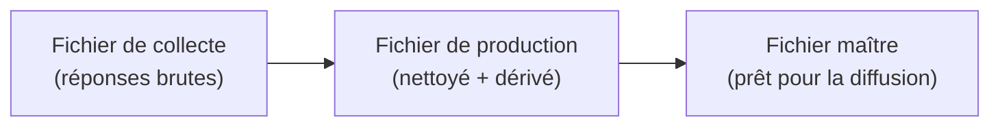
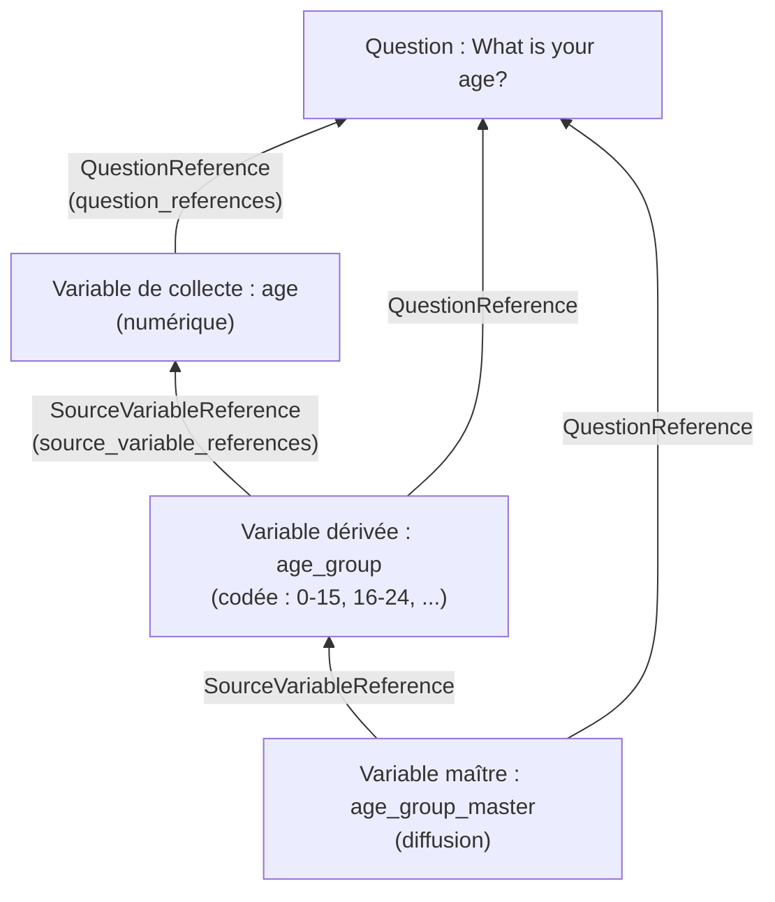

# Module 11 : Documenter les fichiers de données et la traçabilité des variables

!!! info "Objectifs d'apprentissage"
    À la fin de ce module, vous pouvez :

    - **O1.** Expliquer en deux ou trois phrases en quoi un fichier de collecte, un fichier de production et un fichier maître diffèrent, et quelles variables chacun contient.
    - **O2.** Choisir une représentation pour une variable d'après ses valeurs, et la définir avec `set_numeric()`, `set_coded()` ou `set_text()`.
    - **O3.** Lier chaque variable de collecte à sa question source avec `doc.add_variable(..., question=...)`.
    - **O4.** Enregistrer les sources d'une variable dérivée dans `source_variable_references`, qu'elle ait une source ou plusieurs.
    - **O5.** Retracer une variable du fichier maître jusqu'à sa question d'origine en suivant `source_variable_references` et `question_references` avec `doc.find()`.

**Prérequis :** [Module 10](module-10-questionnaire-flows.fr.md).

**Durée :** 60 min en autonomie / 75 min avec instructeur.

**Nouveau dans ce module :** `set_numeric()`, `set_text()`, `variable_representation`, `source_variable_references`, `question_references`, `doc.find()`.

---

## 1. Que se passe-t-il après la collecte ?

Dans le module 10, vous avez construit un questionnaire.
Quand les répondants répondent à ce questionnaire, les réponses deviennent des **fichiers de données**.

Mais les données brutes vont rarement directement aux utilisateurs.
Elles passent par des étapes :



Chaque étape a son propre ensemble de variables.
DDI permet de documenter chaque étape et de suivre comment chaque variable se connecte aux autres.
C'est ce qu'on appelle la **traçabilité des données** ou la **provenance**.

## 2. Les trois fichiers de données

Nous utiliserons l'enquête sur la santé du module 10 comme exemple.

!!! example "Trois fichiers de données"

    **Fichier de collecte** : réponses brutes exactement comme collectées.

    | respondent_id | age | gender | employed | occupation | health_rating | smoker |
    |---|---|---|---|---|---|---|
    | R001 | 34 | Female | Yes | Teacher | Good | No |
    | R002 | 17 | Male | No | | Fair | No |
    | R003 | 68 | Female | No | | Excellent | Yes |

    **Fichier de production** : données nettoyées avec les variables originales et **dérivées**.

    | respondent_id | age | gender | employed | age_group | employment_status_code | health_score |
    |---|---|---|---|---|---|---|
    | R001 | 34 | 2 | 1 | 3 | 1 | 3 |
    | R002 | 17 | 1 | 0 | 2 | 0 | 2 |
    | R003 | 68 | 2 | 0 | 5 | 0 | 4 |

    **Fichier maître** : seulement les variables dérivées finales, prêtes pour la diffusion.

    | respondent_id | age_group | employment_status_code | health_score |
    |---|---|---|---|
    | R001 | 3 | 1 | 3 |
    | R002 | 2 | 0 | 2 |
    | R003 | 5 | 0 | 4 |

## 3. Préparer l'étude

Commencez par créer l'étude et les questions de notre enquête sur la santé.

```python
import ddi_l as ddi
from ddi_l.models.logicalproduct import Category

doc = ddi.new_study(
    title="National Health Survey: Data Documentation",
    agency="health.gc.ca",
)

# Créer les questions sources
q_age = doc.add_question(text="What is your age?")
q_gender = doc.add_question(text="What is your gender?")
q_employed = doc.add_question(text="Are you currently employed?")
q_occupation = doc.add_question(text="What is your occupation?")
q_health = doc.add_question(text="How would you rate your general health?")
q_smoke = doc.add_question(text="Do you smoke?")
```

## 4. Construire les variables de collecte

Les **variables de collecte** capturent exactement ce qui a été demandé.
Chacune a une **représentation** (numérique, codée ou texte) et un lien vers sa **question source**.

Une représentation indique aux utilisateurs **quel type de valeurs** la variable contient :

| Les valeurs sont... | Appel | Exemples |
| --- | --- | --- |
| Des nombres qu'on compte ou mesure | `set_numeric()` | âge, revenu, nuits à l'hôpital |
| Une réponse parmi un ensemble fixe | `set_coded(code_list)` | genre, état de santé, oui/non |
| Des mots libres | `set_text()` | profession, commentaires |

### Variable numérique : age

```python
v_age = doc.add_variable(name="age", question=q_age)
v_age.set_numeric("Integer", low=0, high=120)
```

Le paramètre `question=` crée automatiquement une entrée `question_references` qui lie cette variable à la question dont elle provient.
`set_numeric()` enregistre que les valeurs sont des nombres entiers (`"Integer"`) de 0 à 120.

### Variable codée : gender

Pour les variables codées, vous créez d'abord une liste de codes (module 9), puis vous pointez la variable vers elle avec `set_coded()`, que vous avez vu au module 6.

```python
# Créer la liste de codes Genre
cl_gender = doc.add_code_list(name="Gender Codes")
doc.add_item(Category, name="Male")
doc.add_item(Category, name="Female")
doc.add_item(Category, name="Other")

v_gender = doc.add_variable(name="gender", question=q_gender)
v_gender.set_coded(cl_gender)
```

### Variable texte : occupation

```python
v_occupation = doc.add_variable(name="occupation", question=q_occupation)
v_occupation.set_text()
```

### Vérifier une représentation

Chaque appel remplit la `variable_representation` de la variable. Elle contient
un seul type de représentation (`numeric_representation`,
`code_representation` ou `text_representation`), et les deux autres restent
`None` :

```python
print(v_age.variable_representation.numeric_representation.numeric_type_code)
# -> Integer
print(v_occupation.variable_representation.text_representation is not None)
# -> True
```

### Construire toutes les variables de collecte

```python
v_employed = doc.add_variable(name="employed", question=q_employed)
v_health = doc.add_variable(name="health_rating", question=q_health)
v_smoke = doc.add_variable(name="smoker", question=q_smoke)

print(f"Collection variables: {len(doc.variables)}")
# -> Collection variables: 6
```

Chaque variable de collecte référence sa question source.
C'est le premier maillon de la chaîne de provenance.

## 5. Qu'est-ce qu'une variable dérivée ?

Une **variable dérivée** est calculée à partir d'une ou plusieurs variables existantes.

Exemples :

| Variable dérivée | Variable(s) source | Dérivation |
| --- | --- | --- |
| `age_group` | `age` | Recodage : 0-15→1, 16-24→2, 25-44→3, 45-64→4, 65+→5 |
| `employment_status_code` | `employed` | Recodage : Yes→1, No→0 |
| `health_score` | `health_rating` | Recodage : Excellent→4, Good→3, Fair→2, Poor→1 |

En DDI, vous suivez cette dérivation avec `source_variable_references`, une liste de références pointant vers les variables utilisées pour calculer la valeur dérivée.

## 6. Créer des variables dérivées avec des références source

### Étape 1 : Créer la liste de codes des groupes d'âge

```python
cl_age_group = doc.add_code_list(name="Age Group Codes")
doc.add_item(Category, name="0-15")
doc.add_item(Category, name="16-24")
doc.add_item(Category, name="25-44")
doc.add_item(Category, name="45-64")
doc.add_item(Category, name="65+")
```

### Étape 2 : Créer la variable dérivée

```python
v_age_group = doc.add_variable(name="age_group", question=q_age)
v_age_group.set_coded(cl_age_group)
```

### Étape 3 : Lier à sa variable source

Le champ clé est `source_variable_references`.
Il dit à quiconque lit les métadonnées : « Cette variable a été dérivée de ces autres variables. »
Construisez chaque référence avec `.to_reference()`, comme pour les constructions au module 10 :

```python
v_age_group.source_variable_references = [v_age.to_reference()]
```

Maintenant `age_group` a deux liens de provenance :

- **Question source** : pointe vers « What is your age? » (défini par `question=q_age`)
- **Variable source** : pointe vers la variable de collecte `age` (défini par `source_variable_references`)

## 7. Construire toutes les variables de production

Le fichier de production a à la fois les variables de collecte originales **et** les variables dérivées.

```python
# Dérivée : employment_status_code depuis employed
v_emp_code = doc.add_variable(name="employment_status_code", question=q_employed)
v_emp_code.source_variable_references = [v_employed.to_reference()]

# Dérivée : health_score depuis health_rating
v_health_score = doc.add_variable(name="health_score", question=q_health)
v_health_score.source_variable_references = [v_health.to_reference()]

print(f"Total variables (collection + derived): {len(doc.variables)}")
# -> Total variables (collection + derived): 9
```

## 8. La chaîne de provenance

Chaque variable du fichier de production peut être retracée jusqu'à :

1. **Sa question source** → « Qu'est-ce qui a été demandé ? »
2. **Sa ou ses variable(s) source** → « À partir de quelles données a-t-elle été calculée ? »

Et chaque variable de collecte peut être retracée jusqu'à :

1. **Sa question source** → « Qu'est-ce qui a été demandé ? »

Cela crée une **chaîne de traçabilité** complète :



En lisant de bas en haut, vous pouvez répondre :

- « D'où vient `age_group_master` dans le fichier maître ? » → De la variable de production `age_group`.
- « D'où vient le `age_group` de production ? » → Dérivée de `age` dans le fichier de collecte.
- « D'où vient `age` ? » → De la question « What is your age? »

### Suivre la chaîne dans le code

Une référence stocke l'**identifiant** de sa cible. `doc.find(identifier)`
renvoie l'élément qui porte cet identifiant, où qu'il soit dans le document.
Le [module 13](module-13-properties-find-validate.fr.md) approfondit la recherche
d'éléments. Remontez `age_group` d'une étape, puis jusqu'à sa question :

```python
source = doc.find(v_age_group.source_variable_references[0].identifier)
print(source.names[0].text)  # -> age

question = doc.find(source.question_references[0].identifier)
print(question.question_texts[0].text)  # -> What is your age?
```

## 9. Construire les variables du fichier maître

Le fichier maître contient seulement les variables dérivées prêtes pour la diffusion.
Celles-ci référencent les variables dérivées de l'étape de production comme leur source.

```python
# Les variables du fichier maître référencent les variables de production
v_master_age_group = doc.add_variable(name="age_group_master", question=q_age)
v_master_age_group.source_variable_references = [v_age_group.to_reference()]

v_master_emp = doc.add_variable(name="employment_status_master", question=q_employed)
v_master_emp.source_variable_references = [v_emp_code.to_reference()]

v_master_health = doc.add_variable(name="health_score_master", question=q_health)
v_master_health.source_variable_references = [v_health_score.to_reference()]

print(f"Total variables in document: {len(doc.variables)}")
# -> Total variables in document: 12
```

## 10. Une variable avec plusieurs sources

Certaines variables dérivées combinent **plus d'une** variable source.
Par exemple, un indice de masse corporelle (IMC) est dérivé à la fois de la `taille` et du `poids`.

```python
q_height = doc.add_question(text="What is your height in cm?")
q_weight = doc.add_question(text="What is your weight in kg?")

v_height = doc.add_variable(name="height_cm", question=q_height)
v_weight = doc.add_variable(name="weight_kg", question=q_weight)

v_bmi = doc.add_variable(name="bmi")
v_bmi.source_variable_references = [
    v_height.to_reference(),
    v_weight.to_reference(),
]

print(f"BMI sources: {len(v_bmi.source_variable_references)}")  # -> BMI sources: 2
```

La liste `source_variable_references` contient **deux** références.
Quiconque lit ces métadonnées sait que l'IMC dépend à la fois de la taille et du poids.

## 11. Du numérique au codé : le patron de dérivation

Un patron courant en traitement de données : une variable de collecte **numérique** devient une variable de production **codée**.

| Étape | Variable | Représentation | Valeurs exemples |
| --- | --- | --- | --- |
| Collecte | `age` | Numérique (0-120) | 34, 17, 68 |
| Production | `age_group` | Codée (5 catégories) | « 25-44 », « 16-24 », « 65+ » |

Vous l'avez documenté en trois étapes :

1. `v_age.set_numeric("Integer", low=0, high=120)` donne à `age` une représentation numérique.
2. `v_age_group.set_coded(cl_age_group)` donne à `age_group` une représentation codée qui pointe vers la liste Age Group Codes.
3. `v_age_group.source_variable_references` pointe vers `age`.

La représentation indique aux utilisateurs **quel type de valeurs** la variable contient.
La référence source leur dit **d'où viennent ces valeurs**.

## 12. Le modèle de traçabilité en un coup d'œil

| Fichier | Variables | Chacune pointe vers |
| --- | --- | --- |
| Collecte | `age`, `gender`, `employed`, `occupation`, `health_rating`, `smoker` | sa question (`question_references`) |
| Production (dérivées) | `age_group`, `employment_status_code`, `health_score` | une variable de collecte (`source_variable_references`) |
| Maître | `age_group_master`, `employment_status_master`, `health_score_master` | une variable de production (`source_variable_references`) |

Chaque lien est une `Reference`. Suivez-les depuis n'importe quelle variable
maître et vous arrivez à la question d'origine.

---

!!! example "Scénario"
    Vous documentez le pipeline de données de l'enquête nationale sur la santé.
    Le fichier de collecte a 6 variables brutes du questionnaire.
    Le fichier de production ajoute 3 variables dérivées (age_group,
    employment_status_code, health_score).
    Le fichier maître a seulement les 3 variables dérivées pour la diffusion publique.
    Chaque variable doit être traçable jusqu'à sa source.

---

## Exercices

1. **(O1)** Regardez les trois tableaux de la section 2. En deux ou trois phrases, expliquez en quoi les fichiers de collecte, de production et maître diffèrent, et dites quel fichier reçoit un membre du public.

    ??? success "Réponse"
        Une réponse possible : « Le fichier de collecte contient les réponses
        brutes telles que les répondants les ont données, comme `age` et
        `health_rating`. Le fichier de production garde ces variables
        nettoyées et ajoute des variables dérivées calculées à partir d'elles,
        comme `age_group` et `health_score`. Le fichier maître ne garde que
        les variables dérivées prêtes pour la diffusion, et c'est lui que
        reçoit le public. »

2. **(O3)** Créez une étude pour l'enquête sur la santé. Ajoutez 6 questions et 6 variables de collecte, chacune liée à sa question source. Affichez les compteurs et le nombre de références de question de `age`.

    **Résultat attendu :**

    ```text
    Questions: 6
    Variables: 6
    age question references: 1
    ```

    ??? success "Réponse"
        ```python
        import ddi_l as ddi
        from ddi_l.models.logicalproduct import Category

        doc = ddi.new_study(title="National Health Survey", agency="health.gc.ca")

        q_age = doc.add_question(text="What is your age?")
        q_gender = doc.add_question(text="What is your gender?")
        q_employed = doc.add_question(text="Are you currently employed?")
        q_occupation = doc.add_question(text="What is your occupation?")
        q_health = doc.add_question(text="How would you rate your general health?")
        q_smoke = doc.add_question(text="Do you smoke?")

        v_age = doc.add_variable(name="age", question=q_age)
        v_gender = doc.add_variable(name="gender", question=q_gender)
        v_employed = doc.add_variable(name="employed", question=q_employed)
        v_occupation = doc.add_variable(name="occupation", question=q_occupation)
        v_health = doc.add_variable(name="health_rating", question=q_health)
        v_smoke = doc.add_variable(name="smoker", question=q_smoke)

        print(f"Questions: {len(doc.questions)}")
        print(f"Variables: {len(doc.variables)}")
        print(f"age question references: {len(v_age.question_references)}")
        ```

3. **(O2)** Choisissez et définissez une représentation pour trois des variables de collecte : `age` contient des nombres entiers de 0 à 120, `gender` contient Male, Female ou Other, et `occupation` contient du texte libre. Puis affichez une vérification pour chacune.

    **Résultat attendu :**

    ```text
    age: Integer
    gender is coded: True
    occupation is text: True
    ```

    ??? success "Réponse"
        ```python
        v_age.set_numeric("Integer", low=0, high=120)

        cl_gender = doc.add_code_list(name="Gender Codes")
        for name in ("Male", "Female", "Other"):
            doc.add_item(Category, name=name)
        v_gender.set_coded(cl_gender)

        v_occupation.set_text()

        rep = v_age.variable_representation
        print(f"age: {rep.numeric_representation.numeric_type_code}")
        rep = v_gender.variable_representation
        print(f"gender is coded: {rep.code_representation is not None}")
        rep = v_occupation.variable_representation
        print(f"occupation is text: {rep.text_representation is not None}")
        ```

        `gender` reçoit une liste de codes car ses réponses viennent d'un
        ensemble fixe. `occupation` est du texte car n'importe quel titre
        d'emploi est possible.

4. **(O4)** Créez les trois variables de production. `age_group` est codée avec une liste « Age Group Codes » (0-15, 16-24, 25-44, 45-64, 65+) et dérivée de `age`. `employment_status_code` est dérivée de `employed`, et `health_score` de `health_rating`. Enregistrez chaque source dans `source_variable_references`. Affichez le total.

    **Résultat attendu :**

    ```text
    Variables: 9
    ```

    ??? success "Réponse"
        ```python
        cl_age_group = doc.add_code_list(name="Age Group Codes")
        for group in ("0-15", "16-24", "25-44", "45-64", "65+"):
            doc.add_item(Category, name=group)

        v_age_group = doc.add_variable(name="age_group", question=q_age)
        v_age_group.set_coded(cl_age_group)
        v_age_group.source_variable_references = [v_age.to_reference()]

        v_emp_code = doc.add_variable(name="employment_status_code", question=q_employed)
        v_emp_code.source_variable_references = [v_employed.to_reference()]

        v_health_score = doc.add_variable(name="health_score", question=q_health)
        v_health_score.source_variable_references = [v_health.to_reference()]

        print(f"Variables: {len(doc.variables)}")
        ```

5. **(O4)** Créez 3 variables du fichier maître (`age_group_master`, `employment_status_master`, `health_score_master`). Chacune doit référencer sa variable dérivée de production comme source. Affichez le total, puis chaque variable qui a une source.

    **Résultat attendu :**

    ```text
    Variables: 12
      age_group: 1 source(s)
      employment_status_code: 1 source(s)
      health_score: 1 source(s)
      age_group_master: 1 source(s)
      employment_status_master: 1 source(s)
      health_score_master: 1 source(s)
    ```

    ??? success "Réponse"
        ```python
        v_master_ag = doc.add_variable(name="age_group_master", question=q_age)
        v_master_ag.source_variable_references = [v_age_group.to_reference()]

        v_master_emp = doc.add_variable(name="employment_status_master", question=q_employed)
        v_master_emp.source_variable_references = [v_emp_code.to_reference()]

        v_master_hs = doc.add_variable(name="health_score_master", question=q_health)
        v_master_hs.source_variable_references = [v_health_score.to_reference()]

        print(f"Variables: {len(doc.variables)}")

        for v in doc.variables:
            sources = len(v.source_variable_references)
            if sources > 0:
                print(f"  {v.names[0].text}: {sources} source(s)")
        ```

6. **(O4)** Créez une variable IMC dérivée de deux sources, `height_cm` et `weight_kg`. Affichez combien de références source elle a.

    **Résultat attendu :**

    ```text
    BMI sources: 2
    ```

    ??? success "Réponse"
        ```python
        v_height = doc.add_variable(name="height_cm")
        v_weight = doc.add_variable(name="weight_kg")

        v_bmi = doc.add_variable(name="bmi")
        v_bmi.source_variable_references = [
            v_height.to_reference(),
            v_weight.to_reference(),
        ]

        print(f"BMI sources: {len(v_bmi.source_variable_references)}")
        ```

7. **(O5)** Retracez `health_score_master` jusqu'à sa question. Partez de cette variable, affichez son nom, et suivez sa première référence source avec `doc.find()` jusqu'à une variable sans source. Affichez ensuite le texte de la question de cette variable.

    **Résultat attendu :**

    ```text
    health_score_master
    health_score
    health_rating
    How would you rate your general health?
    ```

    ??? success "Réponse"
        ```python
        current = v_master_hs
        print(current.names[0].text)
        while current.source_variable_references:
            current = doc.find(current.source_variable_references[0].identifier)
            print(current.names[0].text)

        question = doc.find(current.question_references[0].identifier)
        print(question.question_texts[0].text)
        ```

        La boucle s'arrête à `health_rating`, la variable de collecte. Il ne
        reste que son lien de question à suivre.

---

## Quiz

???+ question "Question 1 (O1) : De quel fichier s'agit-il ?"
    Un fichier contient seulement `respondent_id`, `age_group`,
    `employment_status_code` et `health_score`, et il est prêt pour la
    diffusion publique. De quel fichier s'agit-il ?

    **A.** Le fichier de collecte.

    **B.** Le fichier de production.

    **C.** Le questionnaire.

    **D.** Le fichier maître.

    ??? success "Réponse"
        **D.** Le fichier maître ne garde que les variables dérivées finales,
        prêtes pour la diffusion. Le fichier de production contiendrait aussi
        `age`, `gender` et `employed`.

???+ question "Question 2 (O2) : Quel appel convient à cette variable ?"
    Une variable enregistre combien de nuits une personne a passées à
    l'hôpital l'an dernier, de 0 à 365. Quel appel définit la bonne
    représentation ?

    **A.** `v.set_numeric("Integer", low=0, high=365)`

    **B.** `v.set_text()`

    **C.** `v.set_coded(cl_nights)`, avec une catégorie pour chaque nombre possible

    **D.** Aucun : un compte n'a pas besoin de représentation.

    ??? success "Réponse"
        **A.** Les valeurs sont des nombres entiers qu'on peut additionner et
        dont on peut faire la moyenne : la représentation est donc numérique,
        avec l'intervalle valide. Une liste de 366 catégories masquerait cela,
        et du texte permettrait « trois » ou « quelques-unes ».

???+ question "Question 3 (O3) : Comment enregistrer que `smoker` provient de `q_smoke` ?"
    Un script crée la variable avec `v_smoke = doc.add_variable(name="smoker")`.
    Quelle modification enregistre que ses valeurs répondent à la question
    `q_smoke` ?

    **A.** `v_smoke.source_variable_references = [q_smoke.to_reference()]`

    **B.** La créer avec `doc.add_variable(name="smoker", question=q_smoke)`.

    **C.** `v_smoke.set_coded(q_smoke)`

    **D.** `v_smoke.names.append(q_smoke)`

    ??? success "Réponse"
        **B.** Le paramètre `question=` ajoute le lien à `question_references`.
        `source_variable_references` sert aux **variables** sources, pas aux
        questions.

???+ question "Question 4 (O4) : Une variable IMC est calculée à partir de la taille et du poids. Combien de source_variable_references a-t-elle ?"
    **A.** 0

    **B.** 1

    **C.** 2

    **D.** 3

    ??? success "Réponse"
        **C.** L'IMC a 2 références de variables sources, une pour
        la taille et une pour le poids, car il est dérivé des deux.

???+ question "Question 5 (O4) : Que suit source_variable_references ?"
    **A.** De quelles questions provient une variable.

    **B.** De quelles autres variables une variable dérivée a été calculée.

    **C.** Quelle liste de codes une variable utilise.

    **D.** À quel fichier de données une variable appartient.

    ??? success "Réponse"
        **B.** `source_variable_references` est une liste de références
        pointant vers les variables utilisées pour calculer une variable
        dérivée. Les questions vont dans `question_references`, et la liste de
        codes dans la représentation.

???+ question "Question 6 (O5) : Qu'affiche ce code ?"
    `v_master_hs` est la variable `health_score_master` de l'exercice 5.

    ```python
    current = v_master_hs
    while current.source_variable_references:
        current = doc.find(current.source_variable_references[0].identifier)
    print(current.names[0].text)
    ```

    **A.** `health_rating`

    **B.** `health_score`

    **C.** `health_score_master`

    **D.** `How would you rate your general health?`

    ??? success "Réponse"
        **A.** La boucle suit `health_score_master` → `health_score` →
        `health_rating`, et s'arrête là car `health_rating` n'a pas de variable
        source. Elle affiche un nom de variable ; le texte de la question
        demande une étape de plus par `question_references`.

---

## Faites le point

- [ ] Je peux expliquer en deux ou trois phrases en quoi les fichiers de collecte, de production et maître diffèrent. (O1)
- [ ] Je peux choisir une représentation pour une variable et la définir avec `set_numeric()`, `set_coded()` ou `set_text()`. (O2)
- [ ] Je peux lier chaque variable de collecte à sa question source avec `question=`. (O3)
- [ ] Je peux enregistrer les sources d'une variable dérivée dans `source_variable_references`, pour une source ou plusieurs. (O4)
- [ ] Je peux retracer une variable du fichier maître jusqu'à sa question avec `doc.find()`. (O5)

---

!!! tip "Notes pour l'instructeur"
    - Commencez avec l'analogie : « Pensez à une recette. Le fichier de collecte, ce sont les ingrédients bruts. Le fichier de production, c'est la cuisson. Le fichier maître, c'est le plat servi. La provenance, c'est la recette qui vous dit d'où vient chaque ingrédient. »
    - Dessinez le pipeline à trois fichiers au tableau. Pour chaque variable, dessinez une flèche vers sa source. Demandez : « Pouvez-vous retracer cette variable maître jusqu'à la question originale ? » L'exercice 7 fait la même chose dans le code.
    - Le concept de `source_variable_references` vs `question_references` peut être déroutant. Clarifiez : `question_references` dit « qu'est-ce qui a été demandé ». `source_variable_references` dit « quelles données ont été utilisées pour calculer ceci ». Les questions 3 et 5 du quiz vérifient la différence.
    - Le patron numérique-vers-codé (age → age_group) est la dérivation la plus courante dans les enquêtes nationales. Montrez une table de recodage réelle : « âge 0-15 = groupe 1, 16-24 = groupe 2, ... »
    - Pour le personnel des instituts nationaux de statistique (INS) : soulignez que cette traçabilité est ce que les auditeurs et chercheurs recherchent. « Si quelqu'un questionne un chiffre dans votre publication, pouvez-vous le retracer jusqu'aux données originales ? »
    - L'exercice 6 (IMC depuis deux sources) enseigne la dérivation multi-sources. C'est courant : IMC = poids / taille², revenu du ménage = somme des revenus des membres, etc.

---

**Voir aussi :** [Module 10 : Flux de questionnaire](module-10-questionnaire-flows.fr.md) | [Guide utilisateur : Ajouter des variables](../user-guide.fr.md#ajouter-des-variables)
