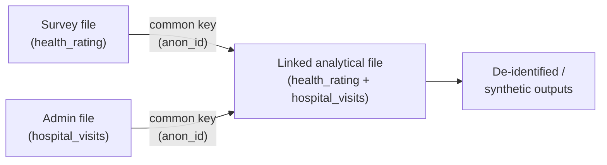
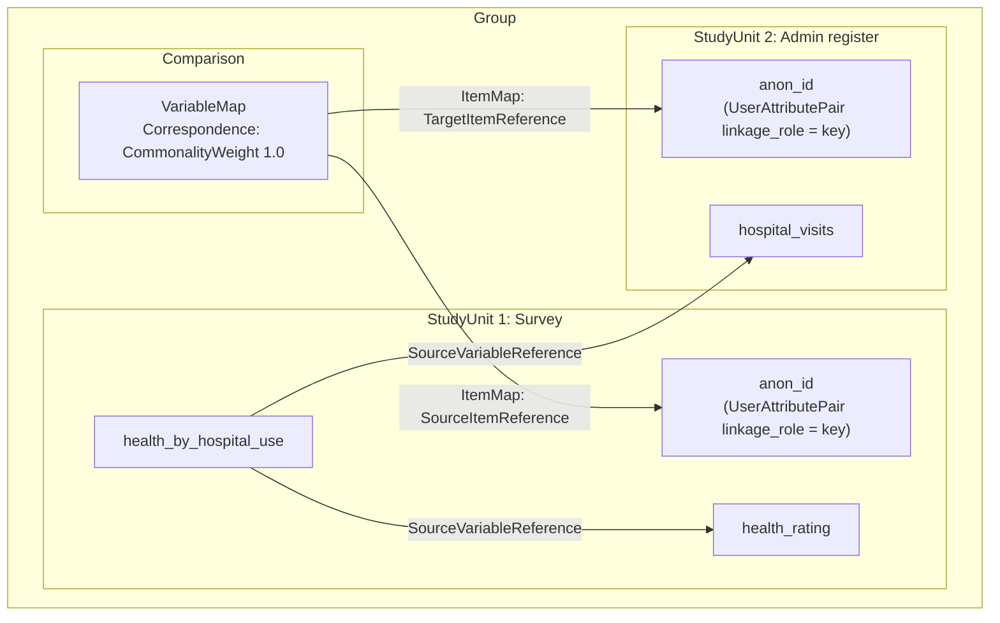

# Module 12: Data linkage: combining records across datasets

!!! info "Learning objectives"
    By the end of this module, you can:

    - **O1.** Explain in two or three sentences what microdata linkage is, and why a national statistical office or a researcher links existing files instead of collecting new data.
    - **O2.** Choose deterministic or probabilistic linkage for a pair of files, and justify the choice from the variables they share.
    - **O3.** Model each source dataset as its own study with `doc.add_study()`, and add its variables through `doc.study()`.
    - **O4.** Tag the linkage key on both sides with `set_property("linkage_role", "key")`, and read it back with `get_property()`.
    - **O5.** Add a `Comparison` that maps the two keys with `add_variable_map()` and a correspondence weight, and record the linkage method and match rate on it.
    - **O6.** Record a linked variable's sources in both studies with `source_variable_references`.

**Prerequisites:** [Module 11](module-11-data-lineage.en.md).

**Time:** 60 min self-paced / 75 min instructor-led.

**New in this module:** `doc.add_study()`, `doc.study()`, `set_property()`, `get_property()`, `doc.add_comparison()`, `correspondence()`, `add_variable_map()`, `doc.comparisons`.

---

## 1. What is data linkage?

**Data linkage** (also called **microdata linkage** or **record linkage**)
is the process of combining records from two or more files that refer to the
**same unit**: an individual, a household, or a business.

Statistics Canada describes it this way:

!!! quote "Statistics Canada: Microdata linkage"
    Microdata linkage is an internationally recognized statistical method that
    maximizes the use of existing information by linking different files and
    variables to create new information. [...] We first link the different data
    records by using the variables they have in common. In order to protect
    confidentiality, all personal information is removed, so that the linked
    files are anonymized, or de-identified.

The key idea: instead of running a new survey to collect a variable, you
**link** an existing survey to an existing administrative file and reuse what
is already there.



## 2. Why statistical offices and researchers link data

A **national statistical office** (NSO) is the government agency that produces
a country's official statistics. NSOs and academic researchers link data for
similar reasons:

| Who | Typical linkage | Why |
| --- | --- | --- |
| **NSO** | Survey → tax/administrative records | Add income without re-asking; reduce burden |
| **NSO** | Census → health/education registers | Study outcomes across domains |
| **NSO** | Same respondents across waves | Build a longitudinal file |
| **Academic** | Survey → hospital admissions | Research health outcomes |
| **Academic** | Birth records → school records | Study life-course trajectories |

For both, the payoff is the same: linkage turns two narrow files into one rich
file that can answer questions neither file could answer alone, without asking
respondents anything new.

## 3. Two ways to link: deterministic and probabilistic

| Method | How it matches | When to use |
| --- | --- | --- |
| **Deterministic** | Exact match on a unique **key** (e.g. an anonymized ID) | A reliable common identifier exists |
| **Probabilistic** | Weighted agreement across several **quasi-identifiers** (name, date of birth, sex, postal code) with a decision threshold | No single reliable key; some fields have errors or missing values |

A **quasi-identifier** is a variable that does not identify a person on its
own, but narrows the match when combined with others.

To choose, look at what the two files share. If both carry the same reliable
ID, link deterministically. If they share only quasi-identifiers, or the ID has
errors, link probabilistically.

Deterministic linkage is simpler and is what we model in detail below.
Probabilistic linkage records the same structure but adds an agreement
**weight** and marks several **matching** variables rather than one key.

## 4. Our running example

We will link two files from a health study:

!!! example "Two source files"

    **Survey file**: collected from respondents.

    | anon_id | age | health_rating |
    |---|---|---|
    | A17 | 34 | Good |
    | A22 | 68 | Excellent |
    | A31 | 17 | Fair |

    **Administrative file**: hospital admissions register.

    | anon_id | hospital_visits | last_admission |
    |---|---|---|
    | A17 | 2 | 2021-03 |
    | A22 | 5 | 2021-07 |
    | A31 | 0 | |

    Both files share the column **`anon_id`**, an anonymized linkage key. That
    common variable is what lets us join a respondent's `health_rating` to their
    `hospital_visits` to create a **linked analytical file**.

## 5. Model each source as its own study

In DDI, each source dataset is its own `StudyUnit`. When you add a second
study, `ddi-l` automatically wraps both in a **group** (a study series). The
first study is the survey; we add the administrative register as a second study.

```python
import ddi_l as ddi

# Source 1: the survey (the primary study)
doc = ddi.new_study(
    title="Canadian Community Health Survey 2021",
    agency="statcan.gc.ca",
)
q_key = doc.add_question(text="Anonymized linkage key")
q_health = doc.add_question(text="How would you rate your general health?")

survey_key = doc.add_variable(name="anon_id", question=q_key)
survey_health = doc.add_variable(name="health_rating", question=q_health)

print(f"Survey variables: {len(doc.variables)}")
# -> Survey variables: 2
```

Now add the administrative register as a **second study** and target it with a
[study cursor](../user-guide.en.md):

```python
# Source 2: the administrative register (a second study in the group)
admin = doc.add_study(title="Hospital Admissions Register 2021")
admin_ds = doc.study(admin.identifier)

admin_key = admin_ds.add_variable(name="anon_id")
admin_visits = admin_ds.add_variable(name="hospital_visits")
```

`doc.add_study()` returns the new study. `doc.study(identifier)` returns a
**cursor** for it: an object with the same `add_*` methods as `doc`, which add
items to that study instead of the first one.

!!! note "Where do the counts live?"
    `doc.variables` counts variables in the **primary** study only. The
    administrative register's variables live in its own study unit, reached
    through the cursor `doc.study(admin.identifier)`. This mirrors reality:
    each source file is a separate, independently maintained dataset.
    `doc.find()` (Module 11) still finds an item in any study.

## 6. Tag the linkage keys

The **linkage key** is the common variable that connects the sources. Mark it
on both sides so anyone reading the metadata knows which variable does the
joining.

DDI has no dedicated field for "this is the linkage key", so you record it as a
**custom property**: a key-value pair you attach to any item. Two methods are
all you need here:

- `item.set_property(key, value)` stores a value under a key.
- `item.get_property(key)` reads it back, or returns `None` if the item has no
  such key.

[Module 13](module-13-properties-find-validate.en.md) covers custom properties
fully.

Tag **both** sides:

```python
survey_key.set_property("linkage_role", "key")
admin_key.set_property("linkage_role", "key")

print(survey_key.get_property("linkage_role"))
# -> key
print(survey_health.get_property("linkage_role"))
# -> None
```

For **probabilistic** linkage you would instead tag several variables as
`"matching"` (e.g. `date_of_birth`, `sex`, `postal_code`) and, optionally, the
ones used to group candidate pairs as `"blocking"`.

## 7. Record how the keys correspond: a Comparison

A `Comparison` is DDI's container for recording how items in different studies
**correspond**. Add a **variable map** from the survey key to the admin key,
and describe the match quality with a **correspondence**.

```python
cmp = doc.add_comparison(name="Survey-to-Admin Microdata Linkage 2021")

# Describe the match: full commonality (weight 1.0) for an exact key
key_match = cmp.correspondence(
    commonality="Anonymized personal identifier common to both sources.",
    weight=1.0,
)

cmp.add_variable_map(
    survey_key.to_reference(),
    admin_key.to_reference(),
    correspondence=key_match,
)

print(f"Comparisons: {len(doc.comparisons)}")
# -> Comparisons: 1
```

For probabilistic linkage, set `weight` below `1.0` to record that agreement
is partial, and add a variable map for each matching variable.

## 8. Record the linkage method and quality

Store the linkage **method** and **quality indicators** as custom properties on
the comparison. These are exactly the facts an auditor, a data steward, or a
future researcher will ask for.

```python
cmp.set_property("linkage_method", "deterministic")
cmp.set_property("match_rate", "0.94")
cmp.set_property("false_match_rate", "0.01")

print(cmp.get_property("linkage_method"))
# -> deterministic
```

## 9. Build the linked variable with cross-source provenance

The **linked analytical file** holds variables drawn from *both* sources. Each
linked variable records where it came from with `source_variable_references`,
just like a derived variable in [Module 11](module-11-data-lineage.en.md), except
now the sources sit in **different studies**.

```python
linked = doc.add_variable(name="health_by_hospital_use")
linked.source_variable_references = [
    survey_health.to_reference(),
    admin_visits.to_reference(),
]

print(f"Linked variable sources: {len(linked.source_variable_references)}")
# -> Linked variable sources: 2
```

!!! warning "Cross-study references warn on save"
    When you save, `ddi-l` may print a `UserWarning` that a
    `source_variable_reference` is "not present in the current document." That
    is **expected** for linkage: the source variable lives in a *different*
    study within the group. The reference is still written correctly: it is a
    full cross-study link, which is the whole point of data linkage.

## 10. Save the linkage document

```python
doc.save("health-linkage-2021.xml")
```

The saved file records, in one place: both source studies, the linkage key on
each side, the comparison that maps the keys, the linkage method and quality,
and the linked variable's provenance to both sources.

## 11. The complete linkage model

The saved file holds one group with the comparison and both studies. The
linked variable sits in the survey study, the primary one. Arrows point the way
the XML refers: from the map's item map to the two keys, and from the linked
variable to its two sources.



Every arrow is a `Reference` in DDI. Reading the model, anyone can see which
variable joined the files, how good the match was, and where every value in the
linked file came from.

---

!!! example "Scenario"
    You are documenting a microdata linkage at a national statistical office.
    A health survey and a hospital admissions register share an anonymized
    identifier, `anon_id`. You link them deterministically to study health
    outcomes against hospital use. You must record: the two source datasets,
    the linkage key on each side, the map between the keys, the linkage method
    and match rate, and the provenance of the linked variable back to both
    sources.

---

## Exercises

1. **(O1)** Your manager asks why the team should link the health survey to the hospital register instead of adding a hospital-visits question to next year's survey. Answer in two or three sentences.

    ??? success "Answer"
        A sample answer: "Linkage combines records from the two files that
        describe the same person, using a variable they share. The register
        already holds every hospital visit, so linking gives us that
        information without asking respondents anything new, which reduces
        their burden. The counts also come from records rather than from
        memory, and the linked file can answer questions neither file answers
        alone, such as whether people who rate their health as poor visit
        hospital more often."

2. **(O2)** For each pair of files, choose deterministic or probabilistic linkage, and give the reason in one sentence.

    - (a) A survey and a tax file that both carry the same anonymized person ID.
    - (b) A birth register and school records that share only name, date of birth, sex and postal code, with some typos in the names.
    - (c) Two waves of a panel survey that keep each respondent's ID from wave to wave.

    ??? success "Answer"
        - (a) **Deterministic**: both files carry the same reliable ID, so an
          exact match on it is enough.
        - (b) **Probabilistic**: there is no shared ID, and the names have
          errors, so you weigh agreement across several quasi-identifiers and
          apply a threshold.
        - (c) **Deterministic**: the respondent ID is stable across waves.

3. **(O3)** Create the survey study with two variables (`anon_id`, `health_rating`). Add the hospital register as a second study with two variables (`anon_id`, `hospital_visits`). Print the number of survey variables, and check with `doc.find()` that `hospital_visits` is in the document.

    **Expected output:**

    ```text
    Survey variables: 2
    hospital_visits found: True
    ```

    ??? success "Answer"
        ```python
        import ddi_l as ddi

        doc = ddi.new_study(
            title="Canadian Community Health Survey 2021",
            agency="statcan.gc.ca",
        )
        q_key = doc.add_question(text="Anonymized linkage key")
        q_health = doc.add_question(text="How would you rate your general health?")
        survey_key = doc.add_variable(name="anon_id", question=q_key)
        survey_health = doc.add_variable(name="health_rating", question=q_health)

        admin = doc.add_study(title="Hospital Admissions Register 2021")
        admin_ds = doc.study(admin.identifier)
        admin_key = admin_ds.add_variable(name="anon_id")
        admin_visits = admin_ds.add_variable(name="hospital_visits")

        print(f"Survey variables: {len(doc.variables)}")
        print(f"hospital_visits found: {doc.find(admin_visits.identifier) is not None}")
        ```

        `doc.variables` counts only the survey's two variables. The register's
        variables are in the second study, and `doc.find()` still reaches them.

4. **(O4)** Tag `anon_id` as the linkage key in both studies. Print the `linkage_role` of both keys, and of `health_rating`.

    **Expected output:**

    ```text
    Survey anon_id: key
    Register anon_id: key
    health_rating: None
    ```

    ??? success "Answer"
        ```python
        survey_key.set_property("linkage_role", "key")
        admin_key.set_property("linkage_role", "key")

        print(f"Survey anon_id: {survey_key.get_property('linkage_role')}")
        print(f"Register anon_id: {admin_key.get_property('linkage_role')}")
        print(f"health_rating: {survey_health.get_property('linkage_role')}")
        ```

        `health_rating` was never tagged, so `get_property()` returns `None`.

5. **(O5)** Add a `Comparison` that maps the survey key to the register key with a correspondence weight of `1.0`. Record the linkage method (`deterministic`) and a `match_rate` of `0.94` as properties on the comparison. Print the counts and the two properties.

    **Expected output:**

    ```text
    Comparisons: 1
    Variable maps: 1
    deterministic, match rate 0.94
    ```

    ??? success "Answer"
        ```python
        cmp = doc.add_comparison(name="Survey-to-Admin Microdata Linkage 2021")
        key_match = cmp.correspondence(
            commonality="Anonymized personal identifier common to both sources.",
            weight=1.0,
        )
        cmp.add_variable_map(
            survey_key.to_reference(),
            admin_key.to_reference(),
            correspondence=key_match,
        )
        cmp.set_property("linkage_method", "deterministic")
        cmp.set_property("match_rate", "0.94")

        print(f"Comparisons: {len(doc.comparisons)}")
        print(f"Variable maps: {len(cmp.variable_maps)}")
        method = cmp.get_property("linkage_method")
        print(f"{method}, match rate {cmp.get_property('match_rate')}")
        ```

6. **(O6)** Create a linked variable `health_by_hospital_use` with `source_variable_references` pointing to **both** `health_rating` (survey) and `hospital_visits` (register). Print how many sources it has.

    **Expected output:**

    ```text
    Linked variable sources: 2
    ```

    ??? success "Answer"
        ```python
        linked = doc.add_variable(name="health_by_hospital_use")
        linked.source_variable_references = [
            survey_health.to_reference(),
            admin_visits.to_reference(),
        ]

        print(f"Linked variable sources: {len(linked.source_variable_references)}")
        ```

7. **(O2, O4, O5)** *(Optional)* Model a **probabilistic** linkage instead. Add `date_of_birth`, `sex` and `postal_code` to both studies and tag each one with `linkage_role="matching"`. Add a second comparison with the method `probabilistic`, and map each pair of variables with a correspondence weight of `0.85`. Print the number of maps and the method.

    **Expected output:**

    ```text
    Variable maps: 3
    probabilistic
    ```

    ??? success "Answer"
        ```python
        prob = doc.add_comparison(name="Probabilistic Linkage")
        prob.set_property("linkage_method", "probabilistic")
        partial = prob.correspondence(
            commonality="Agreement across date of birth, sex, and postal code.",
            weight=0.85,
        )

        for name in ("date_of_birth", "sex", "postal_code"):
            survey_var = doc.add_variable(name=name)
            register_var = admin_ds.add_variable(name=name)
            survey_var.set_property("linkage_role", "matching")
            register_var.set_property("linkage_role", "matching")
            prob.add_variable_map(
                survey_var.to_reference(),
                register_var.to_reference(),
                correspondence=partial,
            )

        print(f"Variable maps: {len(prob.variable_maps)}")
        print(prob.get_property("linkage_method"))
        ```

        A weight below `1.0` records that agreement on these fields is strong
        evidence of a match, but not proof.

---

## Quiz

???+ question "Question 1 (O1): Why link instead of asking a new question?"
    A team has a survey with health ratings and a hospital register. It wants
    to know whether people who rate their health as poor visit hospital more
    often. Why link the two files instead of adding a hospital-visits question
    to the survey?

    **A.** Linking reuses records the register already holds, so respondents answer nothing new and the counts do not depend on memory.

    **B.** DDI cannot store a question about hospital visits.

    **C.** Linking makes the survey file smaller.

    **D.** Linking removes the need for any common variable.

    ??? success "Answer"
        **A.** Linkage combines records about the same person from existing
        files. It reduces respondent burden and creates information that
        neither file holds alone. It still needs a common variable to join
        the records.

???+ question "Question 2 (O2): Which linkage method fits these files?"
    Two files share no ID. Both hold name, date of birth, sex and postal code,
    and some names have typos. Which linkage fits?

    **A.** Deterministic, on name.

    **B.** Probabilistic: weigh agreement across several fields and apply a threshold.

    **C.** None: files without a common ID cannot be linked.

    **D.** Deterministic, on postal code.

    ??? success "Answer"
        **B.** With no reliable key and errors in some fields, an exact match
        on one field would miss true pairs (name typos) or join the wrong
        people (many share a postal code). Probabilistic linkage combines the
        evidence from several quasi-identifiers.

???+ question "Question 3 (O3): How do you add a variable to the register study?"
    You added the register with
    `admin = doc.add_study(title="Hospital Admissions Register 2021")`.
    Which line adds `hospital_visits` to the register, not to the survey?

    **A.** `doc.add_variable(name="hospital_visits")`

    **B.** `doc.add_study(title="hospital_visits")`

    **C.** `doc.study(admin.identifier).add_variable(name="hospital_visits")`

    **D.** `doc.variables.append("hospital_visits")`

    ??? success "Answer"
        **C.** `doc.study()` returns a cursor for that study, and its `add_*`
        methods add items there. `doc.add_variable()` always adds to the
        primary study, the survey.

???+ question "Question 4 (O4): What does this code print?"
    <!-- docs-test: skip -- fragment: survey_key and survey_health are the reader's own variables -->
    ```python
    survey_key.set_property("linkage_role", "key")
    print(
        survey_key.get_property("linkage_role"),
        survey_health.get_property("linkage_role"),
    )
    ```

    **A.** `key key`

    **B.** `None None`

    **C.** `linkage_role key`

    **D.** `key None`

    ??? success "Answer"
        **D.** Only `survey_key` was tagged. `get_property()` returns the
        value stored under the key, or `None` when the item has no such key.

???+ question "Question 5 (O5): Which call records that the two keys correspond exactly?"
    **A.** `cmp.add_variable_map(survey_key.to_reference(), admin_key.to_reference(), correspondence=cmp.correspondence(weight=1.0))`

    **B.** `survey_key.set_property("linkage_role", "key")`

    **C.** `cmp.set_property("match_rate", "1.0")`

    **D.** `linked.source_variable_references = [survey_key.to_reference()]`

    ??? success "Answer"
        **A.** A variable map in the `Comparison` records that the survey key
        corresponds to the register key, and the correspondence weight `1.0`
        says they are the same identifier. Option B tags one side only;
        option C records a quality figure; option D records provenance.

???+ question "Question 6 (O6): How do you record that a linked variable draws on two source files?"
    **A.** Set `question=` twice.

    **B.** Put both sources in `source_variable_references`.

    **C.** Rename the variable.

    **D.** Increase the version number.

    ??? success "Answer"
        **B.** `source_variable_references` holds a `Reference` to each source
        variable (here, one to the survey variable and one to the admin
        variable), even though they live in different studies.

---

## Going further (optional)

This section has no objective or quiz question.

### Linkage environments

Some national statistical offices run dedicated environments for linkage.
Statistics Canada, for example, runs the **Social Data Linkage Environment
(SDLE)**, the **Business – Linkable File Environment (B-LFE)**, and the
**Longitudinal Employee and Business Analytical Files (LEBAF)**, precisely to
build **linked analytical files without collecting additional data** from
Canadians.

### Record confidentiality and governance

Microdata linkage is governed by strict privacy rules. Statistics Canada's
**Directive on Microdata Linkage** requires that the public value of a linkage
outweigh any intrusion on privacy, and that personal identifiers be removed so
the linked file is **de-identified**. Researchers often work with **synthetic**
versions rather than the original records.

Record this governance context as custom properties so it travels with the
metadata:

```python
study = doc.study_unit
study.set_property(
    "confidentiality",
    "de-identified; synthetic file for researcher access",
)
study.set_property("governance", "Directive on Microdata Linkage")
cmp.set_property("approval", "Directive on Microdata Linkage - pre-approved")

print(study.get_property("confidentiality"))
# -> de-identified; synthetic file for researcher access
```

Save again after these calls, so the file carries the governance context too.

---

## Check yourself

- [ ] I can explain in two or three sentences what microdata linkage is and why NSOs and researchers link existing files. (O1)
- [ ] I can choose deterministic or probabilistic linkage for a pair of files, and say why. (O2)
- [ ] I can model each source dataset as its own study with `doc.add_study()` and `doc.study()`. (O3)
- [ ] I can tag the linkage key on both sides with `set_property()` and read it back with `get_property()`. (O4)
- [ ] I can add a `Comparison` that maps the keys with a correspondence weight, and record the method and match rate. (O5)
- [ ] I can record a linked variable's sources in both studies with `source_variable_references`. (O6)

---

!!! tip "Instructor notes"
    - Anchor the concept with the burden argument: "Why ask people their income
      on a survey if the tax file already has it? Link instead." Linkage reuses
      existing data to create new information.
    - Draw two file icons sharing one column (`anon_id`). The shared column is
      the key. Everything else in the module hangs off that picture.
    - Contrast the two data-quality regimes: deterministic (one reliable key,
      weight 1.0) vs probabilistic (several noisy fields, weight < 1.0,
      clerical review). Exercise 2 asks learners to choose; ask which fits a
      file with typos in names.
    - Learners meet custom properties here only as a tool for tagging keys and
      recording the method. Keep it to `set_property()` and `get_property()`;
      Module 13 covers properties fully.
    - Emphasize that `source_variable_references` crossing study boundaries is
      the technical heart of linkage, and that the save-time warning is
      expected, not an error.
    - For NSO staff: "Going further" connects to real infrastructure (SDLE,
      B-LFE, LEBAF) and to governance: pre-approved linkages vs those needing
      a documented proposal and review under the Directive on Microdata Linkage.
    - For academics: stress reproducibility. A reviewer must be able to see
      which key joined the files, the match rate, and the provenance of every
      linked variable. That is exactly what this metadata captures.
    - Privacy framing matters: every real linkage ends with de-identification
      and, often, synthetic data for access. If you have time, do the
      "Going further" governance step in class as the last step, not an
      afterthought.

---

**See also:** [Module 11: Data lineage](module-11-data-lineage.en.md) | [Module 13: Properties, find, and validate](module-13-properties-find-validate.en.md) | [User guide: Compare and harmonize studies](../user-guide.en.md)
