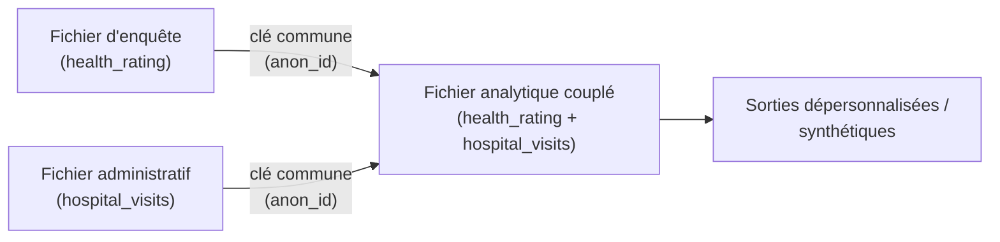
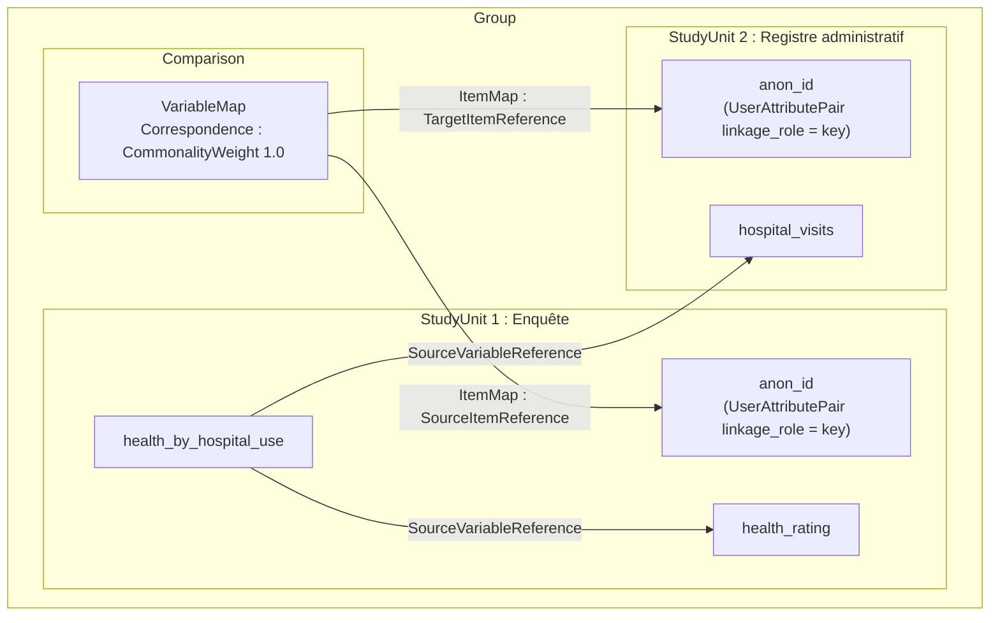

# Module 12 : Couplage de données : combiner des enregistrements entre jeux de données

!!! info "Objectifs d'apprentissage"
    À la fin de ce module, vous pouvez :

    - **O1.** Expliquer en deux ou trois phrases ce qu'est le couplage de microdonnées, et pourquoi un institut national de statistique ou un chercheur couple des fichiers existants au lieu de collecter de nouvelles données.
    - **O2.** Choisir un couplage déterministe ou probabiliste pour une paire de fichiers, et justifier ce choix d'après les variables qu'ils partagent.
    - **O3.** Modéliser chaque jeu de données source comme sa propre étude avec `doc.add_study()`, et y ajouter ses variables au moyen de `doc.study()`.
    - **O4.** Étiqueter la clé de couplage des deux côtés avec `set_property("linkage_role", "key")`, et la relire avec `get_property()`.
    - **O5.** Ajouter une `Comparison` qui cartographie les deux clés avec `add_variable_map()` et un poids de correspondance, et y consigner la méthode de couplage et le taux d'appariement.
    - **O6.** Enregistrer les sources d'une variable couplée dans les deux études avec `source_variable_references`.

**Prérequis :** [Module 11](module-11-data-lineage.fr.md).

**Durée :** 60 min en autonomie / 75 min avec instructeur.

**Nouveau dans ce module :** `doc.add_study()`, `doc.study()`, `set_property()`, `get_property()`, `doc.add_comparison()`, `correspondence()`, `add_variable_map()`, `doc.comparisons`.

---

## 1. Qu'est-ce que le couplage de données ?

Le **couplage de données** (aussi appelé **couplage de microdonnées** ou
**couplage d'enregistrements**) est le processus qui consiste à combiner des
enregistrements de deux fichiers ou plus qui se rapportent à la **même unité** :
un individu, un ménage ou une entreprise.

Statistique Canada le décrit ainsi :

!!! quote "Statistique Canada : Couplage de microdonnées"
    Le couplage de microdonnées est une méthode statistique reconnue à l'échelle
    internationale qui optimise l'utilisation des renseignements existants en
    couplant différents fichiers et variables afin de créer de nouveaux
    renseignements. [...] Nous couplons d'abord les différents enregistrements
    au moyen des variables qu'ils ont en commun. Afin de protéger la
    confidentialité, tous les renseignements personnels sont retirés, de sorte
    que les fichiers couplés sont anonymisés, ou dépersonnalisés.

L'idée clé : au lieu de mener une nouvelle enquête pour collecter une variable,
vous **couplez** une enquête existante à un fichier administratif existant et
réutilisez ce qui s'y trouve déjà.



## 2. Pourquoi les instituts de statistique et les chercheurs couplent des données

Un **institut national de statistique** (INS) est l'organisme public qui
produit les statistiques officielles d'un pays. Les INS et les chercheurs
universitaires couplent des données pour des raisons semblables :

| Qui | Couplage typique | Pourquoi |
| --- | --- | --- |
| **INS** | Enquête → fichiers fiscaux/administratifs | Ajouter le revenu sans le redemander ; réduire le fardeau |
| **INS** | Recensement → registres de santé/d'éducation | Étudier les résultats entre domaines |
| **INS** | Mêmes répondants à travers les vagues | Bâtir un fichier longitudinal |
| **Universitaire** | Enquête → admissions hospitalières | Rechercher les résultats de santé |
| **Universitaire** | Registres de naissances → dossiers scolaires | Étudier les trajectoires de vie |

Pour les deux, le bénéfice est le même : le couplage transforme deux fichiers
étroits en un fichier riche capable de répondre à des questions qu'aucun des
deux ne pourrait résoudre seul, sans rien demander de nouveau aux répondants.

## 3. Deux façons de coupler : déterministe et probabiliste

| Méthode | Comment elle apparie | Quand l'utiliser |
| --- | --- | --- |
| **Déterministe** | Appariement exact sur une **clé** unique (p. ex. un identifiant anonymisé) | Un identifiant commun fiable existe |
| **Probabiliste** | Accord pondéré sur plusieurs **quasi-identifiants** (nom, date de naissance, sexe, code postal) avec un seuil de décision | Aucune clé fiable unique ; certains champs comportent des erreurs ou des valeurs manquantes |

Un **quasi-identifiant** est une variable qui n'identifie pas une personne à
elle seule, mais qui précise l'appariement quand on la combine à d'autres.

Pour choisir, regardez ce que les deux fichiers partagent. S'ils portent tous
deux le même identifiant fiable, couplez de façon déterministe. S'ils ne
partagent que des quasi-identifiants, ou si l'identifiant comporte des erreurs,
couplez de façon probabiliste.

Le couplage déterministe est plus simple et c'est celui que nous modélisons en
détail ci-dessous. Le couplage probabiliste enregistre la même structure mais
ajoute un **poids** d'accord et marque plusieurs variables **d'appariement**
plutôt qu'une seule clé.

## 4. Notre exemple

Nous allons coupler deux fichiers d'une étude sur la santé :

!!! example "Deux fichiers sources"

    **Fichier d'enquête** : collecté auprès des répondants.

    | anon_id | age | health_rating |
    |---|---|---|
    | A17 | 34 | Good |
    | A22 | 68 | Excellent |
    | A31 | 17 | Fair |

    **Fichier administratif** : registre des admissions hospitalières.

    | anon_id | hospital_visits | last_admission |
    |---|---|---|
    | A17 | 2 | 2021-03 |
    | A22 | 5 | 2021-07 |
    | A31 | 0 | |

    Les deux fichiers partagent la colonne **`anon_id`**, une clé de couplage
    anonymisée. Cette variable commune nous permet de joindre le `health_rating`
    d'un répondant à ses `hospital_visits` pour créer un **fichier analytique
    couplé**.

## 5. Modéliser chaque source comme sa propre étude

En DDI, chaque jeu de données source est son propre `StudyUnit`. Quand vous
ajoutez une deuxième étude, `ddi-l` enveloppe automatiquement les deux dans un
**groupe** (une série d'études). La première étude est l'enquête ; nous ajoutons
le registre administratif comme deuxième étude.

```python
import ddi_l as ddi

# Source 1 : l'enquête (l'étude primaire)
doc = ddi.new_study(
    title="Canadian Community Health Survey 2021",
    agency="statcan.gc.ca",
)
q_key = doc.add_question(text="Anonymized linkage key")
q_health = doc.add_question(text="How would you rate your general health?")

survey_key = doc.add_variable(name="anon_id", question=q_key)
survey_health = doc.add_variable(name="health_rating", question=q_health)

print(f"Survey variables: {len(doc.variables)}")
# -> Survey variables: 2
```

Ajoutez maintenant le registre administratif comme **deuxième étude** et
ciblez-le avec un [curseur d'étude](../user-guide.fr.md) :

```python
# Source 2 : le registre administratif (une deuxième étude du groupe)
admin = doc.add_study(title="Hospital Admissions Register 2021")
admin_ds = doc.study(admin.identifier)

admin_key = admin_ds.add_variable(name="anon_id")
admin_visits = admin_ds.add_variable(name="hospital_visits")
```

`doc.add_study()` renvoie la nouvelle étude. `doc.study(identifier)` renvoie un
**curseur** sur elle : un objet doté des mêmes méthodes `add_*` que `doc`, qui
ajoutent les éléments à cette étude plutôt qu'à la première.

!!! note "Où vivent les compteurs ?"
    `doc.variables` ne compte que les variables de l'étude **primaire**. Les
    variables du registre administratif vivent dans leur propre unité d'étude,
    accessible via le curseur `doc.study(admin.identifier)`. Cela reflète la
    réalité : chaque fichier source est un jeu de données distinct, maintenu
    indépendamment. `doc.find()` (module 11) trouve quand même un élément dans
    n'importe quelle étude.

## 6. Étiqueter les clés de couplage

La **clé de couplage** est la variable commune qui relie les sources.
Marquez-la des deux côtés afin que quiconque lit les métadonnées sache quelle
variable réalise la jointure.

DDI n'a pas de champ dédié pour dire « ceci est la clé de couplage » ; vous
l'enregistrez donc comme **propriété personnalisée** : une paire clé-valeur que
vous attachez à n'importe quel élément. Deux méthodes suffisent ici :

- `item.set_property(key, value)` stocke une valeur sous une clé.
- `item.get_property(key)` la relit, ou renvoie `None` si l'élément n'a pas
  cette clé.

Le [module 13](module-13-properties-find-validate.fr.md) couvre entièrement les
propriétés personnalisées.

Étiquetez les **deux** côtés :

```python
survey_key.set_property("linkage_role", "key")
admin_key.set_property("linkage_role", "key")

print(survey_key.get_property("linkage_role"))
# -> key
print(survey_health.get_property("linkage_role"))
# -> None
```

Pour un couplage **probabiliste**, vous étiquetteriez plutôt plusieurs variables
comme `"matching"` (p. ex. `date_of_birth`, `sex`, `postal_code`) et,
facultativement, celles servant à regrouper les paires candidates comme
`"blocking"`.

## 7. Enregistrer la correspondance des clés : une Comparison

Une `Comparison` est le conteneur DDI qui enregistre comment des éléments de
différentes études se **correspondent**. Ajoutez une **carte de variables** de
la clé d'enquête vers la clé administrative, et décrivez la qualité de
l'appariement avec une **correspondance**.

```python
cmp = doc.add_comparison(name="Survey-to-Admin Microdata Linkage 2021")

# Décrire l'appariement : communauté totale (poids 1.0) pour une clé exacte
key_match = cmp.correspondence(
    commonality="Anonymized personal identifier common to both sources.",
    weight=1.0,
)

cmp.add_variable_map(
    survey_key.to_reference(),
    admin_key.to_reference(),
    correspondence=key_match,
)

print(f"Comparisons: {len(doc.comparisons)}")
# -> Comparisons: 1
```

Pour un couplage probabiliste, fixez `weight` sous `1.0` pour enregistrer que
l'accord est partiel, et ajoutez une carte de variables pour chaque variable
d'appariement.

## 8. Enregistrer la méthode et la qualité du couplage

Stockez la **méthode** de couplage et les **indicateurs de qualité** comme
propriétés personnalisées sur la comparaison. Ce sont exactement les faits qu'un
auditeur, un gestionnaire de données ou un futur chercheur demandera.

```python
cmp.set_property("linkage_method", "deterministic")
cmp.set_property("match_rate", "0.94")
cmp.set_property("false_match_rate", "0.01")

print(cmp.get_property("linkage_method"))
# -> deterministic
```

## 9. Construire la variable couplée avec une provenance inter-sources

Le **fichier analytique couplé** contient des variables tirées des *deux*
sources. Chaque variable couplée enregistre son origine avec
`source_variable_references`, comme une variable dérivée du
[Module 11](module-11-data-lineage.fr.md), sauf que maintenant les sources se
trouvent dans des **études différentes**.

```python
linked = doc.add_variable(name="health_by_hospital_use")
linked.source_variable_references = [
    survey_health.to_reference(),
    admin_visits.to_reference(),
]

print(f"Linked variable sources: {len(linked.source_variable_references)}")
# -> Linked variable sources: 2
```

!!! warning "Les références inter-études émettent un avertissement à l'enregistrement"
    À l'enregistrement, `ddi-l` peut afficher un `UserWarning` indiquant qu'une
    `source_variable_reference` est « absente du document courant ». C'est
    **attendu** pour le couplage : la variable source vit dans une étude
    *différente* au sein du groupe. La référence est tout de même écrite
    correctement : c'est un lien inter-études complet, ce qui est précisément le
    but du couplage de données.

## 10. Enregistrer le document de couplage

```python
doc.save("health-linkage-2021.xml")
```

Le fichier enregistré consigne, en un seul endroit : les deux études sources, la
clé de couplage de chaque côté, la comparaison qui cartographie les clés, la
méthode et la qualité du couplage, et la provenance de la variable couplée vers
les deux sources.

## 11. Le modèle complet de couplage

Le fichier enregistré contient un groupe avec la comparaison et les deux
études. La variable couplée se trouve dans l'étude d'enquête, l'étude
principale. Les flèches suivent le sens des références du XML : de la
correspondance d'éléments de la carte vers les deux clés, et de la variable
couplée vers ses deux sources.



Chaque flèche est une `Reference` en DDI. En lisant le modèle, quiconque peut
voir quelle variable a joint les fichiers, la qualité de l'appariement, et
d'où vient chaque valeur du fichier couplé.

---

!!! example "Scénario"
    Vous documentez un couplage de microdonnées dans un institut national de
    statistique. Une enquête sur la santé et un registre des admissions
    hospitalières partagent un identifiant anonymisé, `anon_id`. Vous les
    couplez de façon déterministe pour étudier les résultats de santé au
    regard de l'utilisation hospitalière. Vous devez enregistrer : les deux
    jeux de données sources, la clé de couplage de chaque côté, la carte entre
    les clés, la méthode et le taux d'appariement, et la provenance de la
    variable couplée vers les deux sources.

---

## Exercices

1. **(O1)** Votre gestionnaire demande pourquoi l'équipe devrait coupler l'enquête sur la santé au registre hospitalier au lieu d'ajouter une question sur les visites à l'hôpital dans l'enquête de l'an prochain. Répondez en deux ou trois phrases.

    ??? success "Réponse"
        Une réponse possible : « Le couplage combine les enregistrements des
        deux fichiers qui décrivent la même personne, au moyen d'une variable
        qu'ils partagent. Le registre contient déjà chaque visite à l'hôpital ;
        le couplage nous donne donc cette information sans rien demander de
        nouveau aux répondants, ce qui réduit leur fardeau. Les comptes
        proviennent aussi de dossiers plutôt que de la mémoire, et le fichier
        couplé peut répondre à des questions qu'aucun des deux fichiers ne
        résout seul, par exemple si les personnes qui jugent leur santé
        mauvaise vont plus souvent à l'hôpital. »

2. **(O2)** Pour chaque paire de fichiers, choisissez un couplage déterministe ou probabiliste, et donnez la raison en une phrase.

    - (a) Une enquête et un fichier fiscal qui portent tous deux le même identifiant anonymisé de personne.
    - (b) Un registre des naissances et des dossiers scolaires qui ne partagent que le nom, la date de naissance, le sexe et le code postal, avec quelques fautes de frappe dans les noms.
    - (c) Deux vagues d'une enquête par panel qui gardent l'identifiant de chaque répondant d'une vague à l'autre.

    ??? success "Réponse"
        - (a) **Déterministe** : les deux fichiers portent le même identifiant
          fiable, donc un appariement exact sur celui-ci suffit.
        - (b) **Probabiliste** : il n'y a pas d'identifiant commun, et les noms
          comportent des erreurs ; vous pondérez donc l'accord sur plusieurs
          quasi-identifiants et appliquez un seuil.
        - (c) **Déterministe** : l'identifiant du répondant est stable d'une
          vague à l'autre.

3. **(O3)** Créez l'étude d'enquête avec deux variables (`anon_id`, `health_rating`). Ajoutez le registre hospitalier comme deuxième étude avec deux variables (`anon_id`, `hospital_visits`). Affichez le nombre de variables de l'enquête, et vérifiez avec `doc.find()` que `hospital_visits` se trouve dans le document.

    **Résultat attendu :**

    ```text
    Survey variables: 2
    hospital_visits found: True
    ```

    ??? success "Réponse"
        ```python
        import ddi_l as ddi

        doc = ddi.new_study(
            title="Canadian Community Health Survey 2021",
            agency="statcan.gc.ca",
        )
        q_key = doc.add_question(text="Anonymized linkage key")
        q_health = doc.add_question(text="How would you rate your general health?")
        survey_key = doc.add_variable(name="anon_id", question=q_key)
        survey_health = doc.add_variable(name="health_rating", question=q_health)

        admin = doc.add_study(title="Hospital Admissions Register 2021")
        admin_ds = doc.study(admin.identifier)
        admin_key = admin_ds.add_variable(name="anon_id")
        admin_visits = admin_ds.add_variable(name="hospital_visits")

        print(f"Survey variables: {len(doc.variables)}")
        print(f"hospital_visits found: {doc.find(admin_visits.identifier) is not None}")
        ```

        `doc.variables` ne compte que les deux variables de l'enquête. Les
        variables du registre sont dans la deuxième étude, et `doc.find()` les
        atteint quand même.

4. **(O4)** Étiquetez `anon_id` comme clé de couplage dans les deux études. Affichez le `linkage_role` des deux clés, et celui de `health_rating`.

    **Résultat attendu :**

    ```text
    Survey anon_id: key
    Register anon_id: key
    health_rating: None
    ```

    ??? success "Réponse"
        ```python
        survey_key.set_property("linkage_role", "key")
        admin_key.set_property("linkage_role", "key")

        print(f"Survey anon_id: {survey_key.get_property('linkage_role')}")
        print(f"Register anon_id: {admin_key.get_property('linkage_role')}")
        print(f"health_rating: {survey_health.get_property('linkage_role')}")
        ```

        `health_rating` n'a jamais été étiquetée, donc `get_property()` renvoie
        `None`.

5. **(O5)** Ajoutez une `Comparison` qui cartographie la clé d'enquête vers la clé du registre avec un poids de correspondance de `1.0`. Consignez la méthode de couplage (`deterministic`) et un `match_rate` de `0.94` comme propriétés sur la comparaison. Affichez les compteurs et les deux propriétés.

    **Résultat attendu :**

    ```text
    Comparisons: 1
    Variable maps: 1
    deterministic, match rate 0.94
    ```

    ??? success "Réponse"
        ```python
        cmp = doc.add_comparison(name="Survey-to-Admin Microdata Linkage 2021")
        key_match = cmp.correspondence(
            commonality="Anonymized personal identifier common to both sources.",
            weight=1.0,
        )
        cmp.add_variable_map(
            survey_key.to_reference(),
            admin_key.to_reference(),
            correspondence=key_match,
        )
        cmp.set_property("linkage_method", "deterministic")
        cmp.set_property("match_rate", "0.94")

        print(f"Comparisons: {len(doc.comparisons)}")
        print(f"Variable maps: {len(cmp.variable_maps)}")
        method = cmp.get_property("linkage_method")
        print(f"{method}, match rate {cmp.get_property('match_rate')}")
        ```

6. **(O6)** Créez une variable couplée `health_by_hospital_use` avec `source_variable_references` pointant vers **les deux** `health_rating` (enquête) et `hospital_visits` (registre). Affichez le nombre de sources.

    **Résultat attendu :**

    ```text
    Linked variable sources: 2
    ```

    ??? success "Réponse"
        ```python
        linked = doc.add_variable(name="health_by_hospital_use")
        linked.source_variable_references = [
            survey_health.to_reference(),
            admin_visits.to_reference(),
        ]

        print(f"Linked variable sources: {len(linked.source_variable_references)}")
        ```

7. **(O2, O4, O5)** *(Facultatif)* Modélisez plutôt un couplage **probabiliste**. Ajoutez `date_of_birth`, `sex` et `postal_code` aux deux études et étiquetez chacune avec `linkage_role="matching"`. Ajoutez une deuxième comparaison avec la méthode `probabilistic`, et cartographiez chaque paire de variables avec un poids de correspondance de `0.85`. Affichez le nombre de cartes et la méthode.

    **Résultat attendu :**

    ```text
    Variable maps: 3
    probabilistic
    ```

    ??? success "Réponse"
        ```python
        prob = doc.add_comparison(name="Probabilistic Linkage")
        prob.set_property("linkage_method", "probabilistic")
        partial = prob.correspondence(
            commonality="Agreement across date of birth, sex, and postal code.",
            weight=0.85,
        )

        for name in ("date_of_birth", "sex", "postal_code"):
            survey_var = doc.add_variable(name=name)
            register_var = admin_ds.add_variable(name=name)
            survey_var.set_property("linkage_role", "matching")
            register_var.set_property("linkage_role", "matching")
            prob.add_variable_map(
                survey_var.to_reference(),
                register_var.to_reference(),
                correspondence=partial,
            )

        print(f"Variable maps: {len(prob.variable_maps)}")
        print(prob.get_property("linkage_method"))
        ```

        Un poids inférieur à `1.0` indique que l'accord sur ces champs est une
        forte présomption d'appariement, mais pas une preuve.

---

## Quiz

???+ question "Question 1 (O1) : Pourquoi coupler au lieu de poser une nouvelle question ?"
    Une équipe dispose d'une enquête avec des évaluations de l'état de santé et
    d'un registre hospitalier. Elle veut savoir si les personnes qui jugent
    leur santé mauvaise vont plus souvent à l'hôpital. Pourquoi coupler les
    deux fichiers au lieu d'ajouter une question sur les visites à l'hôpital
    dans l'enquête ?

    **A.** Le couplage réutilise des dossiers que le registre contient déjà : les répondants ne répondent à rien de nouveau, et les comptes ne dépendent pas de leur mémoire.

    **B.** DDI ne peut pas stocker de question sur les visites à l'hôpital.

    **C.** Le couplage réduit la taille du fichier d'enquête.

    **D.** Le couplage supprime le besoin de toute variable commune.

    ??? success "Réponse"
        **A.** Le couplage combine des enregistrements sur la même personne
        tirés de fichiers existants. Il réduit le fardeau des répondants et
        crée une information qu'aucun des deux fichiers ne contient seul. Il
        lui faut quand même une variable commune pour joindre les
        enregistrements.

???+ question "Question 2 (O2) : Quelle méthode de couplage convient à ces fichiers ?"
    Deux fichiers ne partagent aucun identifiant. Tous deux contiennent le nom,
    la date de naissance, le sexe et le code postal, et certains noms
    comportent des fautes de frappe. Quel couplage convient ?

    **A.** Déterministe, sur le nom.

    **B.** Probabiliste : pondérer l'accord sur plusieurs champs et appliquer un seuil.

    **C.** Aucun : des fichiers sans identifiant commun ne peuvent pas être couplés.

    **D.** Déterministe, sur le code postal.

    ??? success "Réponse"
        **B.** Sans clé fiable et avec des erreurs dans certains champs, un
        appariement exact sur un seul champ manquerait de vraies paires (fautes
        dans les noms) ou joindrait les mauvaises personnes (beaucoup partagent
        un code postal). Le couplage probabiliste combine les indices de
        plusieurs quasi-identifiants.

???+ question "Question 3 (O3) : Comment ajouter une variable à l'étude du registre ?"
    Vous avez ajouté le registre avec
    `admin = doc.add_study(title="Hospital Admissions Register 2021")`.
    Quelle ligne ajoute `hospital_visits` au registre, et non à l'enquête ?

    **A.** `doc.add_variable(name="hospital_visits")`

    **B.** `doc.add_study(title="hospital_visits")`

    **C.** `doc.study(admin.identifier).add_variable(name="hospital_visits")`

    **D.** `doc.variables.append("hospital_visits")`

    ??? success "Réponse"
        **C.** `doc.study()` renvoie un curseur sur cette étude, et ses
        méthodes `add_*` y ajoutent les éléments. `doc.add_variable()` ajoute
        toujours à l'étude primaire, l'enquête.

???+ question "Question 4 (O4) : Qu'affiche ce code ?"
    <!-- docs-test: skip -- fragment: survey_key and survey_health are the reader's own variables -->
    ```python
    survey_key.set_property("linkage_role", "key")
    print(
        survey_key.get_property("linkage_role"),
        survey_health.get_property("linkage_role"),
    )
    ```

    **A.** `key key`

    **B.** `None None`

    **C.** `linkage_role key`

    **D.** `key None`

    ??? success "Réponse"
        **D.** Seule `survey_key` a été étiquetée. `get_property()` renvoie la
        valeur stockée sous la clé, ou `None` quand l'élément n'a pas cette
        clé.

???+ question "Question 5 (O5) : Quel appel enregistre que les deux clés se correspondent exactement ?"
    **A.** `cmp.add_variable_map(survey_key.to_reference(), admin_key.to_reference(), correspondence=cmp.correspondence(weight=1.0))`

    **B.** `survey_key.set_property("linkage_role", "key")`

    **C.** `cmp.set_property("match_rate", "1.0")`

    **D.** `linked.source_variable_references = [survey_key.to_reference()]`

    ??? success "Réponse"
        **A.** Une carte de variables dans la `Comparison` enregistre que la clé
        d'enquête correspond à la clé du registre, et le poids de
        correspondance `1.0` dit qu'il s'agit du même identifiant. L'option B
        n'étiquette qu'un côté ; l'option C consigne un indicateur de qualité ;
        l'option D consigne une provenance.

???+ question "Question 6 (O6) : Comment enregistrer qu'une variable couplée s'appuie sur deux fichiers sources ?"
    **A.** Définir `question=` deux fois.

    **B.** Mettre les deux sources dans `source_variable_references`.

    **C.** Renommer la variable.

    **D.** Augmenter le numéro de version.

    ??? success "Réponse"
        **B.** `source_variable_references` contient une `Reference` vers chaque
        variable source (ici, une vers la variable d'enquête et une vers la
        variable administrative), même si elles vivent dans des études
        différentes.

---

## Pour aller plus loin (facultatif)

Cette section n'a ni objectif ni question de quiz.

### Environnements de couplage

Certains instituts nationaux de statistique exploitent des environnements
dédiés au couplage. Statistique Canada, par exemple, exploite
l'**Environnement de couplage de données sociales (ECDS / SDLE)**,
l'**Environnement de fichiers couplables des entreprises (B-LFE)** et les
**Fichiers analytiques longitudinaux des employés et des entreprises (LEBAF)**,
précisément pour bâtir des **fichiers analytiques couplés sans collecter de
données supplémentaires** auprès des Canadiens.

### Consigner la confidentialité et la gouvernance

Le couplage de microdonnées est régi par des règles de protection de la vie
privée strictes. La **Directive sur le couplage de microdonnées** de Statistique
Canada exige que la valeur publique d'un couplage l'emporte sur toute atteinte à
la vie privée, et que les identifiants personnels soient retirés pour que le
fichier couplé soit **dépersonnalisé**. Les chercheurs travaillent souvent avec
des versions **synthétiques** plutôt qu'avec les enregistrements originaux.

Consignez ce contexte de gouvernance comme propriétés personnalisées afin qu'il
accompagne les métadonnées :

```python
study = doc.study_unit
study.set_property(
    "confidentiality",
    "de-identified; synthetic file for researcher access",
)
study.set_property("governance", "Directive on Microdata Linkage")
cmp.set_property("approval", "Directive on Microdata Linkage - pre-approved")

print(study.get_property("confidentiality"))
# -> de-identified; synthetic file for researcher access
```

Enregistrez de nouveau après ces appels, pour que le fichier porte aussi le
contexte de gouvernance.

---

## Faites le point

- [ ] Je peux expliquer en deux ou trois phrases ce qu'est le couplage de microdonnées et pourquoi les INS et les chercheurs couplent des fichiers existants. (O1)
- [ ] Je peux choisir un couplage déterministe ou probabiliste pour une paire de fichiers, et dire pourquoi. (O2)
- [ ] Je peux modéliser chaque jeu de données source comme sa propre étude avec `doc.add_study()` et `doc.study()`. (O3)
- [ ] Je peux étiqueter la clé de couplage des deux côtés avec `set_property()` et la relire avec `get_property()`. (O4)
- [ ] Je peux ajouter une `Comparison` qui cartographie les clés avec un poids de correspondance, et consigner la méthode et le taux d'appariement. (O5)
- [ ] Je peux enregistrer les sources d'une variable couplée dans les deux études avec `source_variable_references`. (O6)

---

!!! tip "Notes pour l'instructeur"
    - Ancrez le concept avec l'argument du fardeau : « Pourquoi demander leur
      revenu aux gens dans une enquête si le fichier fiscal l'a déjà ?
      Couplez plutôt. » Le couplage réutilise des données existantes pour créer
      de nouveaux renseignements.
    - Dessinez deux icônes de fichiers partageant une colonne (`anon_id`). La
      colonne partagée est la clé. Tout le reste du module découle de cette image.
    - Opposez les deux régimes de qualité : déterministe (une clé fiable unique,
      poids 1.0) vs probabiliste (plusieurs champs bruités, poids < 1.0, révision
      manuelle). L'exercice 2 demande aux apprenants de choisir ; demandez
      lequel convient à un fichier comportant des fautes de frappe dans les noms.
    - Les apprenants ne rencontrent ici les propriétés personnalisées que comme
      outil pour étiqueter les clés et consigner la méthode. Limitez-vous à
      `set_property()` et `get_property()` ; le module 13 couvre entièrement
      les propriétés.
    - Soulignez que `source_variable_references` traversant les frontières
      d'étude est le cœur technique du couplage, et que l'avertissement à
      l'enregistrement est attendu, pas une erreur.
    - Pour le personnel des INS : « Pour aller plus loin » relie à
      l'infrastructure réelle (ECDS/SDLE, B-LFE, LEBAF) et à la gouvernance :
      couplages pré-approuvés vs ceux nécessitant une proposition documentée et
      un examen en vertu de la Directive sur le couplage de microdonnées.
    - Pour les universitaires : insistez sur la reproductibilité. Un évaluateur
      doit pouvoir voir quelle clé a joint les fichiers, le taux d'appariement et
      la provenance de chaque variable couplée. C'est exactement ce que ces
      métadonnées capturent.
    - Le cadrage de la vie privée compte : tout couplage réel se termine par une
      dépersonnalisation et, souvent, des données synthétiques pour l'accès. Si
      vous avez le temps, faites en classe l'étape de gouvernance de « Pour
      aller plus loin » comme dernière étape, pas comme une réflexion après
      coup.

---

**Voir aussi :** [Module 11 : Traçabilité des données](module-11-data-lineage.fr.md) | [Module 13 : Propriétés, recherche et validation](module-13-properties-find-validate.fr.md) | [Guide utilisateur : Comparer et harmoniser des études](../user-guide.fr.md)
