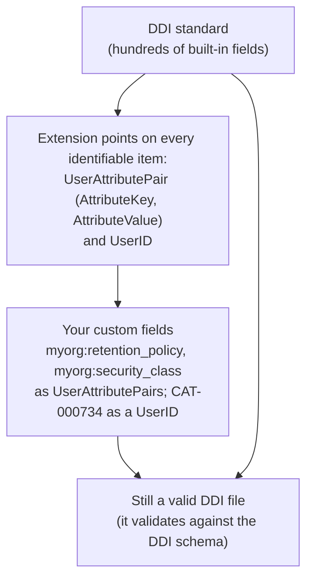

# Module 14: Custom fields: extend the standard for your organization

!!! info "Learning objectives"
    By the end of this module, you can:

    - **O1.** Add namespaced custom fields (keys such as
      `myorg:retention_policy`) with `set_property()`: on the study for facts
      about the whole dataset, and on a variable or question for facts about
      that item.
    - **O2.** Add an external identifier with `UserID`, and choose between a
      `UserID` and a custom property for a given value.
    - **O3.** Back a custom field with a controlled vocabulary: build a code
      list and store its URN in a property.
    - **O4.** Write a catalog of allowed keys and a function that refuses any
      key that is not in it.
    - **O5.** Write an audit that counts the questions and variables carrying
      a field with your prefix.
    - **O6.** Save and reopen a document, show that its custom fields survive,
      and find the `UserAttributePair` that holds a field in the XML.

**Prerequisites:** [Module 13](module-13-properties-find-validate.en.md).

**Time:** 45 min self-paced / 55 min instructor-led.

**New in this module:** `doc.study_unit`, `UserID`, `item.user_ids`,
`CodeItem`, `r:UserAttributePair`.

---

## 1. Why organizations need custom fields

DDI describes hundreds of things: questions, variables, concepts, code lists,
provenance, and more. But no standard can anticipate **every** field that
**every** organization needs.

A real archive or statistical office almost always has local metadata that DDI
has no built-in element for:

| Custom field | Example value | Who uses it |
| --- | --- | --- |
| Retention policy | "destroy after 7 years" | Records management |
| Security classification | "Confidential" | Information security |
| Data steward | "Data Governance Office" | Governance |
| Source system | "CRM-2024" | Data engineering |
| Internal catalogue number | "CAT-000734" | The archive |
| Embargo date | "2026-01-01" | Dissemination |
| Grant / project code | "GRANT-2023-435" | Research administration |

Without a place to record these, teams end up keeping them in a **separate
spreadsheet** that drifts out of sync with the data. The goal of this module is
to keep them **in the DDI file itself**, where they travel with the metadata.

## 2. The openness of the DDI standard

Here is the important idea:

!!! quote "DDI is designed to be extended"
    DDI does not force you to choose between "use only the built-in fields" and
    "abandon the standard." It provides a **standardized extension point**,
    `UserAttributePair`, so you can add your own fields **without forking the
    schema and without leaving valid DDI**.

This openness is a deliberate design choice. Compare the alternatives:

- A **closed** format would force you to either drop your custom metadata or
  invent a private, incompatible variant that no other tool understands.
- DDI's **open** design lets you add `myorg:retention_policy` today, and the
  file is still a valid DDI document that any DDI-aware tool can read, validate,
  and preserve, even if that tool does not know what `myorg:retention_policy`
  means.

Every custom field you add in this module serializes to a small, standard block
of DDI XML:

```xml
<r:UserAttributePair>
  <r:AttributeKey>myorg:retention_policy</r:AttributeKey>
  <r:AttributeValue>destroy after 7 years</r:AttributeValue>
</r:UserAttributePair>
```

That is the openness of the standard, made concrete:



## 3. Where custom fields can live

A custom field can be attached to **any** DDI item: a study, a question, a
variable, a code list, anything. Set it at the level the field describes:

- **Study level**: facts about the whole dataset (retention, security class).
  `doc.study_unit` is the study itself.
- **Item level**: facts about one variable or question (source system, quality
  flag).

```python
import ddi_l as ddi

doc = ddi.new_study(title="Household Survey", agency="survey.example.org")
q_income = doc.add_question(text="What is your household income?")
income = doc.add_variable(name="income", question=q_income)

# Study-level custom fields describe the whole dataset
study = doc.study_unit
study.set_property("myorg:retention_policy", "destroy after 7 years")
study.set_property("myorg:security_class", "Confidential")

print(study.properties)
# -> {'myorg:retention_policy': 'destroy after 7 years',
#     'myorg:security_class': 'Confidential'}
```

## 4. Add organization-specific fields

You already met `set_property` in [Module 13](module-13-properties-find-validate.en.md).
Here we use it deliberately, with a **namespace prefix** on every key so your
fields never collide with anyone else's:

```python
# Item-level custom fields describe one variable
income.set_property("myorg:source_system", "CRM-2024")
income.set_property("myorg:quality_flag", "validated")

print(income.get_property("myorg:source_system"))
# -> CRM-2024
```

!!! tip "Namespace your keys"
    Prefix every custom key with a short organization tag, like `myorg:` or
    `acme:`. This is a convention, not a requirement, but it keeps *your*
    fields distinct from a partner's fields if two DDI files are ever merged.

## 5. Custom fields round-trip: they survive save and reopen

The payoff of using the standard's own extension point: your custom fields are
written into the DDI XML and read straight back. They are not lost on save.

```python
doc.save("household-survey.xml")

reopened = ddi.open_ddi("household-survey.xml")
print(reopened.variables[0].get_property("myorg:source_system"))
# -> CRM-2024
```

Because they live inside standard DDI, another team using different software can
open your file and still see `myorg:source_system`, even if their tool has no
idea what it means. **Nothing is silently dropped.** That is interoperability.
Open `household-survey.xml` in a text editor and search for `UserAttributePair`
to see each field as the XML block of section 2.

!!! tip "Keep editing after a save"
    `income` and `q_income` stay attached to `doc` after `doc.save()`, so you
    can keep setting properties on them; the next save includes the changes.

## 6. Organization-specific identifiers with UserID

Sometimes the custom field you need is an **identifier** from another system:
an internal catalogue number, a records-management ID, a source-database key.
DDI has a second extension point for exactly this: `UserID`, which carries a
value **and** a type.

```python
from ddi_l.models.base import UserID

income.user_ids.append(UserID(value="CAT-000734", type_of_user_id="InternalCatalogue"))

uid = income.user_ids[0]
print(f"{uid.type_of_user_id}: {uid.value}")
# -> InternalCatalogue: CAT-000734
```

Use `UserID` when the value **identifies** the item in another system, and a
custom property (`set_property`) when the value **describes** it. A quick
test: if another system could look the item up by this value, it is an
identifier.

## 7. A custom field backed by a controlled vocabulary (a code list)

Free-text values are flexible but easy to get wrong ("validated", "Validated",
"valid"). For a field that should take a fixed set of values, back it with a
**code list**, a controlled vocabulary. First build the vocabulary (the same
way you did in [Module 9](module-09-code-lists.en.md)), then have a custom field
**reference** it. Passing a DDI item as the value stores its **URN**, a stable
link to that code list.

A code list is not just a bag of categories. A `Category` carries the *meaning*
("validated"); the code list holds **`Code`** entries, and each code
**references** a category. Adding a category alone does not put it in any list;
you must append a `Code` that points at it. Give every code its own
UUID4-based URN, just as `add_code_list` and `add_item` do for the list and the
categories:

```python
from uuid import uuid4

from ddi_l.models.logicalproduct import Category, CodeItem

# 1. Build the controlled vocabulary. For each allowed value, create the
#    Category (its meaning) and a Code in the list that references it.
quality_codes = doc.add_code_list(name="Quality Flag Codes")
for value in ("validated", "provisional", "suppressed"):
    category = doc.add_item(Category, name=value)
    quality_codes.codes.append(
        CodeItem(
            agency=quality_codes.agency,
            identifier=str(uuid4()),  # UUID4 → this code's URN id
            version=quality_codes.version,
            value=value,
            category=category.to_reference(),
        )
    )

print(f"Allowed codes: {len(quality_codes.codes)}")  # -> 3

# 2. A custom field holding one value drawn from that vocabulary
income.set_property("myorg:quality_flag", "validated")

# 3. A custom field that references the code list defining the allowed values
income.set_property("myorg:quality_flag_codes", quality_codes)

print(income.get_property("myorg:quality_flag"))  # -> validated
print(income.get_property("myorg:quality_flag_codes").startswith("urn:ddi:"))
# -> True
```

The `myorg:quality_flag_codes` field stores the code list's URN, and that list
defines three codes, so anyone reading the metadata knows
`myorg:quality_flag` must be one of `validated`, `provisional`, or `suppressed`,
not free text. The custom field is governed by a controlled vocabulary, and that
link travels inside the DDI file.

## 8. Design a custom-field catalog

Openness is powerful, which means it needs **governance**. If every analyst
invents their own key, the fields become as messy as the spreadsheet you were
trying to replace. Agree on a small **catalog** and apply it consistently.

```python
# A documented catalog your whole team shares
CUSTOM_FIELDS = {
    "myorg:retention_policy": "How long to keep the data (records schedule).",
    "myorg:security_class": "Security classification (e.g. Confidential).",
    "myorg:source_system": "The system the data was extracted from.",
    "myorg:quality_flag": "Data-quality status (see Quality Flag Codes).",
    "myorg:steward": "The team accountable for the item.",
}


# Apply a field only if it is in the catalog (a guard against typos)
def set_catalog_field(item, key, value):
    if key not in CUSTOM_FIELDS:
        raise ValueError(f"{key!r} is not in the custom-field catalog")
    item.set_property(key, value)


set_catalog_field(income, "myorg:steward", "Data Governance Office")
print(income.get_property("myorg:steward"))
# -> Data Governance Office
```

A catalog gives you three things: consistent **keys**, documented **meanings**,
and a single place to review your organization's extensions.

## 9. Audit which items carry your custom fields

Because custom fields are just properties, you can **scan** a document and
report on them, which is useful for governance reviews and quality assurance.

```python
def items_with_custom_fields(doc, prefix="myorg:"):
    count = 0
    for collection in (doc.questions, doc.variables):
        for item in collection:
            if any(key.startswith(prefix) for key in item.properties):
                count += 1
    return count


income.set_property("myorg:source_system", "CRM-2024")
q_income.set_property("myorg:steward", "Survey Methods")

print(f"Items with custom fields: {items_with_custom_fields(doc)}")
# -> Items with custom fields: 2
```

## 10. Good practice: and one caution

- **Namespace your keys** (`myorg:...`) so they never collide.
- **Keep a catalog** so keys and meanings stay consistent.
- **Prefer controlled vocabularies** for fields with a fixed set of values.
- **Do not reinvent built-in DDI.** If DDI already has an element (a concept, a
  universe, a version rationale), use it. Custom fields are for what the standard
  genuinely does not cover.
- **Document your fields** for outside readers. A custom field is only as useful
  as the definition that travels with it. Your file stays valid DDI, but only
  *your* catalog explains what `myorg:security_class` means.

---

!!! example "Scenario"
    Your archive receives a survey to catalogue. Records management needs a
    retention policy, information security needs a classification, and the
    archive needs its own catalogue number. DDI has a built-in field for none
    of them. Rather than keep a side spreadsheet, you record them as custom
    fields on the study and its variables, point the quality flag at a code
    list, and confirm they survive a save/reopen so they travel with the file.

---

## Exercises

1. **(O1)** Create a study with an `income` question and variable. Set two
   study-level custom fields: `myorg:retention_policy` =
   `"destroy after 7 years"` and `myorg:security_class` = `"Confidential"`.
   Set one item-level field on the `income` variable: `myorg:source_system` =
   `"CRM-2024"`. Print the study's properties, then the variable's source
   system.

    **Expected output:**

    ```text
    {'myorg:retention_policy': 'destroy after 7 years', 'myorg:security_class': 'Confidential'}
    CRM-2024
    ```

    ??? success "Answer"
        ```python
        import ddi_l as ddi

        doc = ddi.new_study(title="Household Survey", agency="survey.example.org")
        q_income = doc.add_question(text="What is your household income?")
        income = doc.add_variable(name="income", question=q_income)

        study = doc.study_unit
        study.set_property("myorg:retention_policy", "destroy after 7 years")
        study.set_property("myorg:security_class", "Confidential")
        income.set_property("myorg:source_system", "CRM-2024")

        print(study.properties)
        print(income.get_property("myorg:source_system"))  # -> CRM-2024
        ```

        The retention policy and the classification describe the whole
        dataset, so they go on the study. The source system describes one
        variable.

2. **(O2)** Attach an organization-specific external identifier to the
   `income` variable: a `UserID` with value `"CAT-000734"` and type
   `"InternalCatalogue"`. Print it as `type: value`. Then, for each value
   below, say whether it belongs in a `UserID` or in a custom property:
   (a) `RM-2291`, the records-management system's number for this variable;
   (b) `"validated"`, its quality status; (c) `"Data Governance Office"`, the
   team accountable for it.

    **Expected output:**

    ```text
    InternalCatalogue: CAT-000734
    ```

    ??? success "Answer"
        ```python
        from ddi_l.models.base import UserID

        income.user_ids.append(UserID(value="CAT-000734", type_of_user_id="InternalCatalogue"))

        uid = income.user_ids[0]
        print(f"{uid.type_of_user_id}: {uid.value}")  # -> InternalCatalogue: CAT-000734
        ```

        (a) `UserID`: another system can look the variable up by this
        number, so it identifies the item. (b) and (c) are custom
        properties: they describe the item.

3. **(O3)** Build a `Quality Flag Codes` code list with three codes
   (`validated`, `provisional`, `suppressed`), a controlled vocabulary. Set
   `myorg:quality_flag` = `"validated"` on the `income` variable, and set
   `myorg:quality_flag_codes` to the code list object so the field
   **references** that vocabulary. Print the flag, and whether the stored
   reference is a URN (starts with `"urn:ddi:"`).

    **Expected output:**

    ```text
    validated
    True
    ```

    ??? success "Answer"
        ```python
        from uuid import uuid4

        from ddi_l.models.logicalproduct import Category, CodeItem

        # Build the controlled vocabulary. Each allowed value needs a Category (its
        # meaning) AND a Code in the list that references it; a Category alone is not
        # in any list. Each Code gets its own UUID4-based URN.
        quality_codes = doc.add_code_list(name="Quality Flag Codes")
        for value in ("validated", "provisional", "suppressed"):
            category = doc.add_item(Category, name=value)
            quality_codes.codes.append(
                CodeItem(
                    agency=quality_codes.agency,
                    identifier=str(uuid4()),
                    version=quality_codes.version,
                    value=value,
                    category=category.to_reference(),
                )
            )

        # A field whose value is drawn from the vocabulary, plus a field that
        # references the code list defining the allowed values
        income.set_property("myorg:quality_flag", "validated")
        income.set_property("myorg:quality_flag_codes", quality_codes)

        print(income.get_property("myorg:quality_flag"))  # -> validated
        print(income.get_property("myorg:quality_flag_codes").startswith("urn:ddi:"))
        ```

        !!! note "Objects stay attached"
            Variables you hold remain the objects the document serializes, before
            and after `save()`.

4. **(O4)** Write a catalog `CUSTOM_FIELDS` with three keys,
   `myorg:source_system`, `myorg:quality_flag` and `myorg:steward`, each with
   a one-line meaning. Write `set_catalog_field(item, key, value)`, which sets
   the field only if the key is in the catalog and raises a `ValueError`
   otherwise. Use it to set `myorg:steward` = `"Survey Methods"` on the
   `income` variable and print the value. Then try the misspelt key
   `myorg:stewart`, catch the error, and print its message.

    **Expected output:**

    ```text
    Survey Methods
    Refused: 'myorg:stewart' is not in the custom-field catalog
    ```

    ??? success "Answer"
        ```python
        CUSTOM_FIELDS = {
            "myorg:source_system": "The system the data was extracted from.",
            "myorg:quality_flag": "Data-quality status (see Quality Flag Codes).",
            "myorg:steward": "The team accountable for the item.",
        }


        def set_catalog_field(item, key, value):
            if key not in CUSTOM_FIELDS:
                raise ValueError(f"{key!r} is not in the custom-field catalog")
            item.set_property(key, value)


        set_catalog_field(income, "myorg:steward", "Survey Methods")
        print(income.get_property("myorg:steward"))  # -> Survey Methods

        try:
            set_catalog_field(income, "myorg:stewart", "Survey Methods")
        except ValueError as error:
            print(f"Refused: {error}")
        # -> Refused: 'myorg:stewart' is not in the custom-field catalog
        ```

        Without the guard, the typo would create a second, misspelt field
        that no audit or reader looks for.

5. **(O5)** Set `myorg:steward` = `"Survey Methods"` on the income question.
   Write an audit that scans all questions and variables and counts how many
   carry a `myorg:` field. Print the count.

    **Expected output:**

    ```text
    Items with custom fields: 2
    ```

    ??? success "Answer"
        ```python
        q_income.set_property("myorg:steward", "Survey Methods")


        def items_with_custom_fields(doc, prefix="myorg:"):
            count = 0
            for collection in (doc.questions, doc.variables):
                for item in collection:
                    if any(key.startswith(prefix) for key in item.properties):
                        count += 1
            return count


        print(f"Items with custom fields: {items_with_custom_fields(doc)}")
        # -> Items with custom fields: 2
        ```

        The audit counts items, not fields: the `income` variable carries
        several `myorg:` fields and counts once.

6. **(O6)** Save the document, reopen it with `ddi.open_ddi()`, and read
   `myorg:source_system` back from the reopened variable to prove the custom
   field round-trips. Then read the saved file as text and check that it holds
   an `r:AttributeKey` element with the key `myorg:source_system`.

    **Expected output:**

    ```text
    CRM-2024
    True
    ```

    ??? success "Answer"
        ```python
        from pathlib import Path

        doc.save("household-survey.xml")

        reopened = ddi.open_ddi("household-survey.xml")
        print(reopened.variables[0].get_property("myorg:source_system"))  # -> CRM-2024

        xml = Path("household-survey.xml").read_text(encoding="utf-8")
        print("<r:AttributeKey>myorg:source_system</r:AttributeKey>" in xml)  # -> True
        ```

        The key sits in an `r:AttributeKey`, inside the `r:UserAttributePair`
        that also holds its `r:AttributeValue`.

---

## Quiz

???+ question "Question 1 (O1): Which call records that the whole dataset is classified Confidential?"
    **A.** `income.set_property("myorg:security_class", "Confidential")`

    **B.** `doc.study_unit.set_property("myorg:security_class", "Confidential")`

    **C.** `q_income.set_property("security_class", "Confidential")`

    **D.** `doc.add_variable(name="myorg:security_class")`

    ??? success "Answer"
        **B.** A fact about the whole dataset goes on the study,
        `doc.study_unit`. A and C put it on one item (and C drops the
        namespace prefix). D creates a variable, not a field.

???+ question "Question 2 (O6): You save a document and search the XML for your key myorg:source_system. Where do you find it?"
    **A.** In an `r:UserID` element.

    **B.** In the variable's `r:Label`.

    **C.** In an `r:AttributeKey`, inside an `r:UserAttributePair`.

    **D.** Nowhere: custom fields are not saved.

    ??? success "Answer"
        **C.** `set_property` writes an `r:UserAttributePair` with an
        `r:AttributeKey` and an `r:AttributeValue`, the standard's extension
        point for custom fields. That is why the field survives save and
        reopen.

???+ question "Question 3 (O2): RM-2291 is the records-management system's number for a variable. Where do you record it?"
    **A.** In a `UserID`, with a type such as `"RecordsManagement"`.

    **B.** In the variable's label.

    **C.** In a custom property, because every extra value is a property.

    **D.** In a separate spreadsheet.

    ??? success "Answer"
        **A.** The value **identifies** the variable in another system, so it
        is a `UserID`. Use a custom property when the value **describes** the
        item.

???+ question "Question 4 (O3): quality_codes is a code list. What does get_property return after this call?"
    `income.set_property("myorg:quality_flag_codes", quality_codes)`

    **A.** The `CodeList` object itself.

    **B.** The string `"Quality Flag Codes"`.

    **C.** The list `['validated', 'provisional', 'suppressed']`.

    **D.** The code list's URN, a string that starts with `urn:ddi:`.

    ??? success "Answer"
        **D.** Passing a DDI item as the value stores its URN, a stable link
        to the code list. Properties always hold strings.

???+ question "Question 5 (O4): With the catalog guard of section 8, what does set_catalog_field(income, 'myorg:stewart', 'X') do?"
    **A.** Sets `myorg:stewart` on `income`.

    **B.** Corrects the key to `myorg:steward` and sets it.

    **C.** Does nothing and says nothing.

    **D.** Raises a `ValueError` and sets nothing.

    ??? success "Answer"
        **D.** The key is not in `CUSTOM_FIELDS`, so the function raises
        before it calls `set_property`. The typo is caught instead of
        creating a misspelt field.

???+ question "Question 6 (O5): A question has no properties; variable v1 has myorg:a and myorg:b; variable v2 has other:flag. What does items_with_custom_fields(doc) return?"
    **A.** 1

    **B.** 2

    **C.** 3

    **D.** 0

    ??? success "Answer"
        **A.** Only `v1` has a key that starts with `myorg:`. The audit
        counts items, not fields, so its two fields count once, and
        `other:flag` does not match the prefix.

---

## Check yourself

- [ ] I can add namespaced custom fields at the study level and at the item level, choosing the level each field describes. (O1)
- [ ] I can add a `UserID` and choose between a `UserID` and a custom property for a value. (O2)
- [ ] I can back a custom field with a code list by storing the list's URN in a property. (O3)
- [ ] I can write a catalog of allowed keys and a function that refuses any other key. (O4)
- [ ] I can write an audit that counts the items carrying my prefix. (O5)
- [ ] I can show that custom fields survive save and reopen, and find their `UserAttributePair` in the XML. (O6)

---

!!! tip "Instructor notes"
    - Open with the "side spreadsheet" problem: every organization has local
      metadata, and it always drifts out of sync when kept outside the file.
      Custom fields fix that by keeping it in the DDI.
    - Make the openness point explicitly: DDI gives you a *standardized* way to
      extend it. Show the `UserAttributePair` XML on screen so learners see the
      custom field is still valid DDI, not a hack. Exercise 6 has them find it
      themselves.
    - Draw the line between Module 13 and this module: Module 13 taught the
      `set_property` *mechanics*; this module is about *governing* extensions for
      an organization: catalogs, namespaces, controlled values, auditing.
    - The `UserID` vs custom-property distinction (identify vs describe) is a
      common point of confusion. Give two quick examples of each.
    - For staff of statistical offices and archives: connect to real governance:
      records-retention schedules, security classifications, data-steward
      assignments. These are audited in practice, and Section 9's audit loop is
      how you report on them.
    - Emphasize the one caution: do not reinvent built-in DDI. Custom fields are
      for genuine gaps, not for re-doing concepts, universes, or versioning.

---

**See also:** [Module 13: Custom properties, find, remove, and validate](module-13-properties-find-validate.en.md) | [Module 15: Update and version](module-15-update-and-version.en.md) | [User guide: Custom properties](../user-guide.en.md)
