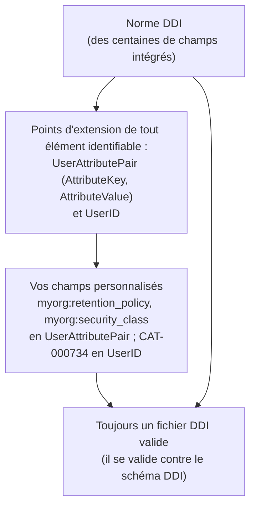

# Module 14 : Champs personnalisés : étendre la norme pour votre organisation

!!! info "Objectifs d'apprentissage"
    À la fin de ce module, vous pouvez :

    - **O1.** Ajouter des champs personnalisés préfixés (des clés comme
      `myorg:retention_policy`) avec `set_property()` : sur l'étude pour des
      faits sur l'ensemble du jeu de données, et sur une variable ou une
      question pour des faits sur cet élément.
    - **O2.** Ajouter un identifiant externe avec `UserID`, et choisir entre
      un `UserID` et une propriété personnalisée pour une valeur donnée.
    - **O3.** Adosser un champ personnalisé à un vocabulaire contrôlé :
      construire une liste de codes et stocker son URN dans une propriété.
    - **O4.** Écrire un catalogue des clés autorisées et une fonction qui
      refuse toute clé absente du catalogue.
    - **O5.** Écrire un audit qui compte les questions et les variables
      portant un champ avec votre préfixe.
    - **O6.** Enregistrer et rouvrir un document, montrer que ses champs
      personnalisés survivent, et trouver dans le XML le `UserAttributePair`
      qui contient un champ.

**Prérequis :** [Module 13](module-13-properties-find-validate.fr.md).

**Durée :** 45 min en autonomie / 55 min avec instructeur.

**Nouveau dans ce module :** `doc.study_unit`, `UserID`, `item.user_ids`,
`CodeItem`, `r:UserAttributePair`.

---

## 1. Pourquoi les organisations ont besoin de champs personnalisés

DDI décrit des centaines de choses : questions, variables, concepts, listes de
codes, provenance, et plus. Mais aucune norme ne peut anticiper **tous** les
champs dont **chaque** organisation a besoin.

Une archive ou un institut de statistique réel a presque toujours des
métadonnées locales pour lesquelles DDI n'a aucun élément intégré :

| Champ personnalisé | Exemple de valeur | Qui l'utilise |
| --- | --- | --- |
| Politique de conservation | « détruire après 7 ans » | Gestion des documents |
| Classification de sécurité | « Confidentiel » | Sécurité de l'information |
| Gestionnaire des données | « Bureau de gouvernance des données » | Gouvernance |
| Système source | « CRM-2024 » | Ingénierie des données |
| Numéro de catalogue interne | « CAT-000734 » | L'archive |
| Date d'embargo | « 2026-01-01 » | Diffusion |
| Code de projet / subvention | « GRANT-2023-435 » | Administration de la recherche |

Sans endroit où les consigner, les équipes finissent par les garder dans un
**chiffrier séparé** qui se désynchronise des données. Le but de ce module est
de les garder **dans le fichier DDI lui-même**, où ils voyagent avec les
métadonnées.

## 2. L'ouverture de la norme DDI

Voici l'idée importante :

!!! quote "DDI est conçu pour être étendu"
    DDI ne vous force pas à choisir entre « n'utiliser que les champs intégrés »
    et « abandonner la norme ». Il fournit un **point d'extension normalisé**,
    `UserAttributePair`, afin que vous puissiez ajouter vos propres champs
    **sans forker le schéma et sans quitter le DDI valide**.

Cette ouverture est un choix de conception délibéré. Comparez les possibilités :

- Un format **fermé** vous forcerait soit à abandonner vos métadonnées
  personnalisées, soit à inventer une variante privée et incompatible qu'aucun
  autre outil ne comprend.
- La conception **ouverte** de DDI vous laisse ajouter `myorg:retention_policy`
  aujourd'hui, et le fichier reste un document DDI valide que n'importe quel
  outil compatible DDI peut lire, valider et préserver, même s'il ne sait pas
  ce que `myorg:retention_policy` signifie.

Chaque champ personnalisé que vous ajoutez dans ce module se sérialise en un
petit bloc standard de XML DDI :

```xml
<r:UserAttributePair>
  <r:AttributeKey>myorg:retention_policy</r:AttributeKey>
  <r:AttributeValue>détruire après 7 ans</r:AttributeValue>
</r:UserAttributePair>
```

C'est l'ouverture de la norme, rendue concrète :



## 3. Où peuvent vivre les champs personnalisés

Un champ personnalisé peut être attaché à **n'importe quel** élément DDI : une
étude, une question, une variable, une liste de codes, tout. Placez-le au niveau
que le champ décrit :

- **Niveau étude** : des faits sur l'ensemble du jeu de données (conservation,
  classification de sécurité). `doc.study_unit` est l'étude elle-même.
- **Niveau élément** : des faits sur une variable ou une question (système
  source, indicateur de qualité).

```python
import ddi_l as ddi

doc = ddi.new_study(title="Household Survey", agency="survey.example.org")
q_income = doc.add_question(text="What is your household income?")
income = doc.add_variable(name="income", question=q_income)

# Study-level custom fields describe the whole dataset
study = doc.study_unit
study.set_property("myorg:retention_policy", "destroy after 7 years")
study.set_property("myorg:security_class", "Confidential")

print(study.properties)
# -> {'myorg:retention_policy': 'destroy after 7 years',
#     'myorg:security_class': 'Confidential'}
```

## 4. Ajouter des champs propres à l'organisation

Vous avez déjà rencontré `set_property` au
[Module 13](module-13-properties-find-validate.fr.md). Ici, nous l'utilisons
délibérément, avec un **préfixe d'espace de noms** sur chaque clé afin que vos
champs n'entrent jamais en collision avec ceux d'un autre :

```python
# Item-level custom fields describe one variable
income.set_property("myorg:source_system", "CRM-2024")
income.set_property("myorg:quality_flag", "validated")

print(income.get_property("myorg:source_system"))
# -> CRM-2024
```

!!! tip "Préfixez vos clés"
    Préfixez chaque clé personnalisée d'une courte étiquette d'organisation,
    comme `myorg:` ou `acme:`. C'est une convention, pas une exigence, mais
    elle garde *vos* champs distincts de ceux d'un partenaire si deux fichiers
    DDI sont un jour fusionnés.

## 5. Les champs personnalisés font un aller-retour : ils survivent

Le bénéfice d'utiliser le point d'extension propre à la norme : vos champs
personnalisés sont écrits dans le XML DDI et relus directement. Ils ne sont pas
perdus à l'enregistrement.

```python
doc.save("household-survey.xml")

reopened = ddi.open_ddi("household-survey.xml")
print(reopened.variables[0].get_property("myorg:source_system"))
# -> CRM-2024
```

Parce qu'ils vivent dans du DDI standard, une autre équipe utilisant un logiciel
différent peut ouvrir votre fichier et voir encore `myorg:source_system`, même
si son outil ignore ce que cela signifie. **Rien n'est silencieusement
supprimé.** C'est l'interopérabilité. Ouvrez `household-survey.xml` dans un
éditeur de texte et cherchez `UserAttributePair` pour voir chaque champ sous
la forme du bloc XML de la section 2.

!!! tip "Continuer après un enregistrement"
    `income` et `q_income` restent attachés à `doc` après `doc.save()` : vous
    pouvez continuer à leur ajouter des propriétés, et l'enregistrement suivant
    les inclut.

## 6. Identifiants propres à l'organisation avec UserID

Parfois le champ personnalisé dont vous avez besoin est un **identifiant**
provenant d'un autre système : un numéro de catalogue interne, un identifiant de
gestion documentaire, une clé de base de données source. DDI a un deuxième point
d'extension exactement pour cela : `UserID`, qui porte une valeur **et** un type.

```python
from ddi_l.models.base import UserID

income.user_ids.append(UserID(value="CAT-000734", type_of_user_id="InternalCatalogue"))

uid = income.user_ids[0]
print(f"{uid.type_of_user_id}: {uid.value}")
# -> InternalCatalogue: CAT-000734
```

Utilisez `UserID` quand la valeur **identifie** l'élément dans un autre système,
et une propriété personnalisée (`set_property`) quand la valeur le **décrit**.
Un test rapide : si un autre système pourrait retrouver l'élément par cette
valeur, c'est un identifiant.

## 7. Un champ personnalisé adossé à un vocabulaire contrôlé (une liste de codes)

Les valeurs en texte libre sont flexibles mais faciles à mal saisir
(« validated », « Validated », « valid »). Pour un champ qui devrait prendre un
ensemble fixe de valeurs, adossez-le à une **liste de codes**, un vocabulaire
contrôlé. Construisez d'abord le vocabulaire (comme au
[Module 9](module-09-code-lists.fr.md)), puis faites qu'un champ personnalisé le
**référence**. Passer un élément DDI comme valeur stocke son **URN**, un lien
stable vers cette liste de codes.

Une liste de codes n'est pas un simple sac de catégories. Une `Category` porte le
*sens* (« validated ») ; la liste de codes contient des entrées **`Code`**, et
chaque code **référence** une catégorie. Ajouter une catégorie seule ne la place
dans aucune liste ; vous devez ajouter un `Code` qui pointe vers elle. Donnez à
chaque code son propre URN fondé sur un UUID4, tout comme `add_code_list` et
`add_item` le font pour la liste et les catégories :

```python
from uuid import uuid4

from ddi_l.models.logicalproduct import Category, CodeItem

# 1. Build the controlled vocabulary. For each allowed value, create the
#    Category (its meaning) and a Code in the list that references it.
quality_codes = doc.add_code_list(name="Quality Flag Codes")
for value in ("validated", "provisional", "suppressed"):
    category = doc.add_item(Category, name=value)
    quality_codes.codes.append(
        CodeItem(
            agency=quality_codes.agency,
            identifier=str(uuid4()),  # UUID4 → this code's URN id
            version=quality_codes.version,
            value=value,
            category=category.to_reference(),
        )
    )

print(f"Allowed codes: {len(quality_codes.codes)}")  # -> 3

# 2. A custom field holding one value drawn from that vocabulary
income.set_property("myorg:quality_flag", "validated")

# 3. A custom field that references the code list defining the allowed values
income.set_property("myorg:quality_flag_codes", quality_codes)

print(income.get_property("myorg:quality_flag"))  # -> validated
print(income.get_property("myorg:quality_flag_codes").startswith("urn:ddi:"))
# -> True
```

Le champ `myorg:quality_flag_codes` stocke l'URN de la liste de codes, et cette
liste définit trois codes, de sorte que quiconque lit les
métadonnées sait que `myorg:quality_flag` doit être l'un de `validated`,
`provisional` ou `suppressed`, et non du texte libre. Le champ
personnalisé est régi par un vocabulaire contrôlé, et ce lien voyage à
l'intérieur du fichier DDI.

## 8. Concevoir un catalogue de champs personnalisés

L'ouverture est puissante, ce qui signifie qu'elle a besoin de **gouvernance**.
Si chaque analyste invente sa propre clé, les champs deviennent aussi
désordonnés que le chiffrier que vous essayiez de remplacer. Convenez d'un petit
**catalogue** et appliquez-le de manière cohérente.

```python
# A documented catalog your whole team shares
CUSTOM_FIELDS = {
    "myorg:retention_policy": "How long to keep the data (records schedule).",
    "myorg:security_class": "Security classification (e.g. Confidential).",
    "myorg:source_system": "The system the data was extracted from.",
    "myorg:quality_flag": "Data-quality status (see Quality Flag Codes).",
    "myorg:steward": "The team accountable for the item.",
}


# Apply a field only if it is in the catalog (a guard against typos)
def set_catalog_field(item, key, value):
    if key not in CUSTOM_FIELDS:
        raise ValueError(f"{key!r} is not in the custom-field catalog")
    item.set_property(key, value)


set_catalog_field(income, "myorg:steward", "Data Governance Office")
print(income.get_property("myorg:steward"))
# -> Data Governance Office
```

Un catalogue vous donne trois choses : des **clés** cohérentes, des
**significations** documentées, et un seul endroit pour réviser les extensions de
votre organisation.

## 9. Auditer quels éléments portent vos champs personnalisés

Parce que les champs personnalisés ne sont que des propriétés, vous pouvez
**parcourir** un document et en faire rapport, ce qui est utile pour les revues de
gouvernance et l'assurance qualité.

```python
def items_with_custom_fields(doc, prefix="myorg:"):
    count = 0
    for collection in (doc.questions, doc.variables):
        for item in collection:
            if any(key.startswith(prefix) for key in item.properties):
                count += 1
    return count


income.set_property("myorg:source_system", "CRM-2024")
q_income.set_property("myorg:steward", "Survey Methods")

print(f"Items with custom fields: {items_with_custom_fields(doc)}")
# -> Items with custom fields: 2
```

## 10. Bonnes pratiques : et une mise en garde

- **Préfixez vos clés** (`myorg:...`) pour qu'elles n'entrent jamais en collision.
- **Tenez un catalogue** pour que les clés et les significations restent cohérentes.
- **Préférez les vocabulaires contrôlés** pour les champs à ensemble fixe de valeurs.
- **Ne réinventez pas le DDI intégré.** Si DDI a déjà un élément (un concept, un
  univers, une justification de version), utilisez-le. Les champs personnalisés
  sont pour ce que la norme ne couvre vraiment pas.
- **Documentez vos champs** pour les lecteurs externes. Un champ personnalisé
  n'est utile que par la définition qui l'accompagne. Votre fichier reste du DDI
  valide, mais seul *votre* catalogue explique ce que `myorg:security_class`
  signifie.

---

!!! example "Scénario"
    Votre archive reçoit une enquête à cataloguer. La gestion documentaire a
    besoin d'une politique de conservation, la sécurité de l'information d'une
    classification, et l'archive de son propre numéro de catalogue, et aucun n'a
    de champ intégré dans DDI. Plutôt que de tenir un chiffrier parallèle, vous
    les consignez comme champs personnalisés sur l'étude et ses variables, faites
    pointer l'indicateur de qualité vers une liste de codes, et confirmez qu'ils
    survivent à un aller-retour enregistrement/réouverture afin qu'ils voyagent
    avec le fichier.

---

## Exercices

1. **(O1)** Créez une étude avec une question et une variable `income`.
   Définissez deux champs personnalisés au niveau étude :
   `myorg:retention_policy` = `"destroy after 7 years"` et
   `myorg:security_class` = `"Confidential"`. Définissez un champ au niveau
   élément sur la variable `income` : `myorg:source_system` = `"CRM-2024"`.
   Affichez les propriétés de l'étude, puis le système source de la variable.

    **Résultat attendu :**

    ```text
    {'myorg:retention_policy': 'destroy after 7 years', 'myorg:security_class': 'Confidential'}
    CRM-2024
    ```

    ??? success "Réponse"
        ```python
        import ddi_l as ddi

        doc = ddi.new_study(title="Household Survey", agency="survey.example.org")
        q_income = doc.add_question(text="What is your household income?")
        income = doc.add_variable(name="income", question=q_income)

        study = doc.study_unit
        study.set_property("myorg:retention_policy", "destroy after 7 years")
        study.set_property("myorg:security_class", "Confidential")
        income.set_property("myorg:source_system", "CRM-2024")

        print(study.properties)
        print(income.get_property("myorg:source_system"))  # -> CRM-2024
        ```

        La politique de conservation et la classification décrivent tout le
        jeu de données : elles vont sur l'étude. Le système source décrit
        une seule variable.

2. **(O2)** Attachez un identifiant externe propre à l'organisation à la
   variable `income` : un `UserID` de valeur `"CAT-000734"` et de type
   `"InternalCatalogue"`. Affichez-le sous la forme `type: valeur`. Ensuite,
   pour chaque valeur ci-dessous, dites si elle va dans un `UserID` ou dans
   une propriété personnalisée : (a) `RM-2291`, le numéro de cette variable
   dans le système de gestion documentaire ; (b) `"validated"`, son statut de
   qualité ; (c) `"Data Governance Office"`, l'équipe qui en répond.

    **Résultat attendu :**

    ```text
    InternalCatalogue: CAT-000734
    ```

    ??? success "Réponse"
        ```python
        from ddi_l.models.base import UserID

        income.user_ids.append(UserID(value="CAT-000734", type_of_user_id="InternalCatalogue"))

        uid = income.user_ids[0]
        print(f"{uid.type_of_user_id}: {uid.value}")  # -> InternalCatalogue: CAT-000734
        ```

        (a) `UserID` : un autre système peut retrouver la variable par ce
        numéro, il identifie donc l'élément. (b) et (c) sont des propriétés
        personnalisées : elles décrivent l'élément.

3. **(O3)** Construisez une liste de codes `Quality Flag Codes` avec trois
   codes (`validated`, `provisional`, `suppressed`), un vocabulaire contrôlé.
   Définissez `myorg:quality_flag` = `"validated"` sur la variable `income`, et
   définissez `myorg:quality_flag_codes` sur l'objet liste de codes pour que le
   champ **référence** ce vocabulaire. Affichez l'indicateur, et si la
   référence stockée est un URN (commence par `"urn:ddi:"`).

    **Résultat attendu :**

    ```text
    validated
    True
    ```

    ??? success "Réponse"
        ```python
        from uuid import uuid4

        from ddi_l.models.logicalproduct import Category, CodeItem

        # Build the controlled vocabulary. Each allowed value needs a Category (its
        # meaning) AND a Code in the list that references it; a Category alone is not
        # in any list. Each Code gets its own UUID4-based URN.
        quality_codes = doc.add_code_list(name="Quality Flag Codes")
        for value in ("validated", "provisional", "suppressed"):
            category = doc.add_item(Category, name=value)
            quality_codes.codes.append(
                CodeItem(
                    agency=quality_codes.agency,
                    identifier=str(uuid4()),
                    version=quality_codes.version,
                    value=value,
                    category=category.to_reference(),
                )
            )

        # A field whose value is drawn from the vocabulary, plus a field that
        # references the code list defining the allowed values
        income.set_property("myorg:quality_flag", "validated")
        income.set_property("myorg:quality_flag_codes", quality_codes)

        print(income.get_property("myorg:quality_flag"))  # -> validated
        print(income.get_property("myorg:quality_flag_codes").startswith("urn:ddi:"))
        ```

        !!! note "Les objets restent attachés"
            Les variables que vous tenez restent les objets que le document
            sérialise, avant comme après `save()`.

4. **(O4)** Écrivez un catalogue `CUSTOM_FIELDS` avec trois clés,
   `myorg:source_system`, `myorg:quality_flag` et `myorg:steward`, chacune
   avec une signification d'une ligne. Écrivez
   `set_catalog_field(item, key, value)`, qui ne définit le champ que si la
   clé est dans le catalogue et lève une `ValueError` sinon. Utilisez-la pour
   définir `myorg:steward` = `"Survey Methods"` sur la variable `income` et
   affichez la valeur. Essayez ensuite la clé mal orthographiée
   `myorg:stewart`, attrapez l'erreur et affichez son message.

    **Résultat attendu :**

    ```text
    Survey Methods
    Refused: 'myorg:stewart' is not in the custom-field catalog
    ```

    ??? success "Réponse"
        ```python
        CUSTOM_FIELDS = {
            "myorg:source_system": "The system the data was extracted from.",
            "myorg:quality_flag": "Data-quality status (see Quality Flag Codes).",
            "myorg:steward": "The team accountable for the item.",
        }


        def set_catalog_field(item, key, value):
            if key not in CUSTOM_FIELDS:
                raise ValueError(f"{key!r} is not in the custom-field catalog")
            item.set_property(key, value)


        set_catalog_field(income, "myorg:steward", "Survey Methods")
        print(income.get_property("myorg:steward"))  # -> Survey Methods

        try:
            set_catalog_field(income, "myorg:stewart", "Survey Methods")
        except ValueError as error:
            print(f"Refused: {error}")
        # -> Refused: 'myorg:stewart' is not in the custom-field catalog
        ```

        Sans le garde-fou, la faute de frappe créerait un second champ, mal
        orthographié, qu'aucun audit ni lecteur ne cherche.

5. **(O5)** Définissez `myorg:steward` = `"Survey Methods"` sur la question du
   revenu. Écrivez un audit qui parcourt toutes les questions et variables et
   compte combien portent un champ `myorg:`. Affichez le compteur.

    **Résultat attendu :**

    ```text
    Items with custom fields: 2
    ```

    ??? success "Réponse"
        ```python
        q_income.set_property("myorg:steward", "Survey Methods")


        def items_with_custom_fields(doc, prefix="myorg:"):
            count = 0
            for collection in (doc.questions, doc.variables):
                for item in collection:
                    if any(key.startswith(prefix) for key in item.properties):
                        count += 1
            return count


        print(f"Items with custom fields: {items_with_custom_fields(doc)}")
        # -> Items with custom fields: 2
        ```

        L'audit compte des éléments, pas des champs : la variable `income`
        porte plusieurs champs `myorg:` et compte une fois.

6. **(O6)** Enregistrez le document, rouvrez-le avec `ddi.open_ddi()`, et
   relisez `myorg:source_system` depuis la variable rouverte pour prouver que
   le champ personnalisé fait un aller-retour. Lisez ensuite le fichier
   enregistré comme texte et vérifiez qu'il contient un élément
   `r:AttributeKey` avec la clé `myorg:source_system`.

    **Résultat attendu :**

    ```text
    CRM-2024
    True
    ```

    ??? success "Réponse"
        ```python
        from pathlib import Path

        doc.save("household-survey.xml")

        reopened = ddi.open_ddi("household-survey.xml")
        print(reopened.variables[0].get_property("myorg:source_system"))  # -> CRM-2024

        xml = Path("household-survey.xml").read_text(encoding="utf-8")
        print("<r:AttributeKey>myorg:source_system</r:AttributeKey>" in xml)  # -> True
        ```

        La clé est dans un `r:AttributeKey`, à l'intérieur du
        `r:UserAttributePair` qui contient aussi son `r:AttributeValue`.

---

## Quiz

???+ question "Question 1 (O1) : Quel appel consigne que tout le jeu de données est classé Confidential ?"
    **A.** `income.set_property("myorg:security_class", "Confidential")`

    **B.** `doc.study_unit.set_property("myorg:security_class", "Confidential")`

    **C.** `q_income.set_property("security_class", "Confidential")`

    **D.** `doc.add_variable(name="myorg:security_class")`

    ??? success "Réponse"
        **B.** Un fait sur tout le jeu de données va sur l'étude,
        `doc.study_unit`. A et C le placent sur un seul élément (et C perd le
        préfixe). D crée une variable, pas un champ.

???+ question "Question 2 (O6) : Vous enregistrez un document et cherchez votre clé myorg:source_system dans le XML. Où la trouvez-vous ?"
    **A.** Dans un élément `r:UserID`.

    **B.** Dans le `r:Label` de la variable.

    **C.** Dans un `r:AttributeKey`, à l'intérieur d'un `r:UserAttributePair`.

    **D.** Nulle part : les champs personnalisés ne sont pas enregistrés.

    ??? success "Réponse"
        **C.** `set_property` écrit un `r:UserAttributePair` avec un
        `r:AttributeKey` et un `r:AttributeValue`, le point d'extension de la
        norme pour les champs personnalisés. C'est pourquoi le champ survit à
        l'enregistrement et à la réouverture.

???+ question "Question 3 (O2) : RM-2291 est le numéro d'une variable dans le système de gestion documentaire. Où le consignez-vous ?"
    **A.** Dans un `UserID`, avec un type comme `"RecordsManagement"`.

    **B.** Dans l'étiquette de la variable.

    **C.** Dans une propriété personnalisée, puisque toute valeur en plus est une propriété.

    **D.** Dans un chiffrier séparé.

    ??? success "Réponse"
        **A.** La valeur **identifie** la variable dans un autre système :
        c'est un `UserID`. Utilisez une propriété personnalisée quand la
        valeur **décrit** l'élément.

???+ question "Question 4 (O3) : quality_codes est une liste de codes. Que retourne get_property après cet appel ?"
    `income.set_property("myorg:quality_flag_codes", quality_codes)`

    **A.** L'objet `CodeList` lui-même.

    **B.** La chaîne `"Quality Flag Codes"`.

    **C.** La liste `['validated', 'provisional', 'suppressed']`.

    **D.** L'URN de la liste de codes, une chaîne qui commence par `urn:ddi:`.

    ??? success "Réponse"
        **D.** Passer un élément DDI comme valeur stocke son URN, un lien
        stable vers la liste de codes. Les propriétés contiennent toujours
        des chaînes.

???+ question "Question 5 (O4) : Avec le garde-fou de catalogue de la section 8, que fait set_catalog_field(income, 'myorg:stewart', 'X') ?"
    **A.** Définit `myorg:stewart` sur `income`.

    **B.** Corrige la clé en `myorg:steward` et la définit.

    **C.** Ne fait rien et ne dit rien.

    **D.** Lève une `ValueError` et ne définit rien.

    ??? success "Réponse"
        **D.** La clé n'est pas dans `CUSTOM_FIELDS` : la fonction lève une
        erreur avant d'appeler `set_property`. La faute de frappe est
        attrapée au lieu de créer un champ mal orthographié.

???+ question "Question 6 (O5) : Une question n'a aucune propriété ; la variable v1 a myorg:a et myorg:b ; la variable v2 a other:flag. Que retourne items_with_custom_fields(doc) ?"
    **A.** 1

    **B.** 2

    **C.** 3

    **D.** 0

    ??? success "Réponse"
        **A.** Seule `v1` a une clé qui commence par `myorg:`. L'audit
        compte des éléments, pas des champs : ses deux champs comptent une
        fois, et `other:flag` ne correspond pas au préfixe.

---

## Faites le point

- [ ] Je peux ajouter des champs personnalisés préfixés au niveau étude et au niveau élément, en choisissant le niveau que chaque champ décrit. (O1)
- [ ] Je peux ajouter un `UserID` et choisir entre un `UserID` et une propriété personnalisée pour une valeur. (O2)
- [ ] Je peux adosser un champ personnalisé à une liste de codes en stockant l'URN de la liste dans une propriété. (O3)
- [ ] Je peux écrire un catalogue des clés autorisées et une fonction qui refuse toute autre clé. (O4)
- [ ] Je peux écrire un audit qui compte les éléments portant mon préfixe. (O5)
- [ ] Je peux montrer que les champs personnalisés survivent à l'enregistrement et à la réouverture, et trouver leur `UserAttributePair` dans le XML. (O6)

---

!!! tip "Notes pour l'instructeur"
    - Commencez par le problème du « chiffrier parallèle » : chaque organisation
      a des métadonnées locales, et elles se désynchronisent toujours quand elles
      sont gardées hors du fichier. Les champs personnalisés corrigent cela en
      les gardant dans le DDI.
    - Faites le point d'ouverture explicitement : DDI vous donne une façon
      *normalisée* de l'étendre. Montrez le XML `UserAttributePair` à l'écran pour
      que les apprenants voient que le champ personnalisé est toujours du DDI
      valide, pas un bricolage. L'exercice 6 le leur fait trouver eux-mêmes.
    - Tracez la ligne entre le Module 13 et ce module : le Module 13 enseignait la
      *mécanique* de `set_property` ; ce module porte sur la *gouvernance* des
      extensions pour une organisation : catalogues, espaces de noms, valeurs
      contrôlées, audit.
    - La distinction `UserID` vs propriété personnalisée (identifier vs décrire)
      est une source de confusion courante. Donnez deux exemples rapides de
      chaque.
    - Pour le personnel des instituts de statistique et des archives : reliez à
      la gouvernance réelle : calendriers de conservation, classifications de
      sécurité, affectation de gestionnaires de données. Ce sont des choses
      auditées en pratique, et la boucle d'audit de la section 9 est la façon
      d'en faire rapport.
    - Insistez sur la mise en garde : ne réinventez pas le DDI intégré. Les champs
      personnalisés sont pour de véritables lacunes, pas pour refaire les
      concepts, les univers ou le versionnage.

---

**Voir aussi :** [Module 13 : Propriétés personnalisées, recherche, suppression et validation](module-13-properties-find-validate.fr.md) | [Module 15 : Mise à jour et versionnage](module-15-update-and-version.fr.md) | [Guide utilisateur : Propriétés personnalisées](../user-guide.fr.md)
