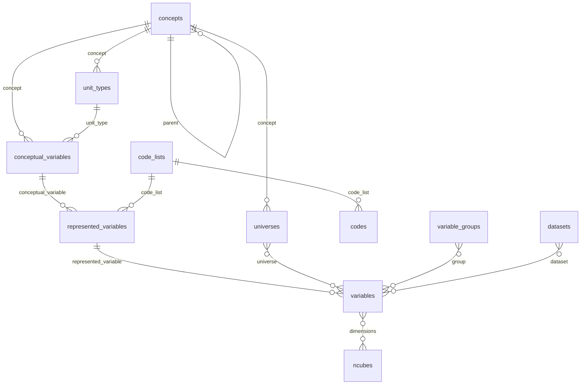
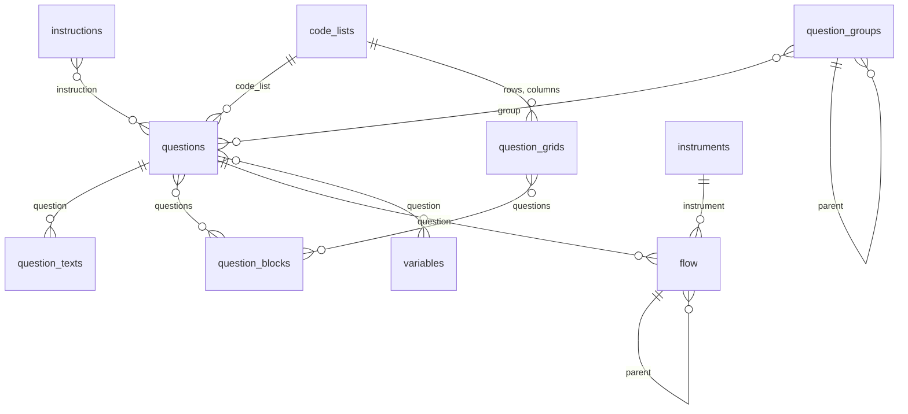
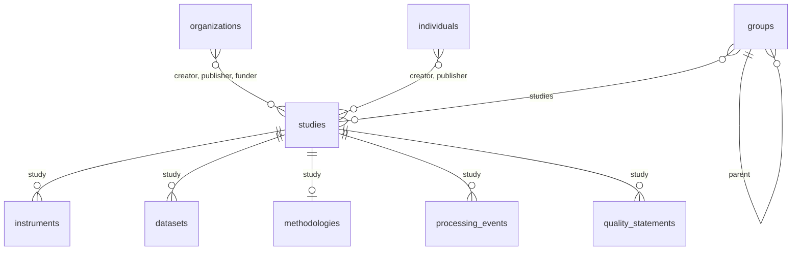

# Load DDI from spreadsheets

Many teams keep their metadata in spreadsheets: one row per variable, one per
question, one per code. `ddi-l` loads those spreadsheets into DDI in one step,
as long as they follow the layout on this page: one table per kind of item,
with rows that point at each other by `id`.

The tables can be a folder of CSV files, the same zipped, or one Excel
workbook with a sheet per table. The result is a Colectica `FragmentInstance` ready to import into a
repository, or a DDI study.

Start from a template: the [spreadsheet templates](spreadsheet-templates.md)
page has blank tables and a filled-in bilingual example, as CSV files and as
an Excel workbook.

## What the tables cover

The tables cover what most organizations document about a study, from its
citation to its questionnaire, variables and data files.

| Area | Tables | DDI items |
| --- | --- | --- |
| The study | `studies`, `groups`, `organizations`, `individuals` | StudyUnit, Group, Organization, Individual |
| Concepts | `concepts`, `universes`, `unit_types` | Concept, Universe, UnitType |
| Variables | `conceptual_variables`, `represented_variables`, `variables` | ConceptualVariable, RepresentedVariable, Variable |
| Codes | `code_lists`, `codes` | CodeList (flat or hierarchical), Category |
| Questions | `instructions`, `questions`, `question_texts`, `question_grids`, `question_blocks`, `question_groups` | Instruction, QuestionItem, QuestionGrid, QuestionBlock, QuestionGroup |
| Questionnaire | `instruments`, `flow` | Instrument, Sequence, QuestionConstruct, StatementItem, IfThenElse, Loop |
| Data | `variable_groups`, `datasets`, `ncubes` | VariableGroup, PhysicalInstance, DataRelationship, NCube |
| Methods and quality | `methodologies`, `processing_events`, `quality_statements` | Methodology, ProcessingEvent, QualityStatement |
| Comparison | `comparisons` | ConceptMap, UniverseMap, QuestionMap, VariableMap, CategoryMap |

`settings` holds the agency, version and language every table uses.

Use the tables you need and leave out the rest: a folder with only
`settings`, `concepts` and `variables` is fine.

Some things are not in the tables: column positions of fixed-width files,
classification levels and families, geography, sampling plans, derivation
and computation code, and managed missing-value schemes. Load the tables,
then add those to the typed models in Python, or in Colectica.

## How the tables fit together

A column that points at another table holds that table's `id`s. The diagrams
show the links, one area at a time.

Concepts, codes and variables:



Questions and the questionnaire:



The study, its people and what hangs from it:



## Rules every table follows

- **One file or sheet per table**, named as in the tables above:
  `concepts.csv`, or a sheet called `concepts`. The first row holds the column
  names; every other row is one item.
- **`id` is your key.** Give every row an `id`, unique within its table: the
  variable name, a question number, anything without spaces. Other tables use
  it to point at the row: a variable's `question` column holds a question's
  `id`.
- **Several ids in one cell** are separated by `|`: `Q_AGE|Q_AGE_PROXY`.
- **Empty cells are fine.** Only the columns marked required below must be
  filled.
- **Notes columns are ignored.** A column whose name starts with `#` or `_` is
  yours, for comments or working notes.
- **Unknown columns are errors**, so a misspelled `lable@en` is caught rather
  than silently dropped.
- **One study needs no `study` column.** When `studies` has a single row,
  instruments, data files, methodologies, processing events and quality
  statements with an empty `study` belong to it.

### Identifiers and versions

Every item gets a DDI identifier (a UUID). Leave `ddi_id` empty and one is
derived from the agency, the table and the row's `id`, so loading the same
tables again gives the same identifiers, and a re-import updates items instead
of duplicating them. Fill `ddi_id` with an existing identifier to update an
item that is already in Colectica.

Every item takes the `version` from `settings`, unless its own `version`
column says otherwise.

### Names and labels

`name` is the item's short name, such as `AGE` or `Q_AGE`, written in the
language set in `settings`. It defaults to `id`. `label` and `description` are
for people, in as many languages as you have.

## Several languages

Text that people read goes in one column per language: the column name, `@`,
and a language tag.

| Column | Meaning |
| --- | --- |
| `label@en`, `label@fr` | the label in English and in French |
| `description@fr-CA` | the description in Canadian French |
| `text@en`, `text@fr` | a question's wording in English and in French |

Any [BCP 47](https://www.rfc-editor.org/info/bcp47) tag works: `en`, `fr`,
`fr-CA`, `iu`. Add a column per language you document; a cell left empty means
that language has no text for that row. All the languages of one row are
written into one DDI element, as Colectica writes them.

## Question wording for different audiences

`text@en` is the wording everyone sees. When a question is worded differently
for some respondents (asked of a proxy, or read by an interviewer), add one
row per wording to `question_texts`:

| `question` | `language` | `audience` | `text` |
| --- | --- | --- | --- |
| `Q_WORK` | `en` | `proxy` | Last week, did this person work at a job or business? |
| `Q_WORK` | `fr` | `proxy` | La semaine dernière, cette personne a-t-elle travaillé à un emploi ou à une entreprise? |
| `Q_AGE` | `en` | `intvwr` | INTERVIEWER: Record the age in completed years. |

Each wording becomes its own `d:QuestionText`. DDI 3.3 records who a wording
is for in its `audienceLanguage` attribute, a language tag, so the audience is
added to the language as a private-use subtag:

| Wording | `audienceLanguage` |
| --- | --- |
| `text@en` in `questions` | `en` |
| `proxy` wording in English | `en-x-proxy` |
| `intvwr` wording in French | `fr-x-intvwr` |

Because it goes into a language tag, an audience is letters and digits, at
most 8 between hyphens: `proxy`, `intvwr`, `self-resp`. A question can have
one wording per language and audience.

## Custom properties

Any property DDI has no column for goes in a column named `custom:` and the
property name: `custom:Steward`, `custom:Sensitivity`, `custom:Mode`. Each
filled cell becomes an `r:UserAttributePair` on the item, with the key
`extension:` and the property name, which is how Colectica Designer stores its
custom fields. A name that already has a prefix, such as `custom:x:Source`,
keeps it as it is.

Every table whose rows are items takes custom columns. Four tables do not:
`settings`, `codes` (a category can be shared by several codes),
`question_texts` and `comparisons`.

## The questionnaire flow

An instrument's content is in `flow`, one row per step, in the order the
steps run. `type` says what a step is:

| `type` | What it is | Needs |
| --- | --- | --- |
| `question` | asks a question, grid or block | `question` |
| `statement` | shows a text | `text@<language>` |
| `sequence` | holds the steps whose `parent` it is, in order | |
| `if` | runs its `then` steps when `condition` holds, else its `else` steps | `condition` |
| `loop` | repeats its steps while `condition` holds | `condition` |

A step without a `parent` is at the top of its instrument. A step inside an
`if` says which side it is on with `branch` (`then` by default, or `else`).
The example's flow:

| `id` | `type` | `parent` | `branch` | `question` | `condition` |
| --- | --- | --- | --- | --- | --- |
| `F_INTRO` | `statement` | | | | |
| `F_DEMO` | `sequence` | | | | |
| `F_AGE` | `question` | `F_DEMO` | | `Q_AGE` | |
| `F_SEX` | `question` | `F_DEMO` | | `Q_SEX` | |
| `F_IF_15` | `if` | | | | `AGE >= 15` |
| `F_WORK` | `question` | `F_IF_15` | `then` | `Q_WORK` | |
| `F_IF_WORKED` | `if` | `F_IF_15` | `then` | | `WORKED = 1` |
| `F_JOBS` | `loop` | `F_IF_WORKED` | | | `job <= JOB_COUNT` |
| `F_JOB` | `question` | `F_JOBS` | | `B_JOB` | |
| `F_TOO_YOUNG` | `statement` | `F_IF_15` | `else` | | |
| `F_END` | `statement` | | | | |

Conditions are text, recorded with the language named in
`condition_language` (`pseudo-code` by default): write them in the syntax your
collection system uses.

## What the tables add

Some items follow from the rows without a table of their own. Their
identifiers are derived like a row's, so they too are the same on every load.

| From | Comes |
| --- | --- |
| each code | a category holding its labels, or the one its `category` key shares |
| each study | a data collection holding its instruments, methodology and processing events |
| each study's processing events | a processing event scheme listing them |
| each instrument | a sequence holding its top-level flow steps |
| each `if` and `loop` | a sequence for each of its branches or its body |
| each dataset | a data relationship with a logical record listing its variables |
| each `map` of `comparisons` | one map holding its rows |

A unit type with no `concept` gets the placeholder concept reference Colectica
writes, since the DDI 3.3 schema requires one by mistake.

## Each table, column by column

Columns marked **required** must be present and filled on every row.

### settings

Two columns, `setting` and `value`, one row per setting:

| `setting` | Meaning | Default |
| --- | --- | --- |
| `agency` | the maintenance agency of every item, such as `ca.statcan` | required |
| `version` | the version of every item without its own | `1` |
| `language` | the language of names | `en` |

### Columns most tables have

Every table whose rows are items, except `studies`, `groups`,
`organizations` and `individuals`, starts with these:

| Column | Required | What goes in it |
| --- | --- | --- |
| `id` | yes | your key for the row |
| `ddi_id` | | an existing DDI identifier to keep |
| `version` | | the item's version, if not the one in `settings` |
| `name` | | the short name; defaults to `id` |
| `label@<language>` | | a short label, per language |
| `description@<language>` | | a longer definition, per language |
| `custom:<name>` | | a property of your own |

`studies`, `groups`, `organizations` and `individuals` have `id`, `ddi_id`,
`version` and custom columns too, and the columns listed for each.

### studies

One row per study: a survey cycle, a census, an administrative source.

| Column | What goes in it |
| --- | --- |
| `title@<language>` | the study's title; defaults to `id` |
| `subtitle@<language>` | a subtitle |
| `alternate_title@<language>` | another title, such as an acronym |
| `abstract@<language>` | what the study is about |
| `purpose@<language>` | why it was done |
| `creator` | who made it: `organizations` or `individuals` ids, or names |
| `publisher` | who publishes it: ids or names, as for `creator` |
| `publication_date` | when it was published: `2024`, `2024-05` or `2024-05-31` |
| `kind_of_data` | `Survey data`, `Administrative records`... |
| `analysis_unit` | `Persons`, `Households`, `Businesses`... |
| `universe` | who the study covers, as a `universes` id |
| `concept` | the concept that defines the study, as a `concepts` id |
| `keywords@<language>` | topics, separated by vertical bars |
| `start_date`, `end_date` | the period covered: `2024-01-01` |
| `countries` | country codes covered, such as `CA` |
| `funder` | who funds it, as `organizations` ids |
| `grant_number` | the funding grant numbers |

A `creator` or `publisher` that is an id in `organizations` or `individuals`
becomes a reference to it; anything else is written as a name.

### groups

One row per group of studies, such as every cycle of a survey.

| Column | What goes in it |
| --- | --- |
| `title@<language>` | the group's title; defaults to `id` |
| `abstract@<language>` | what the group holds |
| `purpose@<language>` | why the studies are grouped |
| `type` | the kind of group: `Series`, `Program`... |
| `studies` | the studies in it, as `studies` ids |
| `parent` | the group it sits in, as a `groups` id |

### organizations

| Column | Required | What goes in it |
| --- | --- | --- |
| `name@<language>` | yes | the organization's name, per language |
| `abbreviation` | | a short name: `StatCan` |
| `email` | | a contact email address |
| `url` | | its web site |
| `description@<language>` | | a description, per language |

### individuals

| Column | What goes in it |
| --- | --- |
| `first_name` | given name |
| `last_name` | family name |
| `email` | a contact email address |
| `url` | a web page |
| `description@<language>` | a description, per language, such as the role |

At least one of `first_name` and `last_name` is needed.

### concepts

| Column | What goes in it |
| --- | --- |
| `parent` | the broader concept(s) this one narrows, as `concepts` ids |

### universes

| Column | What goes in it |
| --- | --- |
| `concept` | the concept that defines the universe, as a `concepts` id |

### unit_types

The kinds of unit described: person, household, business.

| Column | What goes in it |
| --- | --- |
| `concept` | the concept of the unit, as a `concepts` id |

### conceptual_variables

A concept measured on a unit type, with no representation yet.

| Column | What goes in it |
| --- | --- |
| `concept` | the concept, as a `concepts` id |
| `universe` | who it describes, as `universes` ids |
| `unit_type` | the kind of unit, as a `unit_types` id |

### represented_variables

A conceptual variable with a representation, shared by the variables that
record it the same way.

| Column | What goes in it |
| --- | --- |
| `conceptual_variable` | the conceptual variable, as a `conceptual_variables` id |
| `concept`, `unit_type` | without a `conceptual_variable`: the concept and unit type |
| `representation` | **required**: `code`, `numeric`, `text` or `datetime` |
| `code_list`, `numeric_type`, `min`, `max`, `max_length`, `date_type` | as for `questions` |

### code_lists

Only the columns most tables have. The codes go in `codes`.

### codes

One row per code, in the order the codes are listed. Each code gets a category
holding its labels.

| Column | Required | What goes in it |
| --- | --- | --- |
| `code_list` | yes | the code list, as a `code_lists` id |
| `value` | yes | the code as stored in the data: `1`, `01`, `M` |
| `label@<language>` | | the category label, per language |
| `description@<language>` | | a longer definition, per language |
| `category` | | a key to share one category between code lists |
| `missing` | | `true` for a missing-value code, such as Refusal |
| `parent` | | for a hierarchy: the `value` of the code this one sits under |

Codes with the same `category` key share one category, labelled from the
first of them: a "Not stated" category used by every code list, for example.

A classification is a code list whose codes nest: give each code below the top
level the `value` of its parent, in the same code list, and list the parent
first.

| `code_list` | `value` | `label@en` | `parent` |
| --- | --- | --- | --- |
| `OCCUPATIONS` | `1` | Management | |
| `OCCUPATIONS` | `11` | Senior managers | `1` |
| `OCCUPATIONS` | `12` | Middle managers | `1` |
| `OCCUPATIONS` | `2` | Sales and service | |

### instructions

Instructions to respondents or interviewers, attached to questions with their
`instruction` column.

| Column | What goes in it |
| --- | --- |
| `text@<language>` | the instruction, per language |

### questions

| Column | What goes in it |
| --- | --- |
| `text@<language>` | the wording, per language |
| `concept` | the concept the question measures, as a `concepts` id |
| `response` | the kind of answer: `code`, `numeric`, `text` or `datetime` |
| `code_list` | for `code`: the code list, as a `code_lists` id |
| `numeric_type` | for `numeric`: `Integer`, `Decimal`, `Float`, `Double`, `Long` or `Short` |
| `min` | for `numeric`: the lowest valid value |
| `max` | for `numeric`: the highest valid value |
| `max_length` | for `text`: the longest valid answer, in characters |
| `date_type` | for `datetime`: `Date`, `DateTime`, `Time`, `Year`, `YearMonth` or `Duration` |
| `instruction` | instructions shown with it, as `instructions` ids |
| `group` | the question groups it belongs to, as `question_groups` ids |

### question_texts

| Column | Required | What goes in it |
| --- | --- | --- |
| `question` | yes | the question, as a `questions` id |
| `language` | yes | the wording's language |
| `audience` | | who the wording is for; empty for everyone |
| `text` | yes | the wording |

### question_grids

A question asked for each row of a grid: rows from one code list, columns
from another if any, and one response per cell.

| Column | What goes in it |
| --- | --- |
| `text@<language>` | the question, per language |
| `rows` | **required**: the rows, as a `code_lists` id |
| `columns` | the columns, as a `code_lists` id |
| `response` and its details | the answer in each cell, as for `questions` |
| `concept`, `instruction`, `group` | as for `questions` |

### question_blocks

Questions presented together.

| Column | What goes in it |
| --- | --- |
| `intent@<language>` | what the block is for |
| `questions` | its questions in order, as `questions` or `question_grids` ids |
| `concept`, `instruction`, `group` | as for `questions` |

### question_groups

Groups of questions, such as the modules of a questionnaire. Questions, grids
and blocks join with their `group` column.

| Column | What goes in it |
| --- | --- |
| `type` | the kind of group: `Module`, `Topic`... |
| `parent` | the group it sits in, as a `question_groups` id |
| `concept` | the concept it covers, as a `concepts` id |

### instruments

One row per questionnaire. Its content is in `flow`.

| Column | What goes in it |
| --- | --- |
| `study` | the study, as a `studies` id |
| `type` | the kind of instrument: `CAWI`, `CATI`, `Paper`... |

### flow

The steps of each instrument, as explained in
[The questionnaire flow](#the-questionnaire-flow).

| Column | Required | What goes in it |
| --- | --- | --- |
| `instrument` | yes | the instrument, as an `instruments` id |
| `type` | yes | `question`, `statement`, `sequence`, `if` or `loop` |
| `parent` | | the `sequence`, `if` or `loop` it is inside, as a `flow` id |
| `branch` | | inside an `if`: `then` or `else`; defaults to `then` |
| `question` | | for `question`: a `questions`, `question_grids` or `question_blocks` id |
| `text@<language>` | | for `statement`: the text shown |
| `condition` | | for `if` and `loop`: the condition, such as `AGE >= 15` |
| `condition_language` | | the language of the condition; defaults to `pseudo-code` |

### variables

| Column | What goes in it |
| --- | --- |
| `concept` | the concept the variable measures, as a `concepts` id |
| `universe` | who the variable describes, as `universes` ids |
| `question` | the question(s) its values come from, as `questions` ids |
| `representation` | how values are recorded: `code`, `numeric`, `text` or `datetime` |
| `code_list`, `numeric_type`, `min`, `max`, `max_length`, `date_type` | as for `questions` |
| `unit_type` | the kind of unit, as a `unit_types` id |
| `conceptual_variable` | its conceptual variable, as a `conceptual_variables` id |
| `represented_variable` | its represented variable, as a `represented_variables` id |
| `dataset` | the data file(s) it is a column of, as `datasets` ids |
| `group` | its variable groups, as `variable_groups` ids |

A variable with an empty `representation` takes the one of its represented
variable, or else the response of its first question, so a variable fed by a
coded question does not repeat the code list. A data file lists its variables
in the order of the `variables` table.

### variable_groups

Groups of variables, such as topics. Variables join with their `group`
column.

| Column | What goes in it |
| --- | --- |
| `type` | the kind of group: `Topic`, `Derived`... |
| `parent` | the group it sits in, as a `variable_groups` id |
| `concept` | the concept it covers, as a `concepts` id |
| `universe` | who its variables describe, as `universes` ids |

### datasets

One row per data file. Variables join with their `dataset` column.

| Column | What goes in it |
| --- | --- |
| `title@<language>` | the file's title; defaults to `name` |
| `file` | where the file is: a path or URL |
| `study` | the study, as a `studies` id |

In DDI a physical instance has no label, so `label` and `description`
describe the file's record of variables (its logical record).

### ncubes

Multidimensional tables of aggregates.

| Column | What goes in it |
| --- | --- |
| `dimensions` | **required**: its dimensions in order, as `variables` ids |
| `purpose@<language>` | what the n-cube is for |
| `universe` | who it describes, as `universes` ids |

### methodologies

How a study's data were collected. A study has at most one methodology.

| Column | What goes in it |
| --- | --- |
| `study` | the study, as a `studies` id |
| `data_collection@<language>` | how data were collected |
| `time_method@<language>` | cross-section, panel, time series... |
| `sampling@<language>` | how the sample was drawn |
| `deviation@<language>` | how the sample departs from its design |
| `weighting@<language>` | how weights were derived |

### processing_events

What was done to a study's data after collection.

| Column | What goes in it |
| --- | --- |
| `study` | the study, as a `studies` id |
| `control@<language>` | checks made on the data |
| `cleaning@<language>` | how the data were cleaned or edited |
| `weighting@<language>` | how the data were weighted |
| `appraisal@<language>` | response rates, sampling error... |

### quality_statements

| Column | What goes in it |
| --- | --- |
| `study` | the study, as a `studies` id |
| `text@<language>` | the statement |

### comparisons

How items compare, across studies or cycles: one row per pair. Rows with the
same `map` form one map.

| Column | Required | What goes in it |
| --- | --- | --- |
| `map` | yes | your key for the map the row belongs to |
| `type` | yes | what is compared: `concept`, `universe`, `question`, `variable` or `category` |
| `source` | yes | the item compared from, as an id in that table |
| `target` | yes | the item compared to, as an id in that table |
| `commonality@<language>` | | what they share |
| `difference@<language>` | | how they differ |
| `weight` | | how alike they are, from `0` to `1` |

For `category`, write `code_list/value` (`SEX_CODES/1`), or a `category` key
of `codes`.

## Load the tables

From Python, `load_tables()` reads a folder of CSV files or a workbook and
gives back typed models you can check or edit before writing:

```python
from ddi_l.tables import load_tables, write_table_templates

# The bilingual example from the templates page, written to a folder.
write_table_templates("my-survey", example=True)

tables = load_tables("my-survey")
print(len(tables.variables))  # -> 5
print(tables.get("variables", "AGE").labels[1].text)  # -> Âge en années
print(len(tables.tables["flow"]))  # -> 16

# A Colectica FragmentInstance, one item per fragment.
tables.to_fragment().save("my-survey.xml")
```

`tables.tables` holds the items of each table, and those it implies, in row
order: the 16 items of `flow` are its 11 steps and the 5 sequences they imply.
`tables.items` holds them all.

The same tables as one Excel workbook load the same way:

```python
from pathlib import Path

write_table_templates("my-survey.xlsx", example=True, layout="xlsx")
tables = load_tables("my-survey.xlsx")

# A zip of the CSV files, at its top or in one folder, loads too.
write_table_templates("my-survey.zip", example=True, layout="zip")
tables = load_tables("my-survey.zip")

# So do the bytes of a workbook or a zip, received from an upload: they are
# read in memory, and problems name them workbook.xlsx or tables.zip.
tables = load_tables(Path("my-survey.xlsx").read_bytes())
```

`load_tables()` takes `agency=`, `version=` and `language=` to override
`settings`.

### A fragment or a study document

`to_fragment()` writes every item, whatever the tables. Its top-level item is
the only group, or else the only study; pass `top_level=` to choose another.

`to_study()` puts the items inside a new study of a `DDIInstance` document. A
study document has one study and no place for groups, people, variable
groups, processing events, quality statements or comparisons, so it takes the
other tables only, and says which tables to remove otherwise:

```python
from pathlib import Path

folder = Path("questionnaire")
folder.mkdir(exist_ok=True)
(folder / "settings.csv").write_text(
    "setting,value\nagency,example.org\n", encoding="utf-8"
)
(folder / "concepts.csv").write_text("id,label@en\nAGE,Age\n", encoding="utf-8")
(folder / "variables.csv").write_text(
    "id,concept,representation,numeric_type\nAGE,AGE,numeric,Integer\n",
    encoding="utf-8",
)

study = load_tables(folder).to_study("Labour Force Survey")
print(study.validate())  # -> []
study.save("labour-force-survey.xml")
```

From the command line:

```bash
ddi tables template my-survey --example        # the example, as CSV files
ddi tables import my-survey -o my-survey.xml   # a Colectica FragmentInstance
ddi tables import questionnaire --study "Labour Force Survey" -o study.xml
```

Over HTTP, [`ddi serve`](server.md#load-metadata-tables) offers the same:
`POST /v1/tables/import` takes a workbook or a zip and answers with the
fragment, or with every problem as a `422`; `GET /v1/tables/template` gives
the templates, and `GET /v1/tables` describes every table and column as JSON.

## When something is wrong

Loading checks every table before writing anything, and reports every problem
at once, each with its file (or sheet), row and column:

```text
Error: my-survey has 3 problems:
  - variables.csv, row 4, column question: no row in questions has id 'Q_AGEE'
  - codes.csv, row 7, column missing: 'maybe' is not true or false
  - flow.csv, row 6, column parent: 'F_AGE' is a question step; only a
    sequence, if or loop holds other steps
```

Row numbers are the spreadsheet's, header included, so row 4 is the fourth
row you see in Excel.

## Excel tips

- **Keep codes and dates as text.** Excel turns `01` into the number 1 and
  `2024-05` into a date. The template workbooks format every cell as text; in
  your own workbook, format the columns as Text before typing.
- **Save CSV as "CSV UTF-8"**, so accented letters survive. Files saved with
  semicolons by a French-language Excel are read too.
- **One workbook or one folder.** In a workbook, a sheet named `README`, or
  with a name starting with `_`, is ignored; any other sheet must be one of the
  tables.

## Into Colectica

The `FragmentInstance` from `to_fragment()` is written the way Colectica
Designer writes an export, with one item per `<Fragment>`, and imports into a
Colectica repository. See [Work with Colectica exports](colectica.md) for
reading and editing such files. Because identifiers are derived from your ids,
loading the same tables again after editing them gives the same items with the
same identifiers: bump `version` in `settings` (or per row) and import again.
