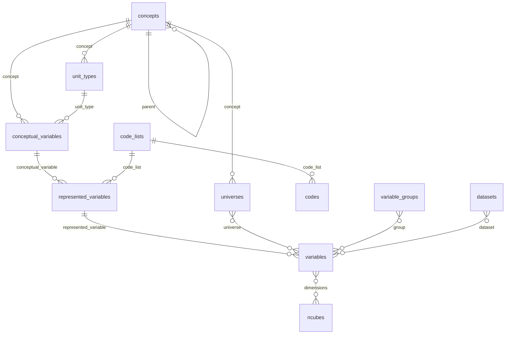
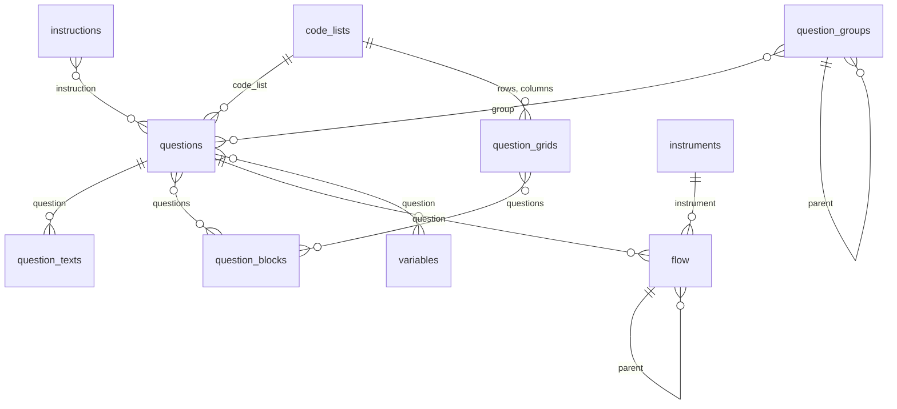
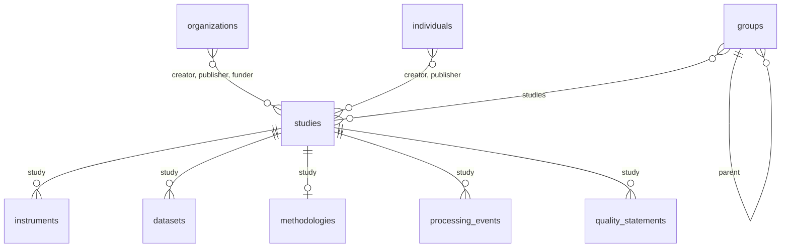

# Charger du DDI depuis des tableurs

Beaucoup d'équipes tiennent leurs métadonnées dans des tableurs : une ligne
par variable, une par question, une par code. `ddi-l` charge ces tableurs en
DDI en une seule étape, pourvu qu'ils suivent la disposition décrite ici : un
tableau par type d'élément, et des lignes qui se désignent les unes les autres
par leur `id`.

Les tableaux peuvent être un dossier de fichiers CSV, le même dossier
compressé en zip, ou un seul classeur Excel avec une feuille par tableau. Le résultat est une `FragmentInstance` Colectica
prête à importer dans un dépôt, ou une étude DDI.

Partez d'un modèle : la page des
[modèles de tableurs](spreadsheet-templates.md) offre des tableaux vides et un
exemple bilingue rempli, en fichiers CSV et en classeur Excel.

## Ce que couvrent les tableaux

Les tableaux couvrent ce que la plupart des organisations documentent sur une
étude, de sa citation à son questionnaire, ses variables et ses fichiers de
données.

| Domaine | Tableaux | Éléments DDI |
| --- | --- | --- |
| L'étude | `studies`, `groups`, `organizations`, `individuals` | StudyUnit, Group, Organization, Individual |
| Concepts | `concepts`, `universes`, `unit_types` | Concept, Universe, UnitType |
| Variables | `conceptual_variables`, `represented_variables`, `variables` | ConceptualVariable, RepresentedVariable, Variable |
| Codes | `code_lists`, `codes` | CodeList (simple ou hiérarchique), Category |
| Questions | `instructions`, `questions`, `question_texts`, `question_grids`, `question_blocks`, `question_groups` | Instruction, QuestionItem, QuestionGrid, QuestionBlock, QuestionGroup |
| Questionnaire | `instruments`, `flow` | Instrument, Sequence, QuestionConstruct, StatementItem, IfThenElse, Loop |
| Données | `variable_groups`, `datasets`, `ncubes` | VariableGroup, PhysicalInstance, DataRelationship, NCube |
| Méthodes et qualité | `methodologies`, `processing_events`, `quality_statements` | Methodology, ProcessingEvent, QualityStatement |
| Comparaison | `comparisons` | ConceptMap, UniverseMap, QuestionMap, VariableMap, CategoryMap |

`settings` contient l'agence, la version et la langue qu'utilisent tous les
tableaux.

Utilisez les tableaux dont vous avez besoin et omettez les autres : un dossier
avec seulement `settings`, `concepts` et `variables` convient.

Certaines choses ne sont pas dans les tableaux : les positions des colonnes
des fichiers à largeur fixe, les niveaux et familles de classifications, la
géographie, les plans d'échantillonnage, le code de dérivation et de calcul,
et les schémas de valeurs manquantes gérées. Chargez les tableaux, puis
ajoutez-les aux modèles typés en Python, ou dans Colectica.

## Comment les tableaux s'articulent

Une colonne qui désigne un autre tableau contient des `id` de ce tableau. Les
diagrammes montrent les liens, un domaine à la fois.

Concepts, codes et variables :



Questions et questionnaire :



L'étude, ses personnes et ce qui s'y rattache :



## Les règles communes à tous les tableaux

- **Un fichier ou une feuille par tableau**, nommé comme dans les tableaux
  ci-dessus : `concepts.csv`, ou une feuille nommée `concepts`. La première
  ligne contient les noms de colonnes ; chaque autre ligne est un élément.
- **`id` est votre clé.** Donnez à chaque ligne un `id` unique dans son
  tableau : le nom de la variable, un numéro de question, n'importe quoi sans
  espace. Les autres tableaux s'en servent pour désigner la ligne : la colonne
  `question` d'une variable contient l'`id` d'une question.
- **Plusieurs id dans une cellule** se séparent par `|` :
  `Q_AGE|Q_AGE_PROXY`.
- **Les cellules vides sont permises.** Seules les colonnes marquées requises
  ci-dessous doivent être remplies.
- **Les colonnes de notes sont ignorées.** Une colonne dont le nom commence
  par `#` ou `_` vous appartient, pour des commentaires ou des notes de
  travail.
- **Les colonnes inconnues sont des erreurs** : un `lable@en` mal orthographié
  est signalé plutôt qu'ignoré en silence.
- **Une seule étude n'exige pas de colonne `study`.** Quand `studies` a une
  seule ligne, les instruments, fichiers de données, méthodologies,
  traitements et énoncés de qualité dont `study` est vide lui appartiennent.

### Identifiants et versions

Chaque élément reçoit un identifiant DDI (un UUID). Laissez `ddi_id` vide et
il est dérivé de l'agence, du tableau et de l'`id` de la ligne : recharger les
mêmes tableaux donne les mêmes identifiants, et une nouvelle importation met
les éléments à jour au lieu de les dupliquer. Remplissez `ddi_id` avec un
identifiant existant pour mettre à jour un élément déjà présent dans
Colectica.

Chaque élément prend la `version` de `settings`, sauf si sa propre colonne
`version` en indique une autre.

### Noms et libellés

`name` est le nom court de l'élément, comme `AGE` ou `Q_AGE`, écrit dans la
langue fixée dans `settings`. Par défaut, c'est l'`id`. `label` et
`description` s'adressent aux personnes, dans autant de langues que vous en
avez.

## Plusieurs langues

Le texte destiné aux personnes va dans une colonne par langue : le nom de la
colonne, `@`, puis une étiquette de langue.

| Colonne | Sens |
| --- | --- |
| `label@en`, `label@fr` | le libellé en anglais et en français |
| `description@fr-CA` | la description en français canadien |
| `text@en`, `text@fr` | le libellé d'une question en anglais et en français |

Toute étiquette [BCP 47](https://www.rfc-editor.org/info/bcp47) convient :
`en`, `fr`, `fr-CA`, `iu`. Ajoutez une colonne par langue documentée ; une
cellule vide signifie que cette langue n'a pas de texte pour cette ligne.
Toutes les langues d'une ligne sont écrites dans un même élément DDI, comme
les écrit Colectica.

## Libellés de question selon le public

`text@fr` est le libellé que tout le monde voit. Quand une question est
formulée autrement pour certains répondants (posée à un mandataire, ou lue
par un intervieweur), ajoutez une ligne par libellé dans `question_texts` :

| `question` | `language` | `audience` | `text` |
| --- | --- | --- | --- |
| `Q_WORK` | `en` | `proxy` | Last week, did this person work at a job or business? |
| `Q_WORK` | `fr` | `proxy` | La semaine dernière, cette personne a-t-elle travaillé à un emploi ou à une entreprise? |
| `Q_AGE` | `fr` | `intvwr` | INTERVIEWEUR : Inscrivez l'âge en années révolues. |

Chaque libellé devient son propre `d:QuestionText`. DDI 3.3 indique à qui
s'adresse un libellé dans son attribut `audienceLanguage`, une étiquette de
langue ; le public est donc ajouté à la langue comme sous-étiquette à usage
privé :

| Libellé | `audienceLanguage` |
| --- | --- |
| `text@en` dans `questions` | `en` |
| libellé `proxy` en anglais | `en-x-proxy` |
| libellé `intvwr` en français | `fr-x-intvwr` |

Comme il entre dans une étiquette de langue, un public s'écrit en lettres et
en chiffres, 8 au plus entre les traits d'union : `proxy`, `intvwr`,
`self-resp`. Une question peut avoir un libellé par langue et par public.

## Propriétés personnalisées

Toute propriété sans colonne DDI va dans une colonne nommée `custom:` suivi du
nom de la propriété : `custom:Steward`, `custom:Sensitivity`, `custom:Mode`.
Chaque cellule remplie devient un `r:UserAttributePair` sur l'élément, avec la
clé `extension:` suivie du nom, comme Colectica Designer enregistre ses champs
personnalisés. Un nom qui a déjà un préfixe, comme `custom:x:Source`, le
garde tel quel.

Tout tableau dont les lignes sont des éléments accepte des colonnes
personnalisées. Quatre tableaux ne les acceptent pas : `settings`, `codes`
(une catégorie peut être partagée par plusieurs codes), `question_texts` et
`comparisons`.

## Le cheminement du questionnaire

Le contenu d'un instrument est dans `flow`, une ligne par étape, dans l'ordre
où les étapes se déroulent. `type` dit ce qu'est une étape :

| `type` | Ce que c'est | Exige |
| --- | --- | --- |
| `question` | pose une question, une grille ou un bloc | `question` |
| `statement` | affiche un texte | `text@<langue>` |
| `sequence` | contient, dans l'ordre, les étapes dont elle est le `parent` | |
| `if` | exécute ses étapes `then` si `condition` est vraie, sinon ses étapes `else` | `condition` |
| `loop` | répète ses étapes tant que `condition` est vraie | `condition` |

Une étape sans `parent` est au premier niveau de son instrument. Une étape
dans un `if` indique son côté avec `branch` (`then` par défaut, ou `else`).
Le cheminement de l'exemple :

| `id` | `type` | `parent` | `branch` | `question` | `condition` |
| --- | --- | --- | --- | --- | --- |
| `F_INTRO` | `statement` | | | | |
| `F_DEMO` | `sequence` | | | | |
| `F_AGE` | `question` | `F_DEMO` | | `Q_AGE` | |
| `F_SEX` | `question` | `F_DEMO` | | `Q_SEX` | |
| `F_IF_15` | `if` | | | | `AGE >= 15` |
| `F_WORK` | `question` | `F_IF_15` | `then` | `Q_WORK` | |
| `F_IF_WORKED` | `if` | `F_IF_15` | `then` | | `WORKED = 1` |
| `F_JOBS` | `loop` | `F_IF_WORKED` | | | `job <= JOB_COUNT` |
| `F_JOB` | `question` | `F_JOBS` | | `B_JOB` | |
| `F_TOO_YOUNG` | `statement` | `F_IF_15` | `else` | | |
| `F_END` | `statement` | | | | |

Les conditions sont du texte, enregistré avec le langage nommé dans
`condition_language` (`pseudo-code` par défaut) : écrivez-les dans la syntaxe
de votre système de collecte.

## Ce que les tableaux ajoutent

Certains éléments découlent des lignes sans avoir de tableau à eux. Leurs
identifiants sont dérivés comme ceux d'une ligne : ils sont donc aussi les
mêmes à chaque chargement.

| De | Vient |
| --- | --- |
| chaque code | une catégorie qui porte ses libellés, ou celle que partage sa clé `category` |
| chaque étude | une collecte de données qui regroupe ses instruments, sa méthodologie et ses traitements |
| les traitements de chaque étude | un schéma de traitements qui les énumère |
| chaque instrument | une séquence qui contient ses étapes de premier niveau |
| chaque `if` et `loop` | une séquence pour chacune de ses branches ou pour son corps |
| chaque jeu de données | une relation de données dont l'enregistrement logique énumère ses variables |
| chaque `map` de `comparisons` | une table de correspondance qui regroupe ses lignes |

Un type d'unité sans `concept` reçoit la référence de concept de substitution
qu'écrit Colectica, puisque le schéma DDI 3.3 en exige une par erreur.

## Chaque tableau, colonne par colonne

Les colonnes marquées **requises** doivent être présentes et remplies à chaque
ligne.

### settings

Deux colonnes, `setting` et `value`, une ligne par paramètre :

| `setting` | Sens | Par défaut |
| --- | --- | --- |
| `agency` | l'agence de maintenance de chaque élément, comme `ca.statcan` | requis |
| `version` | la version des éléments qui n'en ont pas | `1` |
| `language` | la langue des noms | `en` |

### Colonnes de la plupart des tableaux

Tout tableau dont les lignes sont des éléments, sauf `studies`, `groups`,
`organizations` et `individuals`, commence par celles-ci :

| Colonne | Requise | Contenu |
| --- | --- | --- |
| `id` | oui | votre clé pour la ligne |
| `ddi_id` | | un identifiant DDI existant à conserver |
| `version` | | la version de l'élément, si ce n'est pas celle de `settings` |
| `name` | | le nom court ; par défaut, l'`id` |
| `label@<langue>` | | un libellé court, par langue |
| `description@<langue>` | | une définition plus longue, par langue |
| `custom:<nom>` | | une propriété à vous |

`studies`, `groups`, `organizations` et `individuals` ont aussi `id`,
`ddi_id`, `version` et les colonnes personnalisées, ainsi que les colonnes
indiquées pour chacun.

### studies

Une ligne par étude : un cycle d'enquête, un recensement, une source
administrative.

| Colonne | Contenu |
| --- | --- |
| `title@<langue>` | le titre de l'étude ; par défaut, l'`id` |
| `subtitle@<langue>` | un sous-titre |
| `alternate_title@<langue>` | un autre titre, comme un sigle |
| `abstract@<langue>` | le sujet de l'étude |
| `purpose@<langue>` | pourquoi elle a été menée |
| `creator` | qui l'a produite : id de `organizations` ou `individuals`, ou noms |
| `publisher` | qui la diffuse : id ou noms, comme pour `creator` |
| `publication_date` | la date de publication : `2024`, `2024-05` ou `2024-05-31` |
| `kind_of_data` | `Données d'enquête`, `Dossiers administratifs`... |
| `analysis_unit` | `Personnes`, `Ménages`, `Entreprises`... |
| `universe` | qui l'étude couvre, en id de `universes` |
| `concept` | le concept qui définit l'étude, en id de `concepts` |
| `keywords@<langue>` | des sujets, séparés par des barres verticales |
| `start_date`, `end_date` | la période couverte : `2024-01-01` |
| `countries` | les codes des pays couverts, comme `CA` |
| `funder` | qui la finance, en id de `organizations` |
| `grant_number` | les numéros des subventions |

Un `creator` ou un `publisher` qui est un id de `organizations` ou
d'`individuals` devient une référence vers lui ; toute autre valeur est
écrite comme un nom.

### groups

Une ligne par groupe d'études, comme tous les cycles d'une enquête.

| Colonne | Contenu |
| --- | --- |
| `title@<langue>` | le titre du groupe ; par défaut, l'`id` |
| `abstract@<langue>` | ce que contient le groupe |
| `purpose@<langue>` | pourquoi les études sont regroupées |
| `type` | le genre de groupe : `Series`, `Program`... |
| `studies` | les études qu'il contient, en id de `studies` |
| `parent` | le groupe qui le contient, en id de `groups` |

### organizations

| Colonne | Requise | Contenu |
| --- | --- | --- |
| `name@<langue>` | oui | le nom de l'organisation, par langue |
| `abbreviation` | | un nom court : `StatCan` |
| `email` | | une adresse de courriel de contact |
| `url` | | son site Web |
| `description@<langue>` | | une description, par langue |

### individuals

| Colonne | Contenu |
| --- | --- |
| `first_name` | prénom |
| `last_name` | nom de famille |
| `email` | une adresse de courriel de contact |
| `url` | une page Web |
| `description@<langue>` | une description, par langue, comme le rôle |

Il faut au moins `first_name` ou `last_name`.

### concepts

| Colonne | Contenu |
| --- | --- |
| `parent` | le ou les concepts plus larges que celui-ci précise, en id de `concepts` |

### universes

| Colonne | Contenu |
| --- | --- |
| `concept` | le concept qui définit l'univers, en id de `concepts` |

### unit_types

Les genres d'unités décrites : personne, ménage, entreprise.

| Colonne | Contenu |
| --- | --- |
| `concept` | le concept de l'unité, en id de `concepts` |

### conceptual_variables

Un concept mesuré sur un type d'unité, encore sans représentation.

| Colonne | Contenu |
| --- | --- |
| `concept` | le concept, en id de `concepts` |
| `universe` | qui elle décrit, en id de `universes` |
| `unit_type` | le type d'unité, en id de `unit_types` |

### represented_variables

Une variable conceptuelle avec une représentation, partagée par les variables
qui l'enregistrent de la même façon.

| Colonne | Contenu |
| --- | --- |
| `conceptual_variable` | la variable conceptuelle, en id de `conceptual_variables` |
| `concept`, `unit_type` | sans `conceptual_variable` : le concept et le type d'unité |
| `representation` | **requise** : `code`, `numeric`, `text` ou `datetime` |
| `code_list`, `numeric_type`, `min`, `max`, `max_length`, `date_type` | comme pour `questions` |

### code_lists

Seulement les colonnes de la plupart des tableaux. Les codes vont dans
`codes`.

### codes

Une ligne par code, dans l'ordre où les codes sont présentés. Chaque code
reçoit une catégorie qui porte ses libellés.

| Colonne | Requise | Contenu |
| --- | --- | --- |
| `code_list` | oui | la liste de codes, en id de `code_lists` |
| `value` | oui | le code tel qu'il figure dans les données : `1`, `01`, `M` |
| `label@<langue>` | | le libellé de la catégorie, par langue |
| `description@<langue>` | | une définition plus longue, par langue |
| `category` | | une clé pour partager une catégorie entre listes de codes |
| `missing` | | `true` pour un code de valeur manquante, comme un refus |
| `parent` | | pour une hiérarchie : la `value` du code sous lequel il se place |

Les codes qui ont la même clé `category` partagent une catégorie, dont les
libellés viennent du premier d'entre eux : une catégorie « Non déclaré »
commune à toutes les listes de codes, par exemple.

Une classification est une liste de codes imbriqués : donnez à chaque code
sous le premier niveau la `value` de son parent, dans la même liste, et placez
le parent avant lui.

| `code_list` | `value` | `label@fr` | `parent` |
| --- | --- | --- | --- |
| `OCCUPATIONS` | `1` | Gestion | |
| `OCCUPATIONS` | `11` | Cadres supérieurs | `1` |
| `OCCUPATIONS` | `12` | Cadres intermédiaires | `1` |
| `OCCUPATIONS` | `2` | Vente et services | |

### instructions

Des instructions aux répondants ou aux intervieweurs, rattachées aux
questions par leur colonne `instruction`.

| Colonne | Contenu |
| --- | --- |
| `text@<langue>` | l'instruction, par langue |

### questions

| Colonne | Contenu |
| --- | --- |
| `text@<langue>` | le libellé, par langue |
| `concept` | le concept que mesure la question, en id de `concepts` |
| `response` | le type de réponse : `code`, `numeric`, `text` ou `datetime` |
| `code_list` | pour `code` : la liste de codes, en id de `code_lists` |
| `numeric_type` | pour `numeric` : `Integer`, `Decimal`, `Float`, `Double`, `Long` ou `Short` |
| `min` | pour `numeric` : la plus petite valeur valide |
| `max` | pour `numeric` : la plus grande valeur valide |
| `max_length` | pour `text` : la longueur maximale de la réponse, en caractères |
| `date_type` | pour `datetime` : `Date`, `DateTime`, `Time`, `Year`, `YearMonth` ou `Duration` |
| `instruction` | les instructions affichées avec elle, en id de `instructions` |
| `group` | les groupes de questions auxquels elle appartient, en id de `question_groups` |

### question_texts

| Colonne | Requise | Contenu |
| --- | --- | --- |
| `question` | oui | la question, en id de `questions` |
| `language` | oui | la langue du libellé |
| `audience` | | à qui s'adresse le libellé ; vide pour tout le monde |
| `text` | oui | le libellé |

### question_grids

Une question posée pour chaque ligne d'une grille : les lignes viennent d'une
liste de codes, les colonnes d'une autre s'il y en a, et chaque cellule a une
réponse.

| Colonne | Contenu |
| --- | --- |
| `text@<langue>` | la question, par langue |
| `rows` | **requise** : les lignes, en id de `code_lists` |
| `columns` | les colonnes, en id de `code_lists` |
| `response` et ses précisions | la réponse de chaque cellule, comme pour `questions` |
| `concept`, `instruction`, `group` | comme pour `questions` |

### question_blocks

Des questions présentées ensemble.

| Colonne | Contenu |
| --- | --- |
| `intent@<langue>` | à quoi sert le bloc |
| `questions` | ses questions dans l'ordre, en id de `questions` ou de `question_grids` |
| `concept`, `instruction`, `group` | comme pour `questions` |

### question_groups

Des groupes de questions, comme les modules d'un questionnaire. Les
questions, grilles et blocs s'y joignent par leur colonne `group`.

| Colonne | Contenu |
| --- | --- |
| `type` | le genre de groupe : `Module`, `Topic`... |
| `parent` | le groupe qui le contient, en id de `question_groups` |
| `concept` | le concept qu'il couvre, en id de `concepts` |

### instruments

Une ligne par questionnaire. Son contenu est dans `flow`.

| Colonne | Contenu |
| --- | --- |
| `study` | l'étude, en id de `studies` |
| `type` | le genre d'instrument : `CAWI`, `CATI`, `Papier`... |

### flow

Les étapes de chaque instrument, comme l'explique
[Le cheminement du questionnaire](#le-cheminement-du-questionnaire).

| Colonne | Requise | Contenu |
| --- | --- | --- |
| `instrument` | oui | l'instrument, en id de `instruments` |
| `type` | oui | `question`, `statement`, `sequence`, `if` ou `loop` |
| `parent` | | la `sequence`, le `if` ou la `loop` qui la contient, en id de `flow` |
| `branch` | | dans un `if` : `then` ou `else` ; `then` par défaut |
| `question` | | pour `question` : un id de `questions`, `question_grids` ou `question_blocks` |
| `text@<langue>` | | pour `statement` : le texte affiché |
| `condition` | | pour `if` et `loop` : la condition, comme `AGE >= 15` |
| `condition_language` | | le langage de la condition ; `pseudo-code` par défaut |

### variables

| Colonne | Contenu |
| --- | --- |
| `concept` | le concept que mesure la variable, en id de `concepts` |
| `universe` | qui la variable décrit, en id de `universes` |
| `question` | la ou les questions d'où viennent ses valeurs, en id de `questions` |
| `representation` | comment les valeurs sont enregistrées : `code`, `numeric`, `text` ou `datetime` |
| `code_list`, `numeric_type`, `min`, `max`, `max_length`, `date_type` | comme pour `questions` |
| `unit_type` | le type d'unité, en id de `unit_types` |
| `conceptual_variable` | sa variable conceptuelle, en id de `conceptual_variables` |
| `represented_variable` | sa variable représentée, en id de `represented_variables` |
| `dataset` | le ou les fichiers de données dont elle est une colonne, en id de `datasets` |
| `group` | ses groupes de variables, en id de `variable_groups` |

Une variable dont `representation` est vide prend celle de sa variable
représentée, sinon la réponse de sa première question : une variable
alimentée par une question codée n'a pas à répéter la liste de codes. Un
fichier de données énumère ses variables dans l'ordre du tableau `variables`.

### variable_groups

Des groupes de variables, comme des thèmes. Les variables s'y joignent par
leur colonne `group`.

| Colonne | Contenu |
| --- | --- |
| `type` | le genre de groupe : `Topic`, `Derived`... |
| `parent` | le groupe qui le contient, en id de `variable_groups` |
| `concept` | le concept qu'il couvre, en id de `concepts` |
| `universe` | qui ses variables décrivent, en id de `universes` |

### datasets

Une ligne par fichier de données. Les variables s'y joignent par leur colonne
`dataset`.

| Colonne | Contenu |
| --- | --- |
| `title@<langue>` | le titre du fichier ; par défaut, `name` |
| `file` | où se trouve le fichier : un chemin ou une URL |
| `study` | l'étude, en id de `studies` |

En DDI, une instance physique n'a pas de libellé : `label` et `description`
décrivent donc l'enregistrement de variables du fichier (son enregistrement
logique).

### ncubes

Des tableaux multidimensionnels d'agrégats.

| Colonne | Contenu |
| --- | --- |
| `dimensions` | **requise** : ses dimensions dans l'ordre, en id de `variables` |
| `purpose@<langue>` | à quoi sert le n-cube |
| `universe` | qui il décrit, en id de `universes` |

### methodologies

Comment les données d'une étude ont été recueillies. Une étude a au plus une
méthodologie.

| Colonne | Contenu |
| --- | --- |
| `study` | l'étude, en id de `studies` |
| `data_collection@<langue>` | comment les données ont été recueillies |
| `time_method@<langue>` | transversale, panel, série chronologique... |
| `sampling@<langue>` | comment l'échantillon a été tiré |
| `deviation@<langue>` | en quoi l'échantillon s'écarte de son plan |
| `weighting@<langue>` | comment les poids ont été établis |

### processing_events

Ce qui a été fait aux données d'une étude après la collecte.

| Colonne | Contenu |
| --- | --- |
| `study` | l'étude, en id de `studies` |
| `control@<langue>` | les vérifications faites sur les données |
| `cleaning@<langue>` | comment les données ont été nettoyées ou corrigées |
| `weighting@<langue>` | comment les données ont été pondérées |
| `appraisal@<langue>` | taux de réponse, erreur d'échantillonnage... |

### quality_statements

| Colonne | Contenu |
| --- | --- |
| `study` | l'étude, en id de `studies` |
| `text@<langue>` | l'énoncé |

### comparisons

Comment des éléments se comparent, d'une étude ou d'un cycle à l'autre : une
ligne par paire. Les lignes qui ont la même `map` forment une table de
correspondance.

| Colonne | Requise | Contenu |
| --- | --- | --- |
| `map` | oui | votre clé pour la table de correspondance de la ligne |
| `type` | oui | ce qui est comparé : `concept`, `universe`, `question`, `variable` ou `category` |
| `source` | oui | l'élément de départ, en id de ce tableau |
| `target` | oui | l'élément d'arrivée, en id de ce tableau |
| `commonality@<langue>` | | ce qu'ils ont en commun |
| `difference@<langue>` | | en quoi ils diffèrent |
| `weight` | | à quel point ils se ressemblent, de `0` à `1` |

Pour `category`, écrivez `code_list/value` (`SEX_CODES/1`), ou une clé
`category` de `codes`.

## Charger les tableaux

En Python, `load_tables()` lit un dossier de fichiers CSV ou un classeur et
renvoie des modèles typés que vous pouvez vérifier ou modifier avant
l'écriture :

```python
from ddi_l.tables import load_tables, write_table_templates

# L'exemple bilingue de la page des modèles, écrit dans un dossier.
write_table_templates("mon-enquete", example=True)

tables = load_tables("mon-enquete")
print(len(tables.variables))  # -> 5
print(tables.get("variables", "AGE").labels[1].text)  # -> Âge en années
print(len(tables.tables["flow"]))  # -> 16

# Une FragmentInstance Colectica, un élément par fragment.
tables.to_fragment().save("mon-enquete.xml")
```

`tables.tables` contient les éléments de chaque tableau, et ceux qu'il
implique, dans l'ordre des lignes : les 16 éléments de `flow` sont ses 11
étapes et les 5 séquences qu'elles impliquent. `tables.items` les contient
tous.

Les mêmes tableaux dans un seul classeur Excel se chargent de la même façon :

```python
from pathlib import Path

write_table_templates("mon-enquete.xlsx", example=True, layout="xlsx")
tables = load_tables("mon-enquete.xlsx")

# Un zip des fichiers CSV, à sa racine ou dans un dossier, se charge aussi.
write_table_templates("mon-enquete.zip", example=True, layout="zip")
tables = load_tables("mon-enquete.zip")

# Tout comme les octets d'un classeur ou d'un zip reçus d'un envoi : ils sont
# lus en mémoire, et les problèmes les nomment workbook.xlsx ou tables.zip.
tables = load_tables(Path("mon-enquete.xlsx").read_bytes())
```

`load_tables()` accepte `agency=`, `version=` et `language=` pour remplacer
`settings`.

### Un fragment ou un document d'étude

`to_fragment()` écrit tous les éléments, quels que soient les tableaux. Son
élément de premier niveau est le seul groupe, sinon la seule étude ; passez
`top_level=` pour en choisir un autre.

`to_study()` place les éléments dans une nouvelle étude d'un document
`DDIInstance`. Un document d'étude a une seule étude et aucune place pour les
groupes, les personnes, les groupes de variables, les traitements, les
énoncés de qualité ou les comparaisons : il n'accepte donc que les autres
tableaux, et indique sinon quels tableaux retirer :

```python
from pathlib import Path

dossier = Path("questionnaire")
dossier.mkdir(exist_ok=True)
(dossier / "settings.csv").write_text(
    "setting,value\nagency,example.org\n", encoding="utf-8"
)
(dossier / "concepts.csv").write_text("id,label@fr\nAGE,Âge\n", encoding="utf-8")
(dossier / "variables.csv").write_text(
    "id,concept,representation,numeric_type\nAGE,AGE,numeric,Integer\n",
    encoding="utf-8",
)

study = load_tables(dossier).to_study("Enquête sur la population active")
print(study.validate())  # -> []
study.save("enquete-population-active.xml")
```

En ligne de commande :

```bash
ddi tables template mon-enquete --example        # l'exemple, en fichiers CSV
ddi tables import mon-enquete -o mon-enquete.xml # une FragmentInstance Colectica
ddi tables import questionnaire --study "Enquête sur la population active" -o etude.xml
```

Par HTTP, [`ddi serve`](server.md#charger-des-tableaux-de-metadonnees) offre la
même chose : `POST /v1/tables/import` reçoit un classeur ou un zip et répond
par le fragment, ou par tous les problèmes dans un `422` ; `GET
/v1/tables/template` donne les modèles, et `GET /v1/tables` décrit chaque
tableau et chaque colonne en JSON.

## Quand quelque chose cloche

Le chargement vérifie tous les tableaux avant d'écrire quoi que ce soit et
signale tous les problèmes d'un coup, chacun avec son fichier (ou sa feuille),
sa ligne et sa colonne :

```text
Error: mon-enquete has 3 problems:
  - variables.csv, row 4, column question: no row in questions has id 'Q_AGEE'
  - codes.csv, row 7, column missing: 'maybe' is not true or false
  - flow.csv, row 6, column parent: 'F_AGE' is a question step; only a
    sequence, if or loop holds other steps
```

Les numéros de ligne sont ceux du tableur, en-tête compris : la ligne 4 est la
quatrième ligne que vous voyez dans Excel.

## Conseils pour Excel

- **Gardez les codes et les dates en texte.** Excel transforme `01` en nombre
  1 et `2024-05` en date. Les classeurs modèles mettent chaque cellule au
  format texte ; dans votre propre classeur, mettez les colonnes au format
  Texte avant la saisie.
- **Enregistrez en « CSV UTF-8 »** pour que les accents survivent. Les
  fichiers enregistrés avec des points-virgules par un Excel en français sont
  lus aussi.
- **Un classeur ou un dossier.** Dans un classeur, une feuille nommée
  `README`, ou dont le nom commence par `_`, est ignorée ; toute autre feuille
  doit être l'un des tableaux.

## Vers Colectica

La `FragmentInstance` produite par `to_fragment()` est écrite comme Colectica
Designer écrit un export, un élément par `<Fragment>`, et s'importe dans un
dépôt Colectica. Voir
[Travailler avec les exports Colectica](colectica.md) pour lire et modifier ces
fichiers. Comme les identifiants sont dérivés de vos id, recharger les mêmes
tableaux après modification donne les mêmes éléments avec les mêmes
identifiants : augmentez `version` dans `settings` (ou par ligne) et importez
de nouveau.
