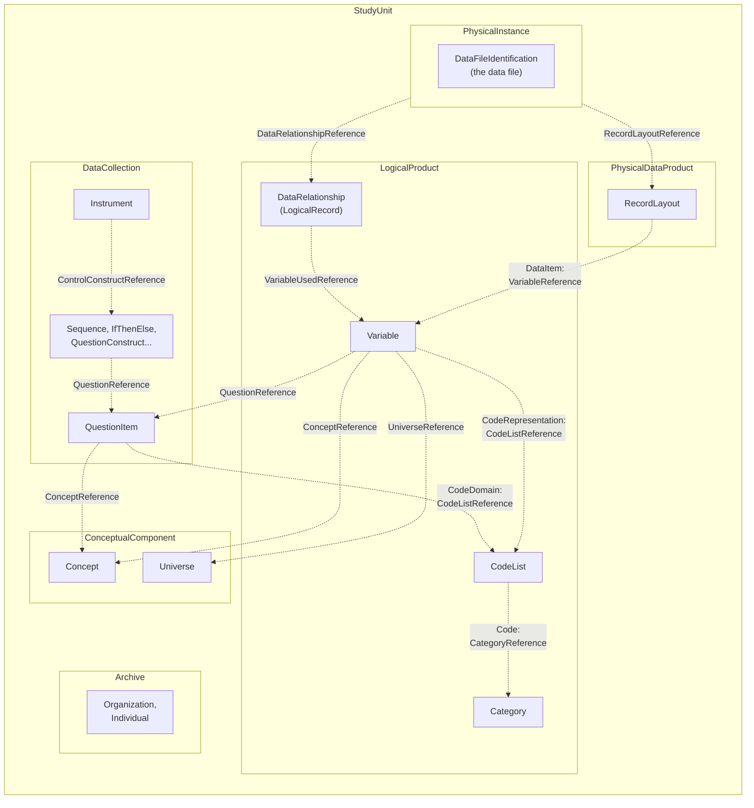

# User guide

This guide walks you through the main features of the `ddi-l` CRUD API.
Each section is self-contained, so you can jump to the workflow you need.

!!! info "Prerequisites"
    - Python 3.11 or newer with `ddi-l` installed (`pip install ddi-l`).
    - No XML knowledge is required for the simple API.

## How a study fits together

A DDI study (a `StudyUnit`) keeps its metadata in modules, the boxes below:
concepts and universes in a `ConceptualComponent`, the questionnaire and its
questions in a `DataCollection`, variables, code lists and categories in a
`LogicalProduct`, record layouts in a `PhysicalDataProduct`, each data file in
a `PhysicalInstance`, and organizations and people in an `Archive`. Items refer
to each other across modules (dashed arrows): a variable to the question that
collected it, the concept it measures, its universe and its code list; a data
file to the record layout and the logical record that list its variables.



## Create a study

Use `ddi.new_study()` to create a new DDI document with a study unit:

```python
import ddi_l as ddi

doc = ddi.new_study(title="Household Survey", agency="example.org")
print(doc.agency)  # -> example.org
```

The function returns a `Document` object. It automatically creates the
DDI instance, study unit, and all required identification metadata.

## Add questions

Use `doc.add_question()` to add questions to the study:

```python
q1 = doc.add_question(text="What is your gender?")
q2 = doc.add_question(text="How old are you?")
q3 = doc.add_question(text="What is your household income?")

print(f"Questions: {len(doc.questions)}")  # -> 3
```

Each question is a `QuestionItem` in a `QuestionScheme` inside the
`DataCollection` module.

## Add variables

Use `doc.add_variable()` to add variables, optionally linking them to
questions or concepts:

```python
age_concept = doc.add_concept(name="Age")

doc.add_variable(name="Gender", question=q1)
doc.add_variable(name="Age", question=q2, concept=age_concept)
doc.add_variable(name="Household Income", question=q3)

print(f"Variables: {len(doc.variables)}")  # -> 3
```

When you pass a `question=` or `concept=` argument, `ddi-l`
automatically creates the DDI reference linking the variable to that item.

## Add concepts and universes

```python
demo_concept = doc.add_concept(name="Demographics")
doc.add_universe(name="Canadian adults aged 18+")

print(f"Concepts: {len(doc.concepts)}")  # -> 2
print(f"Universes: {len(doc.universes)}")  # -> 1
```

## Add code lists

```python
cl = doc.add_code_list(name="Gender Codes")
print(f"Code lists: {len(doc.code_lists)}")  # -> 1
```

## Work with any item type

The `add_item()` method supports all 30 DDI item types registered in the
type registry. Use it for types that do not have a dedicated convenience
method:

```python
from ddi_l.models.logicalproduct import Category, RepresentedVariable
from ddi_l.models.datacollection import Instrument

doc.add_item(Category, name="Male")
doc.add_item(Category, name="Female")
doc.add_item(RepresentedVariable, name="Gender Representation")
doc.add_item(Instrument, name="CAWI Questionnaire")

# Query items by type
print(f"Categories: {len(doc.items(Category))}")  # -> 2
```

## Find and remove items

Every item gets a unique identifier when created. Use `find()` to look up
an item by its identifier, and `remove()` to delete it:

```python
cat = doc.add_item(Category, name="Not specified")
print(cat.identifier)

found = doc.find(cat.identifier)
print(found)  # Prints the Category object

doc.remove(cat.identifier)
print(doc.find(cat.identifier))  # -> None
```

## Save to XML

```python
doc.save("household-survey.xml")
```

The output uses proper DDI namespace prefixes (`r:`, `s:`, `d:`, `l:`,
`c:`, `a:`, `p:`), not generic `ns0`/`ns1`.

## Open an existing file

```python
doc = ddi.open_ddi("household-survey.xml")

print(f"Questions: {len(doc.questions)}")
print(f"Variables: {len(doc.variables)}")

for v in doc.variables:
    print(f"  {v.identifier}")
```

Save it again and the parts you did not change are written as they were
read, byte for byte; only what you added or changed is laid out, with the
file's own indentation. To lay the whole file out afresh, use
`ddi.write_ddi(doc, "out.xml", layout="default")`.

Pass `validate=True` to run schema validation on load:

```python
doc = ddi.open_ddi("household-survey.xml", validate=True)
```

## Validate

Call `doc.validate()` to check the document against the DDI schema:

```python
issues = doc.validate()
if issues:
    for issue in issues:
        print(f"[{issue.severity}] {issue.message}")
else:
    print("Document is valid!")
```

For more validation options, see the [validation guide](validation.en.md).

## Advanced: working with the model layer

The generated model classes under `ddi_l.models` are the advanced layer.
You can import and use them directly for fine-grained control:

```python
from ddi_l.models.base import InternationalString, Reference
from ddi_l.models.logicalproduct import Variable

var = Variable(
    agency="example.org",
    identifier="var-age",
    version="1.0",
    names=[InternationalString(text="Age", lang="en")],
)
```

See the [models reference](models.en.md) for a complete list of available types.
