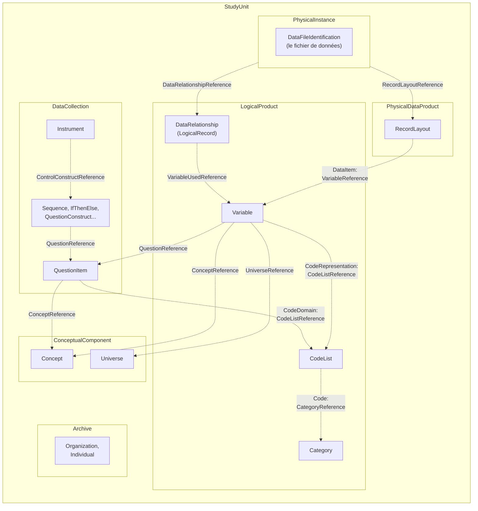

# Guide d'utilisation

Ce guide présente les principales fonctionnalités de l'API CRUD de `ddi-l`.
Chaque section est autonome, vous pouvez donc aller directement au workflow
dont vous avez besoin.

!!! info "Prérequis"
    - Python 3.11 ou plus récent avec `ddi-l` installé (`pip install ddi-l`).
    - Aucune connaissance XML n'est requise pour l'API simple.

## Comment s'articule une étude {#comment-sarticule-une-etude}

Une étude DDI (un `StudyUnit`) range ses métadonnées en modules, les cadres
ci-dessous : concepts et univers dans un `ConceptualComponent`, le
questionnaire et ses questions dans un `DataCollection`, variables, listes de
codes et catégories dans un `LogicalProduct`, dispositions d'enregistrement dans
un `PhysicalDataProduct`, chaque fichier de données dans un `PhysicalInstance`,
et organisations et personnes dans un `Archive`. Les éléments se renvoient les
uns aux autres d'un module à l'autre (flèches pointillées) : une variable à la
question qui l'a collectée, au concept qu'elle mesure, à son univers et à sa
liste de codes ; un fichier de données à la disposition d'enregistrement et à
l'enregistrement logique qui listent ses variables.



## Créer une étude

Utilisez `ddi.new_study()` pour créer un nouveau document DDI avec une unité
d'étude :

```python
import ddi_l as ddi

doc = ddi.new_study(title="Enquete menages", agency="example.org")
print(doc.agency)  # -> example.org
```

La fonction retourne un objet `Document`. Elle crée automatiquement l'instance
DDI, l'unité d'étude et toutes les métadonnées d'identification requises.

## Ajouter des questions

Utilisez `doc.add_question()` pour ajouter des questions à l'étude :

```python
q1 = doc.add_question(text="Quel est votre genre ?")
q2 = doc.add_question(text="Quel age avez-vous ?")
q3 = doc.add_question(text="Quel est le revenu de votre menage ?")

print(f"Questions : {len(doc.questions)}")  # -> 3
```

## Ajouter des variables

Utilisez `doc.add_variable()` pour ajouter des variables, en les liant
optionnellement à des questions ou des concepts :

```python
age_concept = doc.add_concept(name="Age")

doc.add_variable(name="Genre", question=q1)
doc.add_variable(name="Age", question=q2, concept=age_concept)
doc.add_variable(name="Revenu du menage", question=q3)

print(f"Variables : {len(doc.variables)}")  # -> 3
```

Lorsque vous passez un argument `question=` ou `concept=`, `ddi-l` crée
automatiquement la référence DDI liant la variable à cet élément.

## Ajouter des concepts et des univers

```python
doc.add_concept(name="Demographie")
doc.add_universe(name="Adultes canadiens de 18 ans et plus")

print(f"Concepts : {len(doc.concepts)}")  # -> 2
print(f"Univers : {len(doc.universes)}")  # -> 1
```

## Ajouter des listes de codes

```python
cl = doc.add_code_list(name="Codes de genre")
print(f"Listes de codes : {len(doc.code_lists)}")  # -> 1
```

## Travailler avec n'importe quel type d'élément

La méthode `add_item()` prend en charge les 30 types d'éléments DDI
enregistrés dans le registre de types :

```python
from ddi_l.models.logicalproduct import Category, RepresentedVariable
from ddi_l.models.datacollection import Instrument

doc.add_item(Category, name="Homme")
doc.add_item(Category, name="Femme")
doc.add_item(RepresentedVariable, name="Representation du genre")
doc.add_item(Instrument, name="Questionnaire CAWI")

print(f"Categories : {len(doc.items(Category))}")  # -> 2
```

## Chercher et supprimer des éléments

Chaque élément reçoit un identifiant unique à sa création. Utilisez `find()`
pour rechercher un élément par son identifiant, et `remove()` pour le
supprimer :

```python
cat = doc.add_item(Category, name="Non precise")

found = doc.find(cat.identifier)
print(found)  # -> l'objet Category

doc.remove(cat.identifier)
print(doc.find(cat.identifier))  # -> None
```

## Sauvegarder en XML

```python
doc.save("enquete-menages.xml")
```

La sortie utilise les préfixes de noms d'espace DDI corrects (`r:`, `s:`,
`d:`, `l:`, `c:`, `a:`, `p:`).

## Ouvrir un fichier existant

```python
doc = ddi.open_ddi("enquete-menages.xml")

print(f"Questions : {len(doc.questions)}")
print(f"Variables : {len(doc.variables)}")
```

Enregistré de nouveau, le fichier garde les parties que vous n'avez pas
modifiées telles qu'elles ont été lues, octet pour octet ; seul ce que vous
avez ajouté ou modifié est mis en forme, avec l'indentation du fichier. Pour
remettre en forme tout le fichier, utilisez
`ddi.write_ddi(doc, "sortie.xml", layout="default")`.

Passez `validate=True` pour exécuter la validation de schéma au chargement :

```python
doc = ddi.open_ddi("enquete-menages.xml", validate=True)
```

## Valider

Appelez `doc.validate()` pour vérifier le document par rapport au schéma DDI :

```python
issues = doc.validate()
if issues:
    for issue in issues:
        print(f"[{issue.severity}] {issue.message}")
else:
    print("Le document est valide !")
```

Pour plus d'options de validation, consultez le
[guide de validation](validation.fr.md).

## Avancé : travailler avec la couche modèles

Les classes de modèles générées sous `ddi_l.models` constituent la couche
avancée. Vous pouvez les importer et les utiliser directement pour un contrôle
fin :

```python
from ddi_l.models.base import InternationalString, Reference
from ddi_l.models.logicalproduct import Variable

var = Variable(
    agency="example.org",
    identifier="var-age",
    version="1.0",
    names=[InternationalString(text="Age", lang="en")],
)
```

Consultez la [référence des modèles](models.fr.md) pour une liste complète des
types disponibles.
